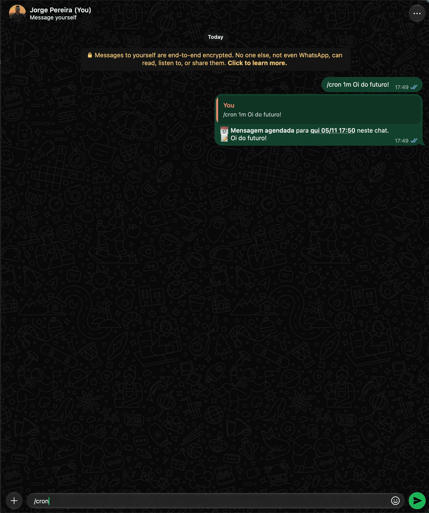

# `/cron` (`/agenda`, `/lembrete`) · admin

Does something at the scheduled time. It has two modes, in the same schedule:

- **Message** (`/cron`, `/agenda`): sends the text as if you typed it, in the current chat or, with
  `-to`, to a contact, a group or a number. Good for birthdays, notices and recurring messages.
- **Reminder** (`/lembrete`, or any of them with `-lembrete`/ `-lem`): sends `⏰ Reminder` and the
  text, replying to the command message, in the current chat (or in your private chat, with `-pv`).
  When you reply to a message, the reminder quotes that message, and its text becomes the reminder
  if you don't write another one.

| Option | Value | Description |
|---|---|---|
| `<when>` | | When: `6h`, `at 18h`, `+2h`, `30m`, `tomorrow 9h`, `friday 18h`, `25/12 10:00`... See [When](#when) |
| `-to` | `<destination>` | Message mode: sends to a contact (`/Jorge Pereira/`), a mention (`@Fulano Da Silva`), a group (`/Grupo L200/`) or a number (`+5521999999999`) instead of the current chat. Repeat it for several: a single item, which goes out to all destinations. Exact names take priority; several results: you pick from the list. Email doesn't work: the message goes out on WhatsApp. See [Destinations](index.md#destinations-contact-group-number-or-email) |
| `-lembrete`, `-lem` | | Reminder mode (the same as calling it as `/lembrete`) |
| `-pv` | | Reminder mode: reminds you in your private chat instead of the current chat |
| `-repetir`, `-r` | `<diario\|semanal\|mensal>` | Repeats at the same time: every day, every week or every month |
| `-list`, `-l` | | Lists the reminders and messages, with the full text (the same as the command with nothing) |
| `-edit` | `<n>` | Edits item #N: changes the time, the text and/or the `-repetir`. See [Edit, pause and resume](#edit-pause-and-resume) |
| `-pause` | `<n...\|all>` | Pauses item #N, several (`-pause 1 3` or `1,3`) or all: they stay in the list but don't go out. If any number doesn't exist, none is paused |
| `-resume` | `<n...\|all>` | Resumes paused items: one, several or all |
| `-rm` | `<n...\|all>` | Removes item #N from the list, several at once (`-rm 1 3 5` or `-rm 1,3,5`) or all. If any number doesn't exist, none is removed |
| `-test` | `<n>` | Builds item #N now, running the `{/comando}` in the text, and shows here how it would go out. See [Commands in the text](#commands-in-the-text) |



```text
/cron 25/12 00:00 Feliz Natal, família! 🎄
/cron sexta 18h -to /Grupo L200/ Bom fim de semana!
/cron seg 8h -repetir semanal -to trabalho Bom dia! Pauta da semana no drive.
/agenda 05/11 9h -repetir mensal -to +5521999999999 Lembrete: aluguel vence hoje.
/cron amanhã 8h -to /Jorge Pereira/ Bom dia! Não esquece a reunião.
/cron 18h -to @Fulano Da Silva Já saiu do trabalho?   (in a group, mentioning)
/cron 20/10 -to /Família/ Parabéns, vó! 🎂
/cron 8h -r diario -to /Família/ -to /Trabalho/ Bom dia!   (one item, in both groups)
/lembrete 30m tirar o bolo do forno
/lembrete às 18h pagar o boleto
/lembrete -pv amanhã 9h ligar pro banco
/cron -lem sexta 18h -r semanal enviar o relatório
/lembrete +2h                   (replying to a message: reminds you of it in 2 hours)
/cron 6h -r diario -to /Grupo L200/ Bom dia!   (every day at 06:00)
/cron 9h -r diario -to /ZapBot/ O preço do Bitcoin agora: {/crypto BTC}
/cron                           → the list
/cron -edit 2 18:30             → #2 moves to 18:30
/cron -pause 3                  → holds #3 (and /cron -resume 3 releases it)
/cron -rm 2                     → removes #2
/cron -rm 1 3 5                 → removes 1, 3 and 5 (the numbers from the previous list)
```

```text
📅 Message scheduled for Fri 02/10 18:00 in 👥 Grupo sobre L200.
📝 Bom fim de semana!

⏰ Reminder created for Fri 02/10 18:00 🔁 every week in this chat.
📝 enviar o relatório
```

At the scheduled time, the message goes out as you wrote it; the reminder goes out like this:

```text
⏰ Reminder

enviar o relatório
```

The list shows both types together, in the order they'll go out (📅 message, ⏰ reminder), with the
full text, as it was registered (the `{/comando}` too), and the numbers are the ones used by `-edit`,
`-pause`/`-resume` and `-rm`. An item with several `-to` shows one destination per line:

```text
/cron -l
📅 Schedule (3)

1. ⏰ Thu 01/10 18:00 — pagar o boleto
   → 👥 Família
2. 📅 Fri 02/10 18:00 — Bom fim de semana!
   → 👥 Grupo sobre L200
   → 👥 Família
   → 👤 Lourival Neto
3. 📅 Thu 05/11 09:00 🔁 every month ⏸️ paused — Lembrete: aluguel vence hoje.
   → 👤 Fulano
```

## Edit, pause and resume

`-edit <nº>` changes whatever comes after it, read the same way as a new item: a "when" changes the
time, `-repetir` (`-r`) changes the repetition (`-r nao` removes it) and the rest becomes the new
text. The destination and the mode (message or reminder) don't change: to do that, remove (`-rm`)
and create it again.

```text
/cron -edit 2 18:30                       → just the time
/cron -edit 2 Bom dia, pessoal!           → just the text
/cron -edit 2 sexta 9h -r semanal Pauta   → time, repetition and text
/cron -edit 2 -r nao                      → stops repeating
```

`-pause <nº...|all>` holds the item (or several: `-pause 1 3`): it stays in the list (with ⏸️) but
doesn't go out. `-resume <nº...|all>` releases it. A repeating item that came due while it was
paused skips to the next time; a one-time item that has already passed goes out right away (the
reply tells you).

## Commands in the text

A `{/comando args}` in the text runs **at send time**, and its reply takes its place. It works in
both modes, anywhere in the text and more than once:

```text
/cron 09:24 -to /ZapBot/ O preço do Bitcoin agora: {/crypto BTC}
/cron 8h -r diario -to /Família/ Bom dia! {/weather Rio de Janeiro}
/cron seg 9h -r semanal Dólar: {/rates USD} · BTC: {/crypto BTC}
/lembrete sexta 18h -r semanal {/stats -7}
/cron 12h -to /Grupo L200/ {/meme}       (media only: the image goes out, no text)
```

Several commands and several destinations in the same item (a single item; at send time, it goes
out to each destination, with the commands running for each chat):

```text
/cron 06:00 -r diario -to /Krishina Da Silva/ -to /Grupo da Faculdade/ ⏰ Status da DeFi! {/defi} Preço do BTC! {/crypto BTC} Preço do Dólar! {/rates USD}
/cron 07:30 -r diario -to /Família/ Bom dia! ☀️ {/weather Recife} Cripto: {/crypto BTC ETH} Câmbio: {/rates USD EUR}
/cron seg 08:00 -r semanal -to /Trabalho/ -to @Fulano Da Silva Resumo da semana: {/news -hack 5} CVEs: {/cve -high 3}
/lembrete -pv 23:00 -r diario Fechamento do dia: {/crypto} {/defi}
```

Each multi-line reply becomes a paragraph, and the surrounding text stays between them. The first
example arrives like this, every day at 06:00, in both chats:

```text
⏰ Status da DeFi!

🌊 Orca · SOL/cbBTC · taxa 0.16%
📍 7xKp…3mQa · ✅ dentro da faixa

💰 Saldo: $2,476.30
   ...

Preço do BTC!

🚀 CRYPTO MARKET
₿ BTC
    💰 $86,906.96  🟢 +3.81%
    ...

Preço do Dólar!

💱 EXCHANGE RATES (in reais)
🇺🇸 USD/BRL (Dollar)
   💰 R$ 5.2000  🟢 +0.50%
   ...
```

- The command runs as if you typed it in the destination chat, with the result from that moment: in
  a repeating item, each send brings a fresh value.
- The text reply takes the place of the `{...}`. A multi-line one (`/crypto`, `/weather`...) becomes a
  paragraph, with a blank line before and after, so it doesn't stick to the surrounding text; a
  single-line one stays in the sentence. A command that replies more than once (`/defi`, one per
  position) has its replies separated by a blank line. Media (`/meme`, `/giphy`, `/pixelart`) goes
  out right after the message.
- Only lookup commands run there: `/ascii`, `/rates`, `/crypto`, `/cve`, `/defi`, `/giphy`,
  `/joke`, `/kernel`, `/meme`, `/news`, `/pixelart`, `/stats`, `/weather`, `/uptime` and `/version`
  (in the definitions, the ones with `cron: true`). Options that change something don't run
  either: `-width` and `-char` of `/ascii`; `-add`, `-del` and `-alerta` of `/crypto` and `/rates`;
  `-address`, `-wallet`, `-pool`, `-nft`, `-name`, `-rm`, `-alerta`, `-taxas` and `-to` of `/defi`
  (the protocols, `-l`, `-mask` and `aave -full` run); and `-flush` and `-flush-all` of `/stats`.
- `/bot` is the exception: only the owner creates an item with `{/bot -flush-email true}` (in it,
  only `-info` and `-flush-email` run; the other options are refused). An admin who isn't the owner
  gets an error on creation.
- The command is checked on creation (and on `-edit`): one that doesn't exist or doesn't run in
  `/cron` gives an error right away, not at send time.
- If the command fails at send time, the message goes out anyway, with `⚠️ /crypto falhou` in its
  place (that text is the same in both languages).
- Outside the braces, nothing runs: a text that starts with `/` is still just text.

A [command alias](alias.md) also works inside the `{...}` (`{/dolar}`, `{/rec 10 20 url}`), with the
`$1`, `$2` and the default values `${1:-USD}` applied as in `/alias`. **Text** aliases don't: they
are refused, so an alias doesn't call itself.

To break the line without leaving the text field, type `\n`: it becomes a line break, and the spaces
around it are removed. It works in any `/cron` text, with or without commands, on creation and in
`-edit`:

```text
/cron 8h -r diario Verificando Orca {/defi orca}\n Verificando Prjx {/defi prjx}
/cron 07:30 -r diario -to /Família/ Bom dia! ☀️\n{/weather Recife}\nCâmbio: {/rates USD}
/lembrete sexta 18h Fechar a semana:\n- relatório\n- backup\n- planilha
/cron -edit 2 Linha 1\nLinha 2
```

To run the same text whenever you want, without scheduling it, save it as a
[text alias](alias.md#text-with-commands): `/alias carteira {/defi orca}\n{/defi prjx}`.

`-test <nº>` builds the item now and shows here how it would go out, without sending it to the
destination or changing the time:

```text
/cron -test 1
🧪 Test of no. 1 (goes out at Fri 02/10 09:24 → 👥 ZapBot)

O preço do Bitcoin agora: (a resposta do /crypto BTC naquele momento)
```

## When

The "when" comes at the beginning, together with the options (in any order); the text is the rest,
as typed (with several lines, if needed). Everything in Brasília time.

| Form | Example | Meaning |
|---|---|---|
| Time | `6h`, `07h`, `18:30`, `18h30`, `at 18h` (or `às 18h`) | Today at that time; if it has passed, tomorrow |
| Duration | `+2h`, `in 2h`, `30m`, `1d`, `1h30m` (also `em 2h`, `daqui a 2h`) | That long from now. Hours alone are a time of day (`6h` is 06:00): for "6 hours from now", use `+6h` or `in 6h` |
| Today / tomorrow | `today 22h`, `tomorrow`, `tomorrow 10:00` (or `hoje`, `amanhã`) | No time: 9h |
| Day of the week | `friday`, `mon 8h`, `saturday 10:00` (or `sexta`, `seg`, `sábado`) | The next one (today, if the time hasn't passed yet). No time: 9h |
| Date | `25/12`, `25/12 10:00`, `25/12/2027 10h` | No year: the next time the date comes around (a 2-digit year also works: `25/12/27`). No time: 9h |

Up to 366 days ahead. `-repetir mensal` (or `-r mensal`) keeps the day of the month: an item on the
31st goes out on the last day of shorter months and goes back to the 31st afterward.

## Details

- Everything is stored in the `schedules` table, survives restarts and is checked every 30 s. If the
  bot is down at the scheduled time, the item goes out when it comes back (the reminder says so:
  `(late: was due ...)`). A repeating one goes out once and moves on to the next time.
- A message that starts with `/` is sent, but never runs as a command (only the `{/comando}` run;
  see [Commands in the text](#commands-in-the-text)).
- `-to` is for message mode only; `-pv`, for reminders only. With several `-to`, it's a single item,
  which goes out to all destinations (and counts as 1 toward the limit); the same destination
  repeated counts once. If sending fails for one destination, the others receive it anyway. `-edit`,
  `-pause` and `-rm` apply to the whole item.
- The limit is 50 items by default, adding up both types (setting `agenda.max`, from 1 to 500).
- The `(late: ...)` notice only appears when it goes out more than 5 minutes late.
