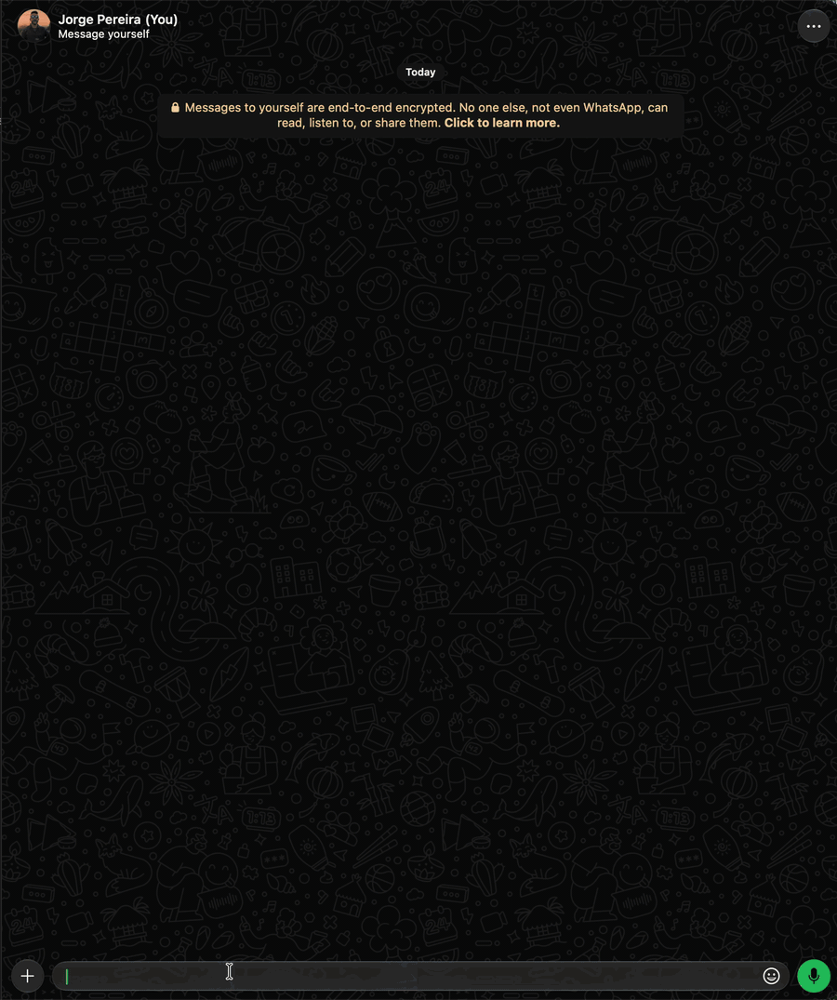

# `/get`

Downloads videos from Instagram, YouTube, X/Twitter, TikTok and other sites supported by
[yt-dlp](https://github.com/yt-dlp/yt-dlp). The URL can come as an argument or you can reply to a
message that contains the link. The typed URL wins over the replied message. A video, image or audio sent with `/get` as the
caption (no reply) is handled as if it had been replied to.

Replying to a WhatsApp video, image or audio, `/get` uses the media itself, without yt-dlp: with no
option, it returns the original file as a document; with `-a`, `-st`, `-ss` or `-es`, it goes
through ffmpeg. If the media has a link in the caption, the media wins.

| Option | Value | Description |
|---|---|---|
| `-sticker`, `-st` | | Sends as an animated sticker (up to 6 s), framed on the middle of the video. Same as [`/sticker`](sticker.md) |
| `-pos` | `<top\|middle\|bottom>` | With `-st`: where the square crop goes (default `middle`; `topo`, `meio`, `baixo`, `cima` and `centro` also work). On media wider than tall, `top` is the left and `bottom` the right |
| `-audio`, `-a` | | Extracts only the audio (`.mp3`) |
| `-startSec`, `-ss` | `<time>` | Starts at this point of the original video (default 0), in seconds (`22`, `1.5`) or in `min:sec` (`09:33`, or `h:min:sec`). With a `-` in front, counts from the **end** of the video (`-10`, `-01:44`) |
| `-endSec`, `-es` | `<time>` | Ends at this point of the original video, in the same format as `-ss` (`-es -5` ends 5 s before the end); must be greater than the start. Also works without `-ss` and for stickers |
| `-verbose`, `-v` | | Shows the parameters used in yt-dlp/ffmpeg |
| `<url>` | | Video link; wins over the replied message |

The converted file is limited to 20 MB (setting `get.maxSizeMB`). The original file of a replied
media goes as it came from WhatsApp; with no name (a camera photo, for example), it gets one like
`zapbot.jpeg`.

Choose audio or sticker per run. Stickers are at most six seconds long: without `-es`, they take
the six seconds from `-ss` (or from the start), and a shorter range set by `-ss` and `-es` keeps the
requested duration. The video and the audio are sent as a document.

From a link, with `-ss`, `-es` or `-st`, yt-dlp downloads only the requested range
(`--download-sections`, cut at the exact time with `--force-keyframes-at-cuts`), without the whole
video. If the site doesn't allow downloading the range, `/get` downloads the whole video and ffmpeg
cuts it.

#### Time counted from the end

`-ss` and `-es` accept the time with a `-` in front, which counts from the end of the video:

- `-ss -10` starts 10 s before the end, that is, the **last 10 seconds**; `-ss -01:44` starts 1:44
  before the end. If the video is shorter than that, it starts from 0.
- `-es -5` ends 5 s before the end.
- You can mix them (`-ss 150 -es -10`). If the end falls before the start, the bot refuses.
- `-0` isn't valid, and `-ss -10 -es -20` is refused like any other end before the start.

To know the exact point the bot needs the duration: from a link, it asks yt-dlp (`--print
duration`) and downloads only the range; if the site doesn't report it, it downloads the whole video
and measures the file with `ffprobe` (which comes with ffmpeg). On a replied media, it measures the
file with `ffprobe`.

On a replied media:

- Image: `-st` makes the sticker framed on the middle, like `/sticker`; `-ss`, `-es` and `-a` are
  refused.
- Audio: with `-ss` or `-es`, the range comes out as `.mp3`; sticker is refused.
- Other files (PDF, documents) are refused.

#### Download cache

With the `get.cache.tmp` setting on (default), what yt-dlp downloads stays in `cache/tmp` (in
Docker, `/app/cache/tmp`) as `<sha1>_original.mp4`, and the same link isn't downloaded again, not by
`/get` nor by `/sticker`. An `-a` or an `-st` on the same link only runs ffmpeg.

- The key is the link plus the range: with `-ss` and `-es` yt-dlp downloads only that, so another
  range of the same video downloads again. The whole video in cache serves any range (ffmpeg cuts).
- Only the downloaded original is kept. The converted file and the log go away on every run, and the
  media replied to on WhatsApp doesn't go through yt-dlp, so it doesn't enter the cache.
- Cached files last `get.cache.maxDays` days (default 2) and the periodic cleanup, which runs every
  10 minutes, deletes the ones past that. `/cache -clean` does the same cleanup right away.
- Off (`/set get.cache.tmp off`), the original is deleted on every run, as before, and what was left
  in cache counts as a regular temporary file (deleted after 2 hours).
- `/cache -all` deletes the download cache along with the other temporary files.

#### Sensitive content on X

X only serves videos marked as sensitive (NSFW) to logged-in users, and yt-dlp without a login
fails on those links. The way out is to give it the cookies of a logged-in account (preferably one
just for this):



```bash
./scripts/get-cookie.sh x.com twitter.com    # reads the Chrome cookies and writes ./cookies.txt (chmod 600)
make DOCK_REMOTE=1 cookies           # copies to the container: /app/cache/cookies.txt
rm cookies.txt
```

- `get-cookie.sh` uses `yt-dlp --cookies-from-browser` (`-b firefox` switches the browser; `-o`
  changes the output file) and keeps only the requested domains. It warns if `auth_token`/`ct0` is
  missing, that is, if the account isn't logged in on the browser.
- `make cookies` uses `docker cp` and does `chmod 600`. The file lands in the cache volume, so it
  survives `make recreate`; without `DOCK_REMOTE=1`, it goes to the local Docker container.
  `FILE=outro.txt` picks another file.
- If `cache/cookies.txt` exists, the bot passes `--cookies` to yt-dlp on every download, from any
  site. Without the file, it downloads without cookies. To turn it off, delete the file from the
  container.
- The file gives access to the account: it doesn't go to git (`cookies.txt` is in `.gitignore`) nor
  over WhatsApp. When X logs the session out, `/get` goes back to failing on those links: generate
  and copy it again.

Limits (`/get` isn't admin: whoever is in `bot.users` uses it; with it set to `true`, anyone):

- Download of at most 200 MB before conversion (setting `get.maxDownloadMB`).
- A playlist link downloads only the video of the link (`--no-playlist`).
- yt-dlp and ffmpeg are interrupted after 5 minutes each.
- An unknown option is refused (`❌ Unknown option: -x`, with a hint to use `/get -h`), instead of becoming the URL.
- At most 2 `/get` (or `/sticker`) with yt-dlp or ffmpeg at the same time. The others get a notice
  to try again.

While it downloads and converts, the bot shows "⏳ Processing your media, please wait." (or "your sticker"). At the
end, that same message becomes "✅ Media downloaded successfully!" (or "✅ Sticker created
successfully!"), or the error, without an extra message.

URLs that point to the internal network (`localhost`, `10.x`, `192.168.x`, `169.254.x`, local IPv6,
etc.) are refused, so `/get` doesn't serve as a bridge into your network (SSRF). The check also
refuses mixed DNS answers (one public and one internal address), which indicate rebinding. Since
yt-dlp resolves DNS again and follows redirects on its own, the root defense is an egress firewall
in the container (`docker/app/egress-firewall.sh`, enabled by `ZAPBOT_EGRESS_FIREWALL=1`), which
blocks all access to the internal network from the bot.

```text
/get https://www.instagram.com/reel/XXXXXXXX/
/get -a https://youtu.be/XXXXXXXXXXX
/get -ss 10 -es 25 https://x.com/usuario/status/123456
/get -es 15 https://youtu.be/XXXXXXXXXXX
/get -ss 09:33 -es 09:45 https://youtu.be/XXXXXXXXXXX
/get -ss -10 https://youtu.be/XXXXXXXXXXX            → the last 10 seconds
/get -ss -01:44 -es -00:30 https://youtu.be/XXXXXXXXXXX → from 1:44 to 0:30 before the end
/get -st -ss 3 -es 6 https://youtu.be/XXXXXXXXXXX
(reply to a message with a link)  /get -a
(reply to a WhatsApp video)       /get -a              → only the audio, as .mp3
(reply to a WhatsApp video)       /get -ss 5 -es 20    → the range, as a document
```
