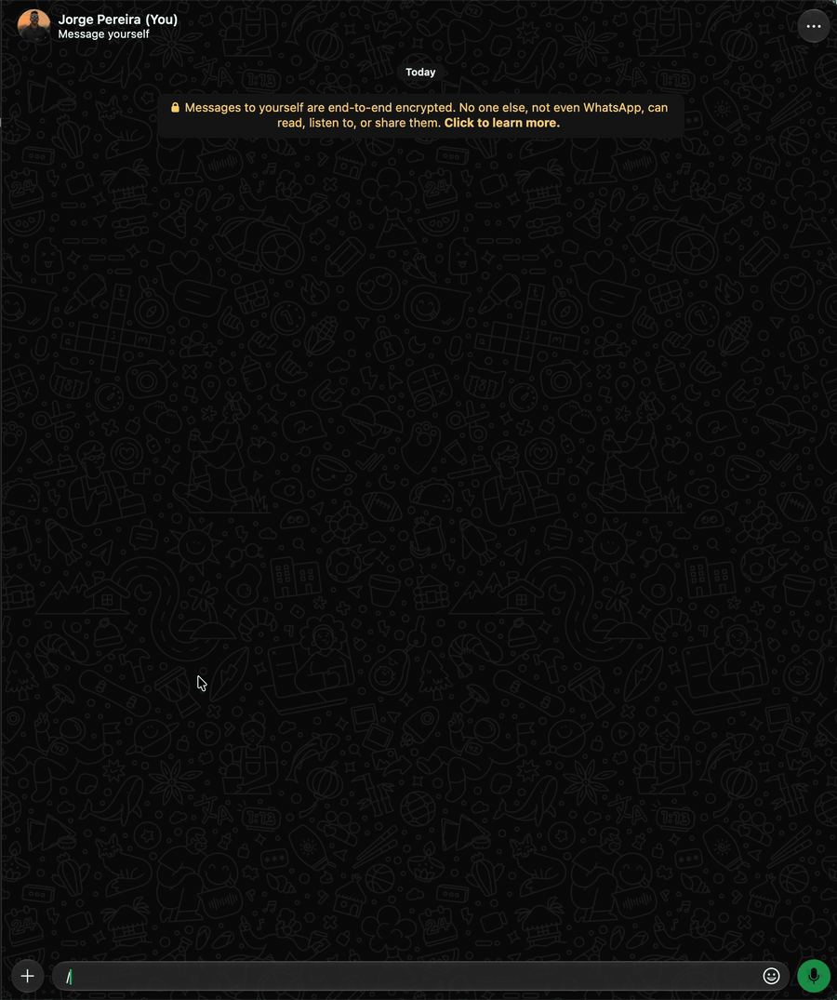

# `/join` (`/entrar`) · admin

Joins a WhatsApp group through the invite link. With `-info`, shows the group (name, participants and
description) without joining. To leave, use [`/leave`](leave.md).



```text
/join <link do convite>  ou  /join -info <link>  ou  /join -l
```

| Option | Value | Description |
|---|---|---|
| *(none)* | `<invite link>` | The link (`https://chat.whatsapp.com/<code>`, with or without `https://`) or just the code |
| `-info`, `-i` | | Shows the invite's group (name, participants and description) without joining |
| `-list`, `-l` | | Lists the groups you're in, numbered (same as `/leave -l`) |

```text
/join https://chat.whatsapp.com/AbCdEfGhIjKlMnOpQrStUv
✅ Entrei em 👥 Família

/join -info chat.whatsapp.com/AbCdEfGhIjKlMnOpQrStUv
👥 *Família*
👤 12 participantes
📝 Avisos e fotos
```

- Invalid, expired or revoked invite: `❌ Convite inválido, expirado ou revogado.`
- Groups that require an admin's approval may refuse the join; WhatsApp's reason comes in the reply.
