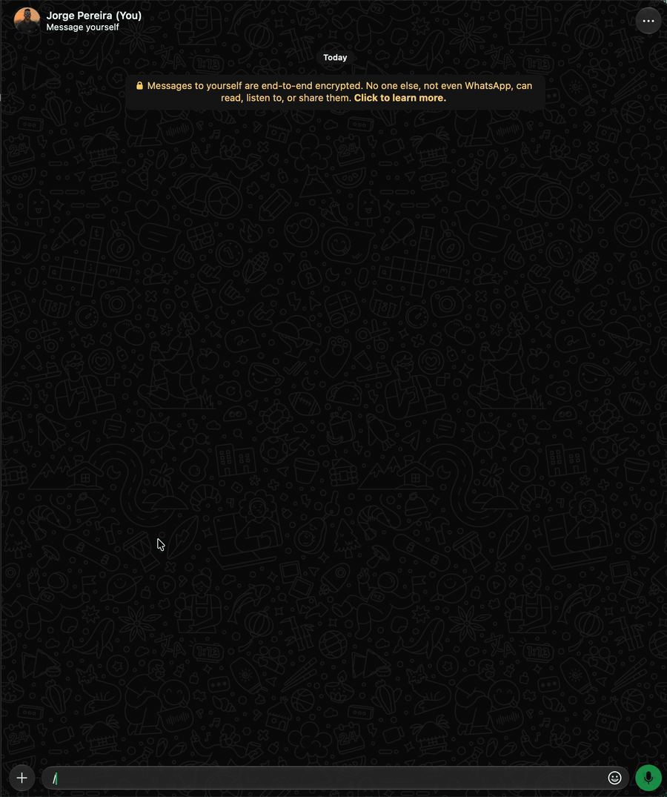

# `/join` · admin

Entra em um grupo do WhatsApp pelo link de convite. Com `-info`, mostra o grupo (nome, participantes
e descrição) sem entrar. Para sair, use o [`/leave`](leave.md).



```text
/join <link do convite>  ou  /join -info <link>  ou  /join -l
```

| Opção | Valor | Descrição |
|---|---|---|
| *(nenhuma)* | `<link do convite>` | O link (`https://chat.whatsapp.com/<código>`, com ou sem `https://`) ou só o código |
| `-info`, `-i` | | Mostra o grupo do convite (nome, participantes e descrição) sem entrar |
| `-list`, `-l` | | Lista os grupos em que você está, numerados (o mesmo que `/leave -l`) |

```text
/join https://chat.whatsapp.com/AbCdEfGhIjKlMnOpQrStUv
✅ Entrei em 👥 Família

/join -info chat.whatsapp.com/AbCdEfGhIjKlMnOpQrStUv
👥 *Família*
👤 12 participantes
📝 Avisos e fotos
💡 Entre com /join chat.whatsapp.com/AbCdEfGhIjKlMnOpQrStUv
```

- Não é um link nem um código: `❌ Link de convite inválido.` com um exemplo.
- Convite inválido, expirado ou revogado: `❌ Convite inválido, expirado ou revogado.`
- Grupos que exigem aprovação de um admin podem recusar a entrada; o motivo do WhatsApp vem na
  resposta (`❌ Não consegui entrar em 👥 <grupo>: <motivo>.`).
