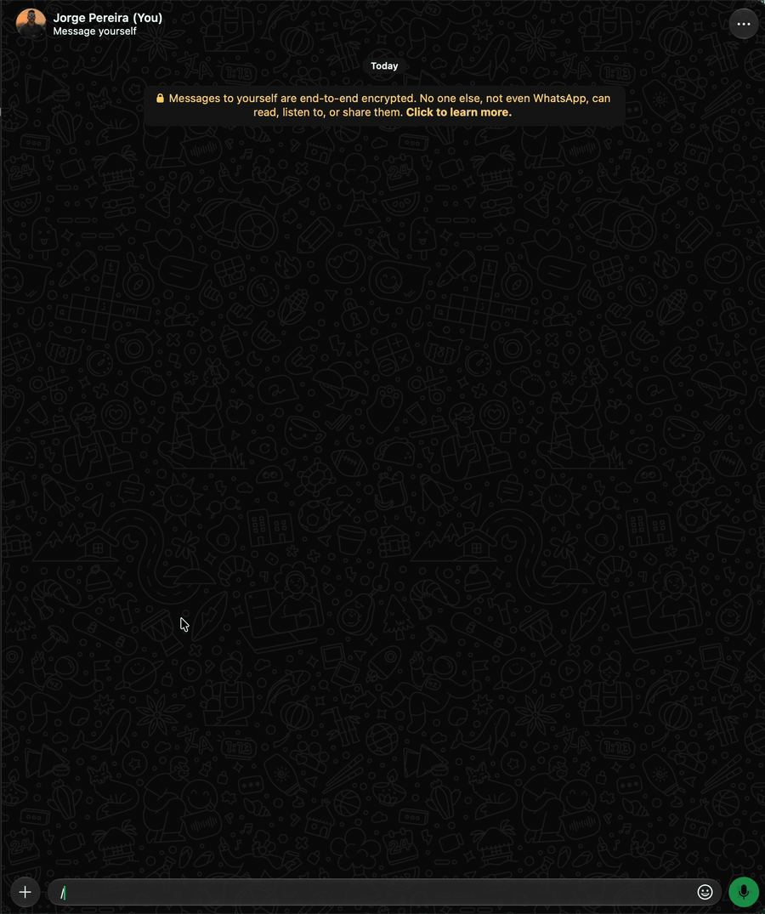

# `/leave` (`/sair`) · admin

Leaves one or more WhatsApp groups. With nothing, lists the groups you're in, numbered. To come back,
you need a new invite ([`/join`](join.md)).



```text
/leave <grupo|nº>...  ou  /leave -l
```

| Option | Value | Description |
|---|---|---|
| *(none)* | `<grupo\|nº>...` | The groups, separated by space or comma, by name or part of it, like in `-to` ([Destinations](index.md#destinations-contact-group-number-or-email); if several fit: you choose from the list), or by the no. from the last `-l` list (name with spaces between `/.../` or quotes; loose words, with no no., slashes or quotes, are a single name) |
| `-list`, `-l` | | Lists the groups you're in (same as `/leave` with nothing) |

```text
/leave -l
👥 *GRUPOS* (2)

1. Família · 12 participantes
2. Trabalho · 40 participantes

/leave 2
👋 Saí de 👥 Trabalho

/leave 2 1 /Grupo L200/  → several at once
```

When leaving the very group where the command was given, the confirmation may not arrive (you're no
longer there).
