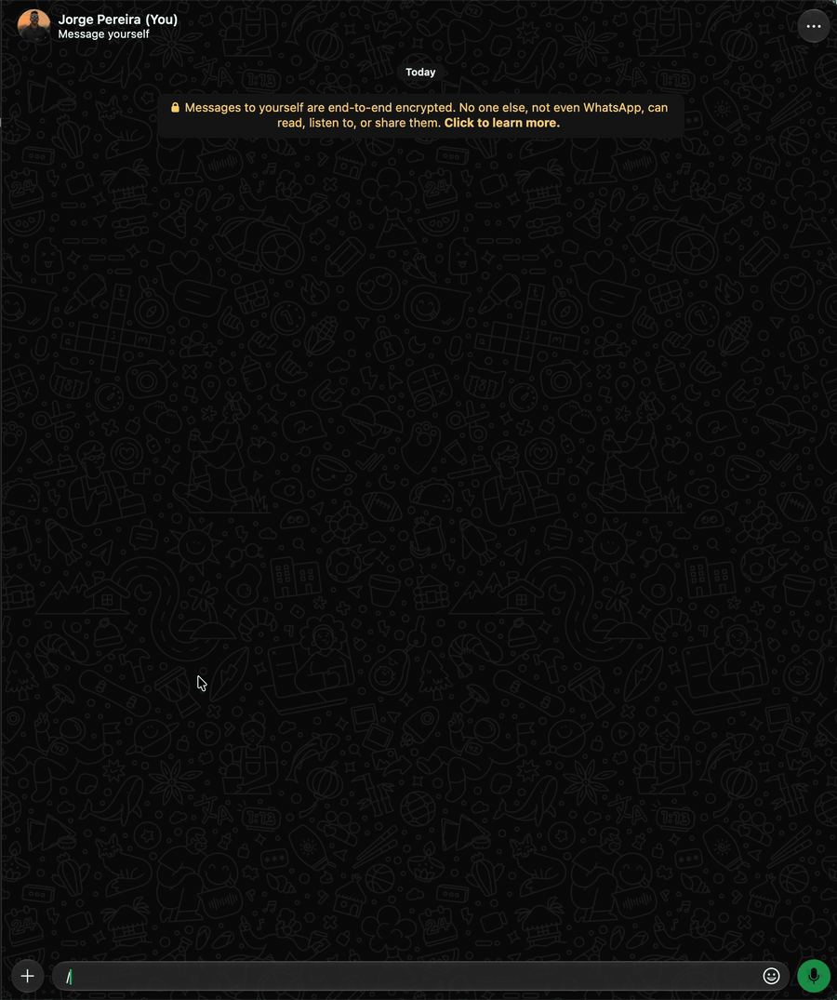

# `/leave` · admin

Sai de um ou mais grupos do WhatsApp. Sem nada, lista os grupos em que você está, numerados. Para
voltar, é preciso um novo convite ([`/join`](join.md)).



```text
/leave <grupo|nº>...  ou  /leave -l
```

| Opção | Valor | Descrição |
|---|---|---|
| *(nenhuma)* | `<grupo\|nº>...` | Os grupos, separados por espaço ou vírgula, pelo nome ou parte dele, como no `-to` ([Destinos](index.md#destinos-contato-grupo-número-ou-e-mail); vários que servem: você escolhe na lista), ou pelo nº da última lista do `-l` (nome com espaço entre `/.../` ou aspas; palavras soltas, sem nº, barras nem aspas, são um nome só) |
| `-list`, `-l` | | Lista os grupos em que você está (o mesmo que `/leave` sem nada) |

```text
/leave -l
👥 *GRUPOS* (2)

1. Família · 12 participantes
2. Trabalho · 40 participantes

💡 *Dicas*
/join <link> entra
/leave <nº|nome> sai

/leave 2
👋 Saí de 👥 Trabalho

/leave 2 1 /Grupo L200/  → vários de uma vez
```

- Os nº são os da última lista que você viu. Um nº fora dela: `❌ Nº 9 fora da lista; veja os
  grupos com /leave -l.`
- Uma falha não segura as outras: cada uma que falha ganha a própria linha
  (`❌ Não consegui sair de 👥 <grupo>: <motivo>.`).
- Saindo de vários, a confirmação lista os grupos (`👋 Saí de 2 grupos:`).

Saindo do próprio grupo em que o comando foi dado, a confirmação pode não chegar (você já não está
lá).
