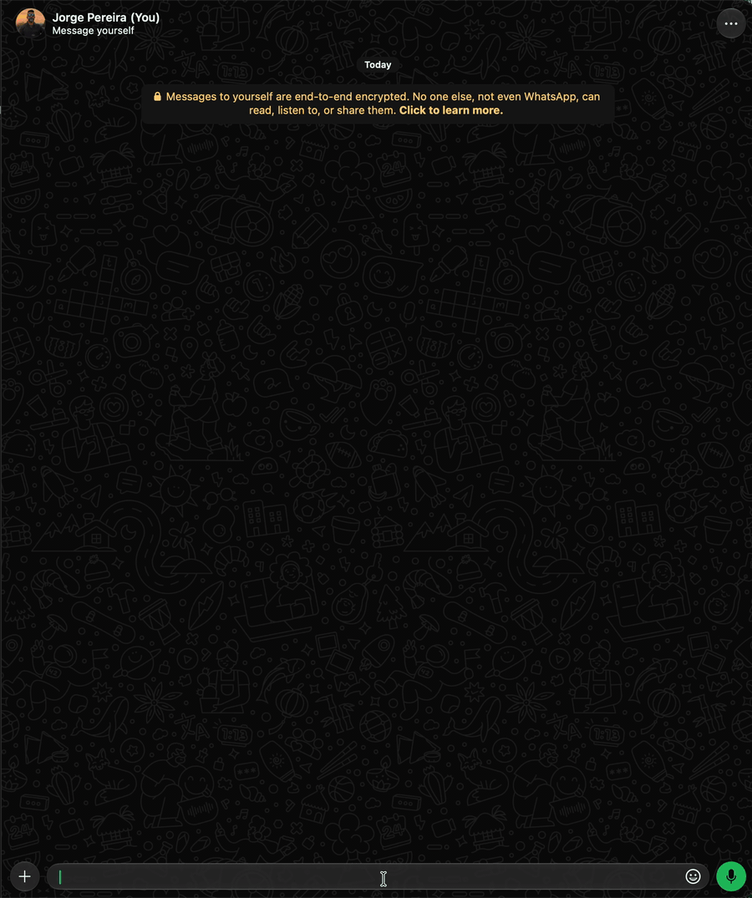

# `/monitor` · admin

👀 Monitors up to five contacts, checking one person at a time and storing the distinct **last
seen** times observed. Available to the bot owner and admins. The registrations and the history
live in SQLite and survive restarts; the database backup includes them too.

| Option | Description |
|---|---|
| *(none)* | Registered contacts, ids, interval, observed state, last check and the last `monitor.maxRecords` times per contact |
| `-add`, `-a` | Registers a person by address book name, `/name with spaces/`, mention or number with country and area code |
| `-rm`, `-r` | Removes by list id or by name, `/name with spaces/`, real mention or phone; `all` deletes all local registrations and histories |
| `-alerta` | With `-add`, turns on the online alert; alone, turns it on for a registered contact, via the same resolver or id |
| `-list`, `-l` | All contacts or only the given contact, with the last `monitor.maxRecords` distinct times per contact; long reports go in a `.txt` |



```text
/monitor
/monitor -add Jorge Chip L200
/monitor -a /Jorge Chip L200/
/monitor -a "Jorge Chip L200"
/monitor -add /Maria/ -alerta
/monitor -alerta /Maria/
/monitor -a @Fulano
/monitor -add +5521999999999
/monitor -list
/monitor -l
/monitor -l Maria
/monitor -l /Maria/
/monitor -l +5521999999999
/monitor -l @Fulano
/monitor -l #1
/monitor -rm 1
/monitor -r #1
/monitor -r 2
/monitor -rm Jorge Chip L200
/monitor -r /Jorge Chip L200/
/monitor -r "Jorge Chip L200"
/monitor -rm @Fulano
/monitor -r +5521999999999
/monitor -rm all
/monitor -r all
```

Names use the same search as [destinations](index.md#destinations-contact-group-number-or-email).
If several contacts match, the bot offers a list to choose from. The mention has to be selected
from the WhatsApp list. Groups and emails aren't accepted. A person who's already registered
doesn't take another slot; the LID becomes a phone number when WhatsApp provides that mapping.
`/monitor -rm all` and `/monitor -r all` clear all contacts and their local histories
immediately, without changing the monitor settings.

`-rm` uses the same contact resolver as `-add`, including choices for ambiguous names.
The ids shown in `/monitor` and `/monitor -l` are stable: removing contact `#1` doesn't renumber
`#2`. The `#` prefix is optional in the id. Only digits with up to nine positions are a list id;
numbers with ten or more digits go through the phone resolver. Groups and emails aren't
accepted in removal.

With no registrations, `/monitor` shows the header followed by `👀 No contacts registered.` and the
hint `💡 /monitor -add /Contact Name/`. With registrations, it shows:

```text
👀 MONITOR · active
⏱️ Each contact is checked every 5 min (300 s) at the most.
👥 Contacts: 1/5 · São Paulo time

📹 #1 · Jorge Chip L200
   ⚫ offline · time observed
   🔎 Checked: 10/14/2026, 4:55:10 PM
   🕒 Last seen observed: 10/14/2026, 4:49:59 PM
   🚨 Online alert: off
   📜 History: 1 distinct time(s) · limit: 30
   • 10/14/2026, 4:49:59 PM · observed on 10/14/2026, 4:55:10 PM
     Source: WhatsApp presence · time not confirmed

⚠️ Frequent checks and more contacts may contribute to WhatsApp blocking. No interval guarantees safety.
```

The header says `active`, `paused` (monitor disabled or bot paused) or `waiting for connection`. A
contact not checked yet shows `⏳ waiting for the first check`. Dates follow `zapbot.lang` (above,
en_US; in pt_BR: `14/10/2026, 16:55:10`), always in São Paulo time.

Both `/monitor` and `/monitor -l` show up to `monitor.maxRecords` entries per contact
(default: 30), from the most recent time to the oldest, with the observed time and the time the
bot found it. The source appears as `WhatsApp presence · time not confirmed`.
The same time never repeats among the stored entries, even if it shows up in several checks.
Reports above 7,000 characters are sent in full as `monitor-historico.txt`
to avoid several replies.

## Filter by contact and online alert

`/monitor -l <contact>` and `/monitor -list <contact>` filter only the monitor registrations,
without querying the WhatsApp address book. Name and `/Contact Name/` look for fragments of the
saved name, ignoring case and accents. `/monitor -l /Maria/` finds the registration "Maria Lucia".
If more than one registration matches, the list shows all the results of the filter.
Phone, id and real mention are compared against the identifiers of the monitored registrations.
Without a filter, they show all monitored contacts; with no match, they say none was found.

Register with `/monitor -add /Maria/ -alerta` or turn it on for an already registered person with
`/monitor -alerta /Maria/`. The alert is saved in the database and shows up as enabled in the list.
The notice is sent **to the bot owner's private chat**, even when an admin turns the option on:

```text
🚨 The contact "Maria" came online at "10/14/2026, 5:05:10 PM".
💡 For more, type /monitor -l
```

The date is in São Paulo time and indicates when the bot observed the online presence,
not the exact moment of connection. The first online observation can trigger a notice; consecutive
checks with the person online don't repeat the alert. An offline observation allows notifying
on the next online entry. Missing data and failures don't rearm the alert.
Turning it on for someone already observed online waits for an offline observation before notifying
again. Removing the registration also removes the alert. Pausing the monitor pauses the checks and
the notices. The option doesn't increase the frequency of the checks; accesses between them
can go unnoticed, and the data received may be cached.

## Interval and limit

| Setting | Default | Values | Effect |
|---|---|---|---|
| `monitor.pool` | `300` | 120–86400 seconds | Minimum interval between checks of each contact; 300 s = 5 min, 120 s = 2 min |
| `monitor.max` | `5` | 1–5 | Limits the registrations; remove contacts before lowering it below the registered total |
| `monitor.maxRecords` | `30` | 1–1000 | Maximum entries in the database and in the lists per contact; keeps the most recent times |
| `monitor.enabled` | `true` | true/false | Pauses or resumes the checks without deleting registrations or history |

```text
/set monitor.pool
/set monitor.pool 300
/set monitor.pool=120
/set monitor.max
/set monitor.max=5
/set monitor.max 3
/set monitor.maxRecords=30
/set monitor.maxRecords 50
/set monitor.enabled false
/set monitor.enabled=true
/set monitor
```

The `key=value` form is accepted for the four monitoring settings; the form with a space works
too. Changes take effect without restarting. **300 seconds is the default to reduce the frequency,
not a safety guarantee.** 120 seconds makes more queries; increasing the interval reduces
the frequency and also increases the chance of missing brief accesses.

The scheduler checks the pending contacts every ten seconds, locally only. The first
check happens on the next pass after registration, once the bot is connected. Each person
gets at most one check per `monitor.pool` seconds, counted from the start of the attempt;
the order of the pending contacts is shuffled without repetition on each pass. Between checks,
the bot waits 1 to 15 seconds, chosen at random, including after failures. This spreads
the checks over time, without increasing their frequency or guaranteeing protection against
blocking. During the wait, pausing the monitor or removing the contact prevents its next check.
A check waits for data for up to five seconds,
within the ten-second window for its attempts. Failures also respect the interval,
with no immediate retries in a loop. The list command reads only the database: it doesn't force checks.

Monitoring pauses with `monitor.enabled false`, `/bot -off`, an unavailable connection or
`/set commands.disabled monitor`. It resumes when those conditions are resolved. A check
that has already started may finish. Removing a registration prevents its pending result from
recreating the history.

The database keeps at most `monitor.maxRecords` entries per contact, including after restarts.
Lowering this value immediately removes the oldest excess entries of each contact.
Raising the limit allows storing more future entries; it doesn't recover the ones already removed.

## What the history represents

- The state can be `🟢 online`, `⚫ offline · time observed`, `❔ no data`,
  `❔ no time available`, `🔒 time unavailable` or `⚠️ check failed`.
- The bot prefers the presence collection by LID, keeping indicators and time in the same source.
  It reuses the active subscription and only requests presence if there's no active subscription.
  The monitor doesn't open chats automatically or change the online presence of the bot account.
- The `chatstate.t` time of an offline state without `deny` is a **candidate** for last seen.
  The technical source and this classification are stored in the database. In the list and in the
  report, `Source: WhatsApp presence · time not confirmed` appears; compare it with the app.
- Data already in cache can be observed and stored. A distinct time doesn't prove there was
  an update during that check. An online contact doesn't generate a new offline time.
- `null`, failures and data without a valid time don't generate fictitious entries. A time
  already observed stays in the summary even when the current check has no data.
- It isn't a complete record of comings and goings: accesses between checks can go
  unobserved. Contact privacy, cache, connection and WhatsApp changes can prevent data.

## Risk of being blocked

⚠️ **Short intervals and more contacts increase the volume of queries and can contribute to
being blocked by WhatsApp.** There's no frequency or quantity that's guaranteed safe, including
five people every five minutes. The limit of five and the two-minute minimum are limits of the
bot, not limits approved by WhatsApp. The warnings appear at registration, in the list and when
changing `monitor.pool` or `monitor.max` through `/set`.

WhatsApp states that automated collection of information for disallowed purposes
can cause temporary or permanent account suspension. See the
[official guidance on information harvesting](https://faq.whatsapp.com/general/security-and-privacy/about-harvesting-personal-information).

To stop the checks without losing data:

```text
/set monitor.enabled false
```

The native subscription may remain active in the WhatsApp session. Removing the registration deletes its
local history, but copies already made in the database backup remain in the respective backups.
