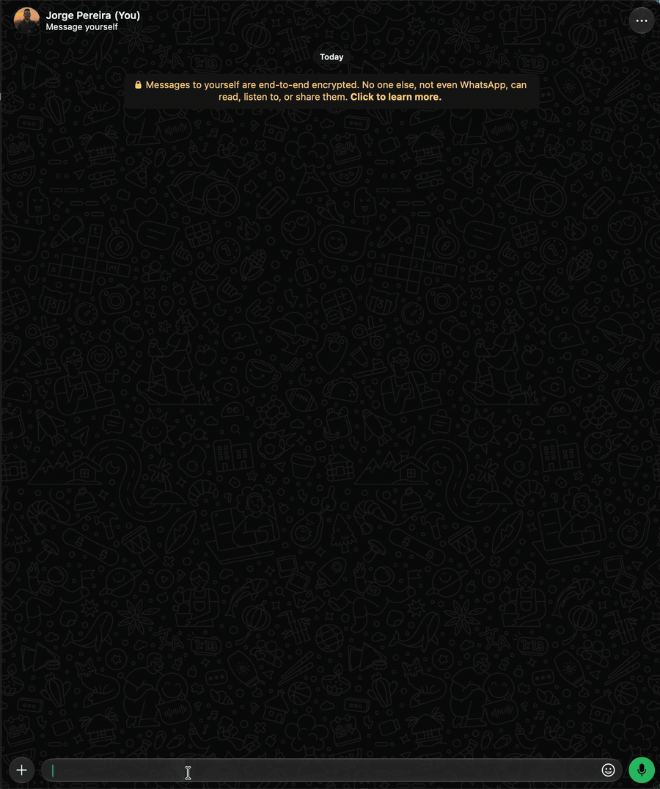

# `/show` · admin

Role `admin`: just you and the extra admins. The owner grants it to a person or group with
`/bot +u +cmd /show` ([Delegating](index.md#delegating-an-admin-command)).
Whoever receives it sees only the current chat: `-l`, `chat` and `-flush` are for the owner and the
extra admins.

With no parameters in a private chat, it lists the cache of all chats, like `/show -l`. In groups,
it redisplays the group's last deleted message.

Redisplays what's still in the cache: deleted messages (`-d`), edited ones (`-e`), deleted statuses
(`-s`) and removed or changed reactions (`-r`). Deleted messages and statuses are kept for 30 days
(setting `cache.revokedRetentionDays`), edited ones also 30 days (setting
`cache.editedRetentionDays`), and reactions, 30 days (setting `cache.reactionRetentionDays`).
Sends are spaced by `show.delayMs` (700 ms) to avoid flooding.

Channel messages (`@newsletter`) are identified with `📰 Channel: <name>`, in the deleted and edited
message notices and in the `/show` redisplay. `/show -l` marks channels with 📰; they can be
selected by name, regex or list number, like the other chats. When the channel can't be queried,
the redisplay uses the saved name. There's no contact name or phone in a channel's items. Statuses
(`status@broadcast`) follow the `-s` filter.

With the private notice turned off (`/set show.alert.deleted off`, `/set show.alert.edited off` or
`/set show.alert.reaction off`), messages are still stored and `/show` redisplays them normally.
With `/set show.alert.status off`, new status deletions are ignored: they don't generate a notice or
enter the deleted list.

| Option | Value | Description |
|---|---|---|
| `-N` | | Quantity (default 1, default limit 20, configurable up to 100 in `show.max`). E.g.: `-3` |
| `chat` | | Another chat: the list number from `-l`, part of the name, `@mention` or `/regex/`. See [The chat](#the-chat) |
| `-deleted`, `-d` | | Deleted messages (with no chat, the default) |
| `-edited`, `-e` | | Edited messages, with the text from before and after. Each edit is an item: a message edited twice shows up twice |
| `-status`, `-s` | | Deleted statuses: in a private chat, the person's; in your private chat, with no chat, everyone's |
| `-reaction`, `-r` | | Removed or changed reactions, with the previous reaction (and the new one, if changed) and the text of the message reacted to. See [Reactions](#reactions) |
| `-list`, `-l` | `[chat]` | Lists all chats with content in the cache (in any chat), numbered for `/show <nº>`, marking the current chat with `← this chat`. With a chat (number, name, `@mention` or `/regex/`), only the ones that match. See [List](#list) |
| `-query`, `-q` | `<text\|/regex/flags>` | Searches for the ones that have the text (ignoring case and accents) or that match the regex: in this chat, in the requested chat or, in your private chat, in all of them. Without `-N`: the 5 most recent. See [Search](#search) |
| `-flush`, `-f` | | Removes from the cache the deleted ones of this chat or, with `-e`, `-s`, `-r` or chat, whatever was requested (in your private chat, with no chat: from all chats) |
| `-mask`, `-m` | | Obfuscates phone numbers in the texts and captions of this run. E.g.: `+55219****44` |

With `/show -mask`, the phone numbers displayed keep the first five and the last two digits. The mask
applies to this run; the data stored in the cache stays complete.

`-d`, `-e`, `-s` and `-r` add up (`/show -d -s` brings deleted ones and statuses). With none of them,
with options but no chat you get only the deleted ones of this chat; with a chat (or in a search in
your private chat), you get everything together, by date.



```text
/show                       → in a private chat, lists the cache; in a group, the last deleted one
/show -5                    → the last 5
/show -2 -e                 → the last 2 edited
/show /^Maria/             → the last one (deleted, edited, status or reaction) of the chat that starts with "Maria"
/show -2 Maria Lucia        → the last 2 of the chat with "Maria Lucia" in the name
/show -5 -deleted /Carlos$/ → the last 5 deleted of the chat that ends with "Carlos"
/show -3 -edited @Jorge     → the last 3 edited of the private chat with Jorge
/show -s Marcio             → Marcio's last deleted status
/show -3 -r Family         → the last 3 removed or changed reactions in the Family group
/show 2                     → from chat #2 of /show -l
/show -l                    → what's in the cache, by chat
/show -l /^Maria/          → the same, only for chats that start with "Maria"
/show -f                    → deletes this chat's deleted ones from the cache
/show -e -f                 → deletes this chat's edited ones from the cache
/show -f Work               → deletes everything from the Work chat from the cache
/show -q pix                → the deleted ones with "pix" (in your private chat: everything, from all chats)
/show -e -q "bom dia" -10   → up to 10 edited ones with "bom dia"
/show -5 -q /pix|boleto/i   → up to 5 deleted ones that match the regex
```

In your private chat, when there's nothing from this chat, the bot suggests the next steps, one per
line:

```text
/show -e
✏️ No edited messages in this chat.
💡 To see the ones from another chat: /show -l and then /show -e -N <chat>
💡 To search in all of them: /show -e -q <text|/regex/>
```

## The chat

The chat comes after the options (`-N` can come before or after it) and is searched among the ones
that have something in the cache, ignoring case and accents:

- **`2`**: the list number from the last `/show -l`. No hyphen: `-2` is the quantity.
- **`Maria Lucia`** or **`"Maria Lucia"`**: the name has all the words; the exact name wins.
- **`/^Maria/`**: a regex on the name (here, the ones that start with "Maria").
- **`@Maria`**: the mention (picked from WhatsApp's `@` list) is the private chat with the person; an
  `@` typed without picking from the list counts as a name.

In a private chat, the statuses are the person's. If more than one chat matches, the bot lists them
and waits for you to reply with just the number (within 2 minutes; with no reply, the list becomes
the notice `⌛ No number chosen…`). It works in any chat.

## Search

`-q <text>` filters by the snippet, ignoring case and accents (for edited ones, by the text from
before or after; for reactions, by the reaction or the text of the message reacted to). With spaces,
it goes in quotes (`-q "bom dia"`). The scope is the usual one: this chat, the requested chat or, **in
your private chat, all chats** (and, without `-d`, `-e`, `-s` or `-r`, all types). Without `-N`, you
get the 5 most recent that match; the summary says how many were found in total.

With slashes, it's a JavaScript regex, with flags (`-q /pix|boleto/i`). It tests the text as it came:
without the `i` flag, it's case-sensitive, and accents count. The `g` and `y` flags are ignored.

```text
/show -2 -q pix
♻️ 2 deleted messages with "pix" (the 2 most recent of 4; use -N for more)

/show -5 -q /\bpix\b|boleto/i
♻️ 2 deleted messages with "/\bpix\b|boleto/i"
```

`-q` doesn't combine with `-l` or `-f`. Without the text, or with an invalid regex, the bot warns
you:

```text
/show -q
❌ Say what to search for: /show -q <text|/regex/flags>
💡 With spaces, use quotes: -q "good morning"
```

## List

`-l` shows how many there are of each type and the chats, numbered for `/show <nº>`. The tips at the
end come one per line:

```text
🗄️ Messages in the cache

🗑️ Deleted: 3 (1 with media · the oldest expires in 29 days)
✏️ Edited: 1 (the oldest expires in 30 days)
📸 Status: 1 (the oldest expires in 30 days)
😶 Reactions: 0

1. 👥 Family — 🗑️ 2 (last 9/30/2026, 10:02:11) ← this chat
2. 👤 Beltrano — 🗑️ 1 · 📸 1 (last 9/30/2026, 09:40:05)
3. 👥 Work — ✏️ 1 (last 9/30/2026, 11:15:42)

💡 /show <number, name, @mention or /regex/> shows the ones of a chat: deleted, edited, status and reactions together.
   -d, -e, -s and -r filter
   -N for more (max. 20)
   -l <chat> lists only the matching ones
   -f removes this chat's from the cache (in your private chat: everyone's)
```

With a chat (`/show -l <nº, nome, @menção ou /regex/>`), `-l` shows only the chats that match (all of
them, without asking which one), keeping the number from the full list, and the counts per type
become just theirs. The title shows the chat name when only one matches; with several, what was
typed. With `@mention`, the person's private chat and statuses are included:

```text
/show -l work
🗄️ Messages in the cache of: Work

🗑️ Deleted: 0
✏️ Edited: 1 (the oldest expires in 30 days)
📸 Status: 0
😶 Reactions: 0

3. 👥 Work — ✏️ 1 (last 9/30/2026, 11:15:42)

💡 /show <number, name, @mention or /regex/> shows the ones of a chat: deleted, edited, status and reactions together.
   …
```

## Output examples

With a chat and without `-d`, `-e`, `-s` or `-r`, the summary counts each type:

```text
/show -5 Beltrano
🗄️ 2 messages (🗑️ 1 · 📸 1) (asked for 5, found 2)
💬 Chat: Beltrano
```

The **Name** is the contact's name in your address book; only people who aren't in it show up with
their own profile name (the one the person chose). The bot records the name at the moment the
message arrives, so the ones already stored stay as they were.

An edited message redisplayed with `-e`:

```text
✏️ EDITED MESSAGE (1/1)

👥 Group: Work
👤 Name: Fulano
📱 Number: +5521999999999
📅 Sent at: 9/30/2026, 11:14:03
✏️ Edited at: 9/30/2026, 11:15:42
📝 Before: "meeting at 2pm"
💬 After: "meeting at 3pm"
```

## Reactions

WhatsApp only notifies the new reaction from whoever reacted. That's why the bot stores each
person's current reaction on each message and, when it's **removed** or **changed** to another one,
it stores the previous one for `/show -r` and notifies you in your private chat (turn it off with
`/set show.alert.reaction off`; the reaction is still stored). Your own reactions and channel
reactions (which are anonymous) are ignored. A reaction made before the bot was running doesn't
generate anything when removed: the bot doesn't know what it was.

The text of the message reacted to comes from the cache, as it was at the time; if it had already
left the cache, the notice says `(not in the cache)`. Each change is an item: changing twice generates
two.

```text
😶 REACTION REMOVED DETECTED

👥 Group: Family
👤 Name: Fulano
📱 Number: +5521999999999
📅 Reacted at: 9/30/2026, 11:14:03
🗑️ Removed at: 9/30/2026, 11:15:42
😶 Reaction: 😂
💬 On the message: "the boss will love it"
```

When changed, the title and the reaction line show both:

```text
🔄 REACTION CHANGED (1/1)

…
🔄 Changed at: 9/30/2026, 11:15:42
😶 Reaction: 👍 → ❤️
💬 On your message: "I arrive at 8"
```

To stop receiving notices from someone (or from a group), use [`/mute -r`](mute.md).
