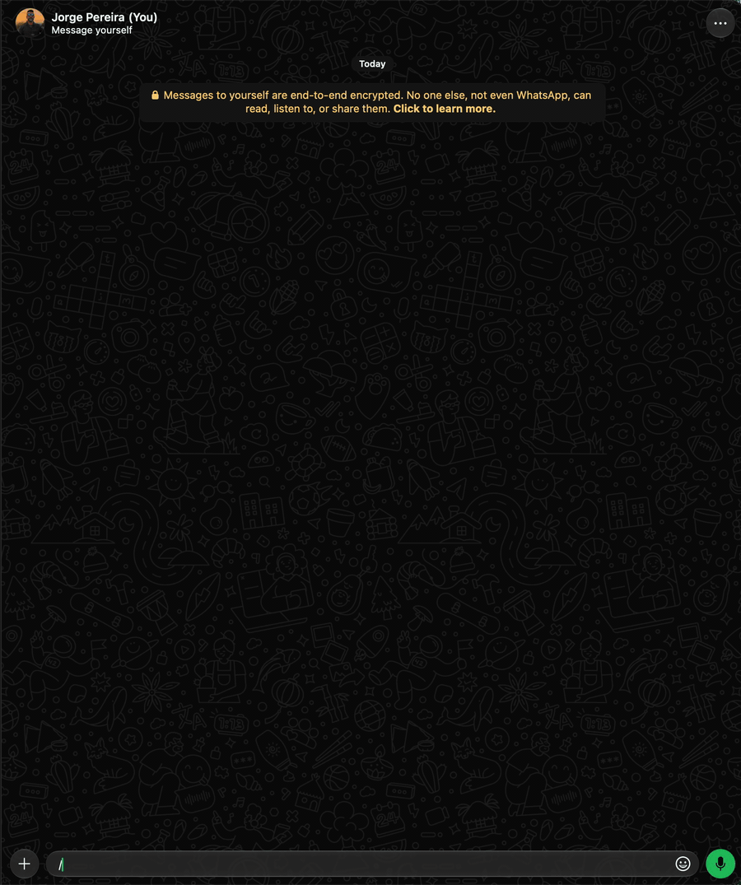

# `/stats` · admin

Role `admin`: only you and the extra admins. The owner grants it to a person or group with
`/bot +u +cmd /stats` ([Delegating](index.md#delegating-an-admin-command)).
Whoever receives it sees only the current chat and deletes nothing: `-l`, `/chat/`, `-me`, `-flush`
and `-flush-all` are for the owner and extra admins.

Chat ranking over the last N days (default 7): total messages, who talks the most, who deletes and
edits the most, messages per time-of-day slot, peak hour and peak day. With `-me`, **your** messages
summed across all chats: which ones you talk in the most, how many you deleted, your hours and your
peak day.

The numbers come from the counters in the `stats` table, filled on every received message (setting `stats.enable`, on by default; off stops counting
and keeps the history). Your messages count toward your number in any chat, including private chats with other people. The chat
with yourself and statuses are not included. The bot's own replies and WhatsApp notices (someone
joined the group, the name changed, encryption, a call...), which have no author, don't count either.

| Option | Value | Description |
|---|---|---|
| `-N` | | Period in days (default 7; maximum set by `stats.retentionDays`, default 90 and configurable from 7 to 365). Goes before or after the chat. E.g.: `-30` |
| *(chat)* | `/Family Group/` | Another chat instead of the current one: a group, or the private chat with a person, looked up by name (case- and accent-insensitive) among those that have statistics. In slashes or quotes when it has a space. Several with the name: the bot lists them and you reply with the number |
| `-me` | | Your statistics, summed across all chats (or only in the given chat) |
| `-list`, `-l` | | Lists the chats with statistics, from the one that talks the most to the least, with the total and the day of the last message |
| `-flush`, `-f` | `</chat/>` | Deletes a chat's statistics |
| `-flush-all` | | Deletes the statistics of all chats |



```text
/stats                         → last 7 days of this chat
/stats -30                     → last 30 days
/stats /Family Group/         → of the group "Family Group"
/stats -10 /Family Group/     → of the group, over the last 10 days
/stats /Family Group/ -10     → the same
/stats -me                     → yours, across all chats
/stats -me /Family/            → yours, only in "Family"
/stats -l                      → the chats that have statistics
/stats -flush /Family Group/  → deletes the group's
/stats -flush-all              → deletes all of them
```

```text
/stats -l
📊 Chats with statistics (3)
Kept for up to 90 days

1. 👥 Family — 1,234 msgs (last on 02/10)
2. 👥 Work — 456 msgs (last on 01/10)
3. 👤 Fulano — 78 msgs (last on 28/09)

💡 /stats /name/ shows one
💡 /stats -f /name/ deletes its statistics
```

```text
📊 Statistics of Family
Last 7 days

💬 Messages: 78 (average 11/day)
📎 With media: 21
👥 Active participants: 4

🏆 Who talks the most
🥇 Aunt — 40 (51%)
🥈 Uncle — 25 (32%)
🥉 Cousin — 10 (13%)
4. Grandma — 3 (4%)

🗑️ Who deletes the most
1. Uncle — 2

✏️ Who edits the most
1. Cousin — 1

🕐 By hour
09–12h █████      18
12–15h ██████████ 34
15–18h ████████   26
...
⏰ Peak hour: 14h–15h (13 msgs)
📅 Busiest day: 30/09/2026 (16 msgs)

💡 /stats -N for another period (max. 90 days)
💡 /stats -me for yours
💡 /stats -l for the other chats
```

```text
/stats -me
📊 Your statistics
Last 7 days, all chats

💬 Messages: 17 (average 2/day)
📎 With media: 5
🗑️ Deleted by you: 1
👥 Chats where you talked: 2

🏆 Where you talk the most
🥇 👥 Family — 12 (71%)
🥈 👤 Beltrano — 5 (29%)

🕐 By hour
...

💡 /stats -N for another period (max. 90 days)
💡 /stats -l for the other chats
```
