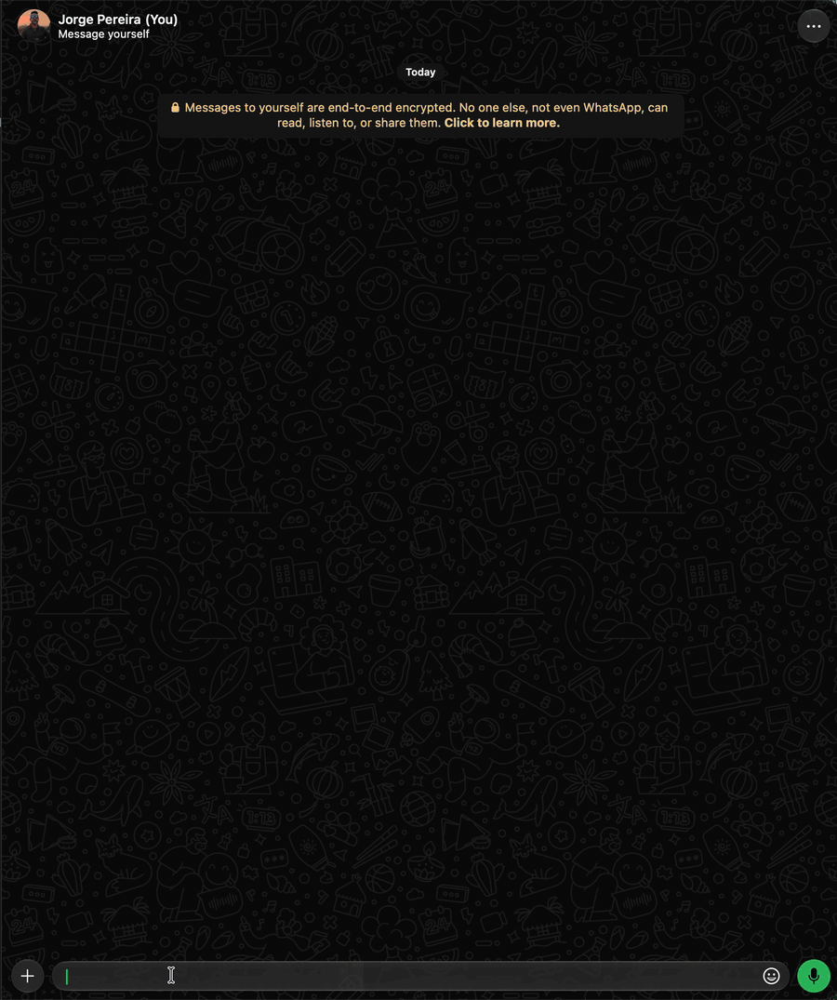

# `/sticker`

`/sticker` is [`/get -sticker`](get.md): it accepts a URL, or a reply to a message with a link, a
video/GIF or an image, and returns the sticker. The sticker's name and author come from the
`sticker.name` and `sticker.author` settings.

- **URL or replied link**: downloads the video with yt-dlp and makes the animated sticker. If the link
  has no video (an article, a photo post), it uses the link preview's thumbnail.
- **Replied video or GIF**: animated sticker via ffmpeg.
- **Replied image**: a 512x512 square **framed on the middle of the image**: on a landscape photo the
  sides are cropped, on a portrait one the top and bottom. GIFs (image) keep the animation. Stickers
  (WebP) go as they are.
- **Image or video sent with `/sticker` as the caption** (no reply): same as above, using the
  message's own media.

The video becomes a 512x512 square framed on the middle, at most six seconds long: without `-es`, the
six seconds from `-ss` (or from the start). While it downloads and converts, the bot shows
"⏳ Processing your sticker, please wait.", which turns into "✅ Sticker created successfully!"
(or the error). The animated sticker has to fit in 500 KB (WhatsApp's limit): the bot retries with
lower quality and, if it still doesn't fit, suggests a shorter clip with `-ss` and `-es`.



```text
(reply to a photo)               /sticker
(photo with the caption)         /sticker
(reply to a link)                /sticker
(reply to a video)               /sticker -ss 12            → from 0:12 to 0:18
(reply to a link)                /sticker -ss 10 -es 13     → from 0:10 to 0:13
(reply to a video)               /sticker -ss 01:10 -es 01:13 → from 1:10 to 1:13
(reply to a video)               /sticker -ss -10           → starts 10 s before the end (6 s)
/sticker https://www.instagram.com/p/XXXXXXXX/
```

| Option | Value | Description |
|---|---|---|
| `-pos` | `<top\|middle\|bottom>` | Where the square crop of the image or video sits (default `middle`; `topo`, `meio`, `baixo`, `cima` and `centro` also work). On media wider than tall, `top` is the left and `bottom` the right. Doesn't work with `-txt` |
| `-txt` | `<text>` | Animated sticker with the text, without having to reply to anything. See [Text sticker](#text-sticker) |
| `-bg` | `<color>` | With `-txt`: the background color, in `#RRGGBB` (default `#FFFFFF`, white) |
| `-fg` | `<color>` | With `-txt`: the letter color, in `#RRGGBB` (default `#000000`, black) |
| `-startSec`, `-ss` | `<time>` | Video: starts at this point (default 0) and takes the next 6 s. In seconds (`12`, `1.5`) or in `min:sec` (`01:12`). With a leading `-`, counts from the end (`-10`) |
| `-endSec`, `-es` | `<time>` | Video: ends at this point, in the same format as `-ss` (also with a leading `-`) and after the start; at most 6 s after `-ss` |
| `-verbose`, `-v` | | Shows the parameters used in yt-dlp/ffmpeg |
| `[url]` | | Video link; takes precedence over the replied message |

The limits and the protection against internal network URLs are the ones from [`/get`](get.md). The
preview thumbnail, when it comes from another address, goes through the same protection.

## Text sticker

`-txt` creates an animated sticker with the text, which **blinks** swapping colors every half second:
`-fg` letters on a `-bg` background, then the reverse. The text wraps into lines on its own, and the
letters are the biggest size that fits.

```text
/sticker -txt "Good morning!"                            → black letters on a white background
/sticker -txt "Beach time?" -bg "#2980B9" -fg "#FFFFFF"
/sticker -txt Happy birthday, grandma! -bg #C0392B -fg #fff
```

- The text goes with or without quotes (up to 200 characters); colors, in `#RRGGBB` or `#RGB`, with
  or without the `#`. The same color in `-bg` and `-fg` is an error: the text wouldn't show.
- Everything after `-txt` is text. Before it, `-ss`, `-es`, `-v` or a URL are an error: they belong
  to the video, and `-txt` makes the sticker from the text only (and ignores the replied message).
- How it's made: the bot draws the two frames as PNG (512x512) and `ffmpeg` joins them into an
  animated WebP, which WhatsApp accepts as a sticker without conversion. Name and author come from
  the same `sticker.name` and `sticker.author` settings.
