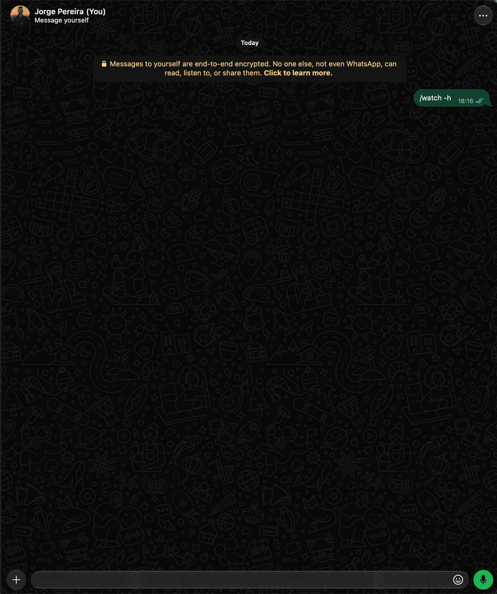

# `/watch` (`/vigiar`) · admin

Watches incoming messages that match text or regex rules and sends notices to your private chat or
to each rule's destinations. With no parameters, it lists the rules and, when there are matches,
adds the most recent hits. `/watch -10` shows the last ten matches of all rules, capped by the
`watch.showMax` setting.



```text
/watch /Defesa.*Civil/i                → creates a rule (regex)
/watch /pix/i -in /Jorge Pereira/      → only in Jorge's messages
/watch /chuva/i -in /Defesa Civil/     → only in the channel's posts
/watch promoção -to /Grupo Ofertas/    → notifies in the group, not in your private chat
/watch                                 → the rules and the latest matches
/watch -10                             → the last 10 matches
/watch -s 3                            → the matches of rule #3, in full
/watch -s /Jorge/                      → the same, by rule
/watch -s /Jorge/ -q "carro"           → only the ones with "carro"
/watch -s 3 -q /carr(o|ão)/i           → only the ones that match the regex
/watch -s 3 -to /Jorge Pereira/        → changes the destinations of rule #3
/watch -rm 3                          → removes rule #3
/watch -flush /Jorge/                  → clears the hits of /Jorge/
/watch -mask 3                         → 🔒 turns on mask for rule #3 (notices with obfuscated phone)
/watch -umask 3                        → turns off the 🔒 of rule #3
```
A rule without `-in` applies everywhere. With `-in`, you choose the source:

- **Contact:** tests messages from that sender, in private chats, groups and status. Accepts the
  name, a real WhatsApp mention or the phone with country code.
- **Group:** tests messages received only in that group.
- **Channel:** tests posts from that `@newsletter`. Accepts the channel name or ID.

Names with spaces go between slashes or quotes (`/Jorge Pereira/`, `"Grupo Ofertas"`). If there are
several results, the bot presents a list to choose from. Email isn't an accepted source. The source
is stored with the rule and survives restarts.

Rule types:

- **Text:** matches if the message contains the text, ignoring case and accents.
- **`/regex/flags`:** JavaScript regular expression, with spaces and escapes preserved. The `g`
  and `y` flags are ignored in detection, so each message is evaluated independently. A regex that
  risks hanging the bot (a quantifier over a group that already repeats, like `(x+)+`) is refused:
  since it's tested against every incoming message, exponential backtracking would freeze the whole
  bot.

Rules are tested against the original message text. In notices and in the history, mentions like
`@100000000000001` appear with the contact's name when it can be resolved.

| Option | Value | Description |
|---|---|---|
| *(none)* | | Lists rules, sources, destinations and counts; adds recent matches when there are any |
| `-N` | | Number of recent matches, across all rules (1 to 100, capped by `watch.showMax`). E.g.: `/watch -10` |
| `-list`, `-l` | | Lists only the rules, sources, destinations and counts |
| `-show`, `-s` | `[N\|regra]` | Shows the full texts of the matches of rule N (or of the rule by its text); without N, of all. `-N` controls the quantity |
| `-query`, `-q` | `<texto\|/regex/flags>` | Only the matches that contain the text (ignoring case and accents) or that match the regex. With `-s` or in the listing. See [Search](#search) |
| `-in` | `<origem>` | Restricts a new rule to a contact, group or channel |
| `-rm`, `-r` | `N\|regra` | Removes rule N (or the rule by its text), its hits, source and destinations; the following ones are renumbered |
| `-flush`, `-f` | `[N\|regra]` | Deletes the hits of rule N (or of the rule by its text); without N, of all. Keeps rules, sources and destinations |
| `-to` | `<destino\|off>` | Sets where the notices will be sent, when creating the rule or with `-s N`. Repeat for several destinations; `off` goes back to your private chat |
| `-mask`, `-m` | `[N]` | Without N, obfuscates phones only in this run's output. With N, turns on the 🔒 of rule N (see [Mask in notices](#mask-in-notices)). E.g.: `+55219****44` |
| `-umask`, `-u` | `N` | Turns off the 🔒 of rule N |

Use `/watch -s 3 -mask` to see the matches with obfuscated phones, keeping the first five and
the last two digits. Rules, destinations and hits are stored in full. Without the rule
number, the mask applies only to that run.

## Mask in notices

With `/watch -mask 3`, rule #3 gets a 🔒 in the listing, and from then on its notices go out with
obfuscated phones (the same format as `-mask`, `+55219****44`), whether in your private chat, in
the `-to` destinations or by email. `-s` and the hits listing of that rule also come out obfuscated.
`/watch -umask 3` removes the 🔒.

```text
👀 WATCH: REGRAS (3/20)

#1  /TCPRO.*La.*Sportiva/i  (1)
#2  /Renato.*r38tao/  (1)
#3  /(tcpro|tc pro)/i  (5) 🔒
```

- When creating the rule, `-mask` already turns on the 🔒: `/watch /(tcpro|tc pro)/i -mask`.
- It's per rule: the ones you already have stay as they are (no 🔒) until you turn it on.
- It applies to the whole notice: the sender's number, the message text and the rule. If a single
  notice combines a rule with 🔒 and one without, it comes out obfuscated.
- `-mask N` and `-umask N` go alone, with no other option or rule.
- The mask is presentation only: hits are stored in full in the database.
- The 🔒 is stored with the rule text. Removing the rule with `-rm` removes the 🔒 too.

## List and query

The positive numbers after `-s`, `-rm` and `-flush` identify **rules**, as in the listing. The
hyphenated number `-N` is the number of matches to display. The normal listing summarizes the texts;
`-s` shows the full texts. The order is from the most recent hit to the oldest.

In place of the number, `-s`, `-rm` and `-flush` accept the rule itself, as it appears in `/watch -l`:
`/watch -s /Jorge/` is the same as `/watch -s 3` when rule #3 is `/Jorge/`. The whole rule works,
ignoring case and accents, or a fragment that's in only one rule
(`/watch -s Sportiva`). If the fragment is in more than one, the bot lists the rules that match.

A listing, with the tips at the end, one per line:

```text
👀 WATCH: REGRAS (2/20)

#1  /Defesa.*Civil/i  (1) apenas em 📰 Defesa Civil
#2  /pix/i  (0) apenas em 👤 Jorge Pereira

👀 WATCH: OCORRÊNCIAS
🔎 Regras: todas
📦 Total: 1

1. 📅 06/10/2026, 01:09:35 · 🔎 #1
    📰 Defesa Civil
    💬 "A Defesa Civil informa: alerta de chuva"

💡 Dicas (N: o nº ou a própria regra)
/watch -s N mostra as mensagens completas.
/watch -s N -q <texto|/regex/> só as que casam.
/watch -s N -to <destino|off> troca os destinos.
/watch -f N limpa as ocorrências.
/watch -mask N liga o 🔒 (telefones ofuscados nos avisos); -umask N desliga.
```

## Search

`-q <text>` filters the matches by the message body, ignoring case and accents.
With spaces, put it in quotes (`-q "bom dia"`). It works with `-s` (of one rule or, without N, of
all) and in the listing (`/watch -q carro`). The total counts only the ones that match, and `-N`
limits how many are displayed. It can't be combined with `-l`, `-rm`, `-flush` or a new rule.

With slashes, it's a regex with flags, as in rules (`-q /carr(o|ão)/i`): it tests the text as it
came, so, without the `i` flag, it's case sensitive, and accents count.

```text
/watch -s /Jorge/ -q "carro"
👀 WATCH: OCORRÊNCIAS
🔎 Regra #3: /Jorge/
🔍 Busca: "carro"
📦 Total: 1

1. 📅 09/10/2026, 10:12:40
    👥 Família · 👤 Fulano
    💬 "Jorge vendeu o carro"
```

## Notify somewhere else

`-in` chooses **where to detect**; `-to` chooses **where to notify**. Destinations accept a contact,
group, number, mention or email, as in the other commands
([Destinations](index.md#destinations-contact-group-number-or-email)).

```text
/watch /vaga de emprego/i -in /Grupo Trabalho/ -to /Grupo Carreira/ -to email
/watch -s 1 -to /Jorge Pereira/
/watch -s 1 -to email
/watch -s 1 -to off
```

Email requires SMTP to be configured; `email` uses `QRCODE_EMAIL_SMTP_TO`. A hit generates one
notice per destination, gathering the rules that matched for that destination.

## Muted in `/mute`

People and groups muted in [`/mute`](mute.md), of any type, don't generate a notice in your
private chat. The hit is still recorded (it shows up in `/watch -N`), and rules with `-to`
still notify their destinations. Each suppressed notice counts toward the ignored ones in `/mute`
and `/bot -status`, as `watch`.

## Details

The account's own messages and recognized commands are left out of detection. The same message
doesn't generate two notices for the same rule. Rules are stored in `watch.rules`, with a maximum
set by `watch.max` (default 20, up to 100); a rule has 1 to 200 characters, and a repeated one is
refused; hits are retained for `watch.hitsRetentionDays` or until a `/watch -flush`. The
replies go to the chat where the command was typed.

Location thumbnails are left out of the text and regex rules. The location and its
coordinates are still stored in the cache; receiving it doesn't run commands.

In status and broadcasts (`@broadcast`), the sender is identified by the message author. A
`@lid` is converted to a phone number when WhatsApp provides the mapping. Without it, the number
is unavailable; with no author, the name shows as `Desconhecido`.

Channel posts (`@newsletter`) appear with `📰 Canal: <nome>` in notices; the history uses 📰 and
the channel name. Channels don't show a contact name or phone. When the channel can't be
queried, the history uses the saved name.
