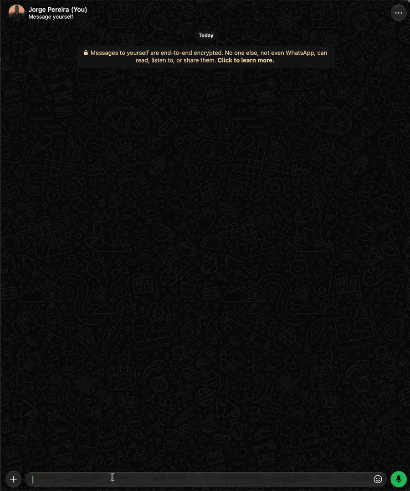

# `/get`

Downloads videos from Instagram, YouTube, X/Twitter, TikTok, Facebook and other sites supported by
[yt-dlp](https://github.com/yt-dlp/yt-dlp). The URL can come as an argument or you can reply to a
message that contains the link. The typed URL wins over the replied message. A video, image or audio sent with `/get` as the
caption (no reply) is handled as if it had been replied to.

**Several links** at once: `/get <url> <url> <url>` (up to 10) downloads them one after the other, each with its own
reply marked `1/3 🔗 📥 <url>`, `2/3 🔗 📥 <url>`... A link that fails does not stop the others. `-a` and the transcription (`-stt`)
apply to all; what picks a piece of **one** link (`-ss`, `-es`, `-photo`, `-st` and `-pos`/`-pt`/`-pc`/`-pb`) is refused,
and so is `/sticker` with more than one link: use one link at a time for those. The links come from the command, not
from a replied message.

```text
/get https://www.instagram.com/p/Df77hpuFFDI/ https://www.instagram.com/p/DffQZ0ex6Fm/ https://x.com/ParadigmaEdu/status/2123460271964381214
/get -a <url> <url>      → the audio of both
```

Replying to a WhatsApp video, image or audio, `/get` uses the media itself, without yt-dlp: with no
option, it returns the original file as a document; with `-a`, `-st`, `-ss` or `-es`, it goes
through ffmpeg. If the media has a link in the caption, the media wins.

| Option | Value | Description |
|---|---|---|
| `-quiet`, `-q` | | Returns **only** the transcribed text: no header (language and duration), no engine tip and no `⏳` notice. With `-sum`, the summary and the text, with no titles. To hide the tip always: the `stt.footer` setting off |
| `-sticker`, `-st` | | Sends as an animated sticker (up to 6 s), framed on the middle of the video. Same as [`/sticker`](sticker.md) |
| `-photo`, `-ph` | `<n>` | Photo post (Instagram, X/Twitter): sends only this photo of the carousel, instead of all (`1` is the first; with a leading `-`, counts from the end: `-1` is the last). With `-st`, the sticker is made from it |
| `-pos` | `<top\|center\|bottom>` | With `-st`: where the square crop goes (default `center`). On media wider than tall, `top` is the left and `bottom` the right |
| `-pb` | | Same as `-pos bottom` |
| `-pc` | | Same as `-pos center` |
| `-pt` | | Same as `-pos top` |
| `-audio`, `-a` | | Extracts only the audio (`.mp3`) |
| `-stt`, `-t` | | Shortcut for [`/stt`](stt.md): replies with the **text of the speech** instead of the file. See [Transcribe the speech](#transcribe-the-speech--stt) |
| `-gpt`, `-g` | | With `-t`: transcribes with ChatGPT (OpenAI API, spends your account) instead of the local faster-whisper. Without `-gpt` or `-local`, the [`stt.engine`](../settings.md) setting decides |
| `-local`, `-l` | | With `-t`: transcribes with the local faster-whisper (no key, uses the server CPU), even with `stt.engine` at `gpt` |
| `-summary`, `-sum` | | With `-t`: also summarizes the speech with ChatGPT. See [Transcribe the speech](#transcribe-the-speech--stt) |
| `-lang`, `-L` | `<code>` | The language of the speech: `pt`, `en`, `es`, `pt-br`... or `auto` (whisper detects it). With `-gpt`, it also goes to the OpenAI API. The default is the `stt.language` setting (`auto`). (`-l` is the short of `-local`) |
| `-model`, `-M` | `<name>` | The faster-whisper model (`tiny`, `base`, `small`, `medium`, `large-v3-turbo`...; bigger is better and slower; one that isn't in the image is downloaded the first time). With `-gpt`, the OpenAI model. The default is the `stt.model` setting |
| `-beam`, `-b` | `<1-10>` | The beam size of the local search: `1` is the fastest, more can get a little more right and takes longer. The default is the `stt.beam` setting |
| `-vad` | `<on\|off>` | `on`: skips the silence and the music before transcribing (where whisper invents text); `off`: transcribes it all. Local engine only. The default is the `stt.vad` setting |
| `-startSec`, `-ss` | `<time>` | Starts at this point of the original video (default 0), in seconds (`22`, `1.5`) or in `min:sec` (`09:33`, or `h:min:sec`). With a `-` in front, counts from the **end** of the video (`-10`, `-01:44`) |
| `-endSec`, `-es` | `<time>` | Ends at this point of the original video, in the same format as `-ss` (`-es -5` ends 5 s before the end); must be greater than the start. Also works without `-ss` and for stickers |
| `-verbose`, `-v` | | Shows yt-dlp/ffmpeg commands and technical details if a download fails |
| `<url>` | | Video link; wins over the replied message |

The converted file is limited to 20 MB (setting `get.maxSizeMB`). The original file of a replied
media goes as it came from WhatsApp; with no name (a camera photo, for example), it gets one like
`zapbot.jpeg`.

Choose audio or sticker per run. Stickers are at most six seconds long: without `-es`, they take
the six seconds from `-ss` (or from the start), and a shorter range set by `-ss` and `-es` keeps the
requested duration. `get.showAsMedia` sends media inline by default; off, it sends documents instead.
Media larger than `get.maxInlineSizeMB` (16 MB by default) always goes as a document, even when inline
media is enabled. X post text goes in the inline video's caption or in a separate message below a
document. Download failures show a friendly message; `-v` includes technical details. Replies to WhatsApp
images, videos or audio follow the same rule. Use `/set get.showAsMedia off` to always send documents
with `📥 Here is the media to download.`.

From a link, with `-ss`, `-es` or `-st`, yt-dlp downloads only the requested range
(`--download-sections`, cut at the exact time with `--force-keyframes-at-cuts`), without the whole
video. If the site doesn't allow downloading the range, `/get` downloads the whole video and ffmpeg
cuts it.

#### Time counted from the end

`-ss` and `-es` accept the time with a `-` in front, which counts from the end of the video:

- `-ss -10` starts 10 s before the end, that is, the **last 10 seconds**; `-ss -01:44` starts 1:44
  before the end. If the video is shorter than that, it starts from 0.
- `-es -5` ends 5 s before the end.
- You can mix them (`-ss 150 -es -10`). If the end falls before the start, the bot refuses.
- `-0` isn't valid, and `-ss -10 -es -20` is refused like any other end before the start.

To know the exact point the bot needs the duration: from a link, it asks yt-dlp (`--print
duration`) and downloads only the range; if the site doesn't report it, it downloads the whole video
and measures the file with `ffprobe` (which comes with ffmpeg). On a replied media, it measures the
file with `ffprobe`.

On a replied media:

- Image: `-st` makes the sticker framed on the middle, like `/sticker`; `-ss`, `-es` and `-a` are
  refused.
- Audio: with `-ss` or `-es`, the range comes out as `.mp3`; sticker is refused.
- Other files (PDF, documents) are refused.

#### Posts with only photos (carousel)

For a link that has **only photos** (an Instagram or X carousel, for example), `/get` downloads each photo
and sends **all of them inline as images**, each one with `Image i/N`, and the **text of the post** in the
last one:

On X, this also works with single-photo links such as `/status/123/photo/1`, as well as carousels.

```text
/get https://www.instagram.com/p/XXXXXXXX/        (a carousel of 3 photos)
🖼️ Image 1/3
🖼️ Image 2/3
🖼️ Image 3/3

The text of the post, all of it here...
✅ 3 photos sent!
```

- Up to 20 photos, with a short pause between them. The caption of the last one holds up to 1000
  characters; if the text is longer, the rest comes in the next message.
- A photo that doesn't download is left out and the final notice says how many. If none does, the reply is
  `This link has no video or audio to download (a post with only photos?)`.
- With `-a`, `-st`, `-t` or in [`/stt`](stt.md) the photos are not sent (there is no audio to
  take): the reply is that notice.
- Photos are downloaded with the same anti-SSRF protection as the rest of `/get`. A carousel that mixes photos
  and videos is not handled yet.

#### Download cache

With the `get.cache.tmp` setting on (default), what yt-dlp downloads stays in `cache/tmp` (in
Docker, `/app/cache/tmp`) as `<sha1>_original.mp4`, and the same link isn't downloaded again, not by
`/get` nor by `/sticker`. An `-a` or an `-st` on the same link only runs ffmpeg.

- The key is the link plus the range: with `-ss` and `-es` yt-dlp downloads only that, so another
  range of the same video downloads again. The whole video in cache serves any range (ffmpeg cuts).
- Only the downloaded original is kept. The converted file and the log go away on every run, and the
  media replied to on WhatsApp doesn't go through yt-dlp, so it doesn't enter the cache.
- Cached files last `get.cache.maxDays` days (default 2) and the periodic cleanup, which runs every
  10 minutes, deletes the ones past that. `/cache -clean` does the same cleanup right away.
- Off (`/set get.cache.tmp off`), the original is deleted on every run, as before, and what was left
  in cache counts as a regular temporary file (deleted after 2 hours).
- `/cache -all` deletes the download cache along with the other temporary files.

#### Transcribe the speech (`-stt`)

`-stt` (`-t`) is a shortcut for [`/stt`](stt.md): it gets the text of what is said in the video, and replies with it instead of
sending a file. It runs **inside the server**, with [faster-whisper](https://github.com/SYSTRAN/faster-whisper)
(open source, on the CPU): no OpenAI, no cost per minute, and the audio doesn't leave the homelab.

```text
/get -t https://www.instagram.com/reel/XXXXXXXX/
⏳ Transcribing the speech, this can take a while.   →   📝 Transcription · 🗣️ pt · 1:23
(the text)

/get -t -ss 30 -es 90 https://youtu.be/XXXXXXXXXXX     → only from 0:30 to 1:30
(reply to a WhatsApp audio or video)  /get -t
```

- **Light download.** From a link, yt-dlp downloads only the **lowest-quality audio**
  (`-f worstaudio`), a few hundred KB per minute, and ffmpeg turns it into 16 kHz mono wav,
  which is what whisper uses. The video is not downloaded when the site has an audio-only track.
- **Original language.** YouTube has auto-dubbed audio tracks; the bot picks the **original** track,
  otherwise you would get a transcription of the dub (a Portuguese video coming out in English).
- **Replying** to a WhatsApp video or audio (a voice note too) transcribes it, with no download.
- `-ss` and `-es` pick a part (same format as always, `-ss -60` is the last minute).
- The language is detected by whisper. If it gets it wrong on a short clip, fix it with
  `/set stt.language pt`.
- The model is `stt.model` (default `small`, which comes in the Docker image). `medium` or
  `large-v3-turbo` are better and slower; they are downloaded the first time they are used.
- At most `stt.maxMinutes` (default 20) of audio, otherwise the bot asks for a part with
  `-ss` and `-es`. It uses the server CPU, and counts in the limit of 2 `/get` at once.
- `-sum` (with `-t`) also summarizes, as in [`/stt`](stt.md).
- `-v` also sends the commands that ran (yt-dlp, ffmpeg, faster-whisper) and how long the
  transcription took, before the text.
- It doesn't mix with `-a`, `-st` or `-pos`. Instagram may ask for login: it uses the same
  `cookies.txt` as the rest of `/get` (see below).

#### Content that needs a login

X only serves videos marked as sensitive (NSFW) to logged-in users, and Facebook does the same
with age-restricted videos; yt-dlp without a login fails on those links (the bot replies that the
video only opens with a login). The way out is to give it the cookies of a logged-in account
(preferably one just for this).



Step by step, on your computer (in the project folder):

1. **Log in to the sites in Chrome:** open each one (x.com, facebook.com, instagram.com,
   youtube.com...) and sign in. It needs `yt-dlp` installed on the computer
   (`brew install yt-dlp`).
2. **Close Chrome** (the cookie database is locked while it is open).
3. **Generate the file with every site at once.** `make cookies` replaces the bot's whole file: a
   site left out loses its cookies.

   ```bash
   ./scripts/get-cookie.sh x.com twitter.com instagram.com youtube.com facebook.com
   ```

   On macOS, the system asks for the password to unlock "Chrome Safe Storage": click **Allow**.
   The output shows each site:

   ```text
   ✅ x.com: 12 cookies (logado)
   ✅ facebook.com: 9 cookies (logado)
   ⚠️  instagram.com: 4 cookies, mas sem sessionid (a conta não está logada no chrome)
   ```

   With ⚠️, log in to that site, close Chrome and run it again.
4. **Copy it to the bot** and **delete the local copy**:

   ```bash
   make DOCK_REMOTE=1 cookies    # copies it to the container: /app/cache/cookies.txt
   rm cookies.txt
   ```

5. **Test:** send `/get` with the link that failed. No need to restart the bot: it reads the file
   on every download.

To see which sites are in the bot's file (without showing the values):

```bash
docker --context homelab exec zapbot sh -c 'grep -v "^#" /app/cache/cookies.txt | cut -f1 | sort -u'
```

- `get-cookie.sh` uses `yt-dlp --cookies-from-browser` (`-b firefox` switches the browser; `-o`
  changes the output file) and keeps only the requested domains. It checks the login cookie of each
  site (`auth_token` on X, `c_user` on Facebook, `sessionid` on Instagram, `LOGIN_INFO` on YouTube).
- `make cookies` uses `docker cp` and does `chmod 600`. The file lands in the cache volume, so it
  survives `make recreate` and the deploy; without `DOCK_REMOTE=1`, it goes to the local Docker
  container. `FILE=other.txt` picks another file.
- If `cache/cookies.txt` exists, the bot passes `--cookies` to yt-dlp on every download, from any
  site. Without the file, it downloads without cookies. To turn it off, delete the file from the
  container.
- The file gives access to the account: it doesn't go to git (`cookies.txt` is in `.gitignore`) nor
  over WhatsApp. When a site logs the session out (or you sign out in Chrome), `/get` goes back to
  replying that the video only opens with a login: repeat steps 1 to 4.

Limits (`/get` isn't admin: whoever is in `bot.users` uses it; with it set to `true`, anyone):

- Download of at most 200 MB before conversion (setting `get.maxDownloadMB`).
- A playlist link downloads only the video of the link (`--no-playlist`).
- yt-dlp and ffmpeg are interrupted after 5 minutes each.
- An unknown option is refused (`❌ Unknown option: -x`, with a hint to use `/get -h`), instead of becoming the URL.
- At most 2 `/get` (or `/sticker`) with yt-dlp or ffmpeg at the same time. The others get a notice
  to try again.

While it downloads and converts, the bot shows "⏳ Processing your media, please wait." (or "your sticker"). At the
end, that same message becomes "✅ Media downloaded successfully!" (or "✅ Sticker created
successfully!"), or the error, without an extra message.

URLs that point to the internal network (`localhost`, `10.x`, `192.168.x`, `169.254.x`, local IPv6,
etc.) are refused, so `/get` doesn't serve as a bridge into your network (SSRF). The check also
refuses mixed DNS answers (one public and one internal address), which indicate rebinding. Since
yt-dlp resolves DNS again and follows redirects on its own, the root defense is an egress firewall
in the container (`docker/app/egress-firewall.sh`, enabled by `ZAPBOT_EGRESS_FIREWALL=1`), which
blocks all access to the internal network from the bot.

```text
/get https://www.instagram.com/reel/XXXXXXXX/
/get -a https://youtu.be/XXXXXXXXXXX
/get -ss 10 -es 25 https://x.com/usuario/status/123456
/get -es 15 https://youtu.be/XXXXXXXXXXX
/get -ss 09:33 -es 09:45 https://youtu.be/XXXXXXXXXXX
/get -ss -10 https://youtu.be/XXXXXXXXXXX            → the last 10 seconds
/get -ss -01:44 -es -00:30 https://youtu.be/XXXXXXXXXXX → from 1:44 to 0:30 before the end
/get -st -ss 3 -es 6 https://youtu.be/XXXXXXXXXXX
(reply to a message with a link)  /get -a
(reply to a WhatsApp video)       /get -a              → only the audio, as .mp3
(reply to a WhatsApp video)       /get -ss 5 -es 20    → the range, as a document
/get -t https://www.instagram.com/reel/XXXXXXXX/   → the speech, as text
/get -st -pos top https://youtu.be/XXXXXXXXXXX   → sticker framed on the top
/get -v https://youtu.be/XXXXXXXXXXX            → also shows the commands that ran
```
