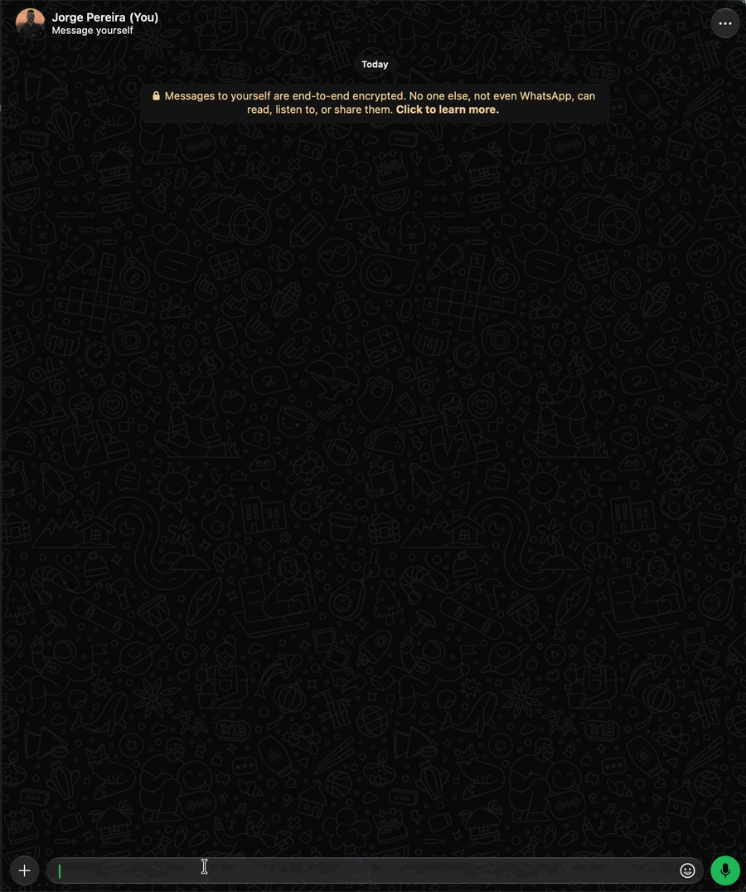

# `/get`

Baixa vídeos de Instagram, YouTube, X/Twitter, TikTok e outros sites suportados pelo
[yt-dlp](https://github.com/yt-dlp/yt-dlp). A URL pode vir como argumento ou você pode dar reply
numa mensagem que contenha o link. A URL digitada vale mais que a mensagem respondida. Um vídeo, imagem ou áudio enviado com `/get`
na legenda (sem responder) é tratado como se tivesse sido respondido.

**Vários links** de uma vez: `/get <url> <url> <url>` (até 10) baixa um depois do outro, cada um com a sua resposta
marcada `1/3 🔗 📥 <url>`, `2/3 🔗 📥 <url>`... Um link que falha não para os outros. O `-a` e a transcrição (`-stt`) valem para todos;
o que escolhe um pedaço de **um** link (`-ss`, `-es`, `-photo`, `-st` e `-pos`/`-pt`/`-pc`/`-pb`) é recusado, e o
`/sticker` com mais de um link também: para esses, um link por vez. Os links vêm do comando, não de uma mensagem
respondida.

```text
/get https://www.instagram.com/p/Df77hpuFFDI/ https://www.instagram.com/p/DffQZ0ex6Fm/ https://x.com/ParadigmaEdu/status/2123460271964381214
/get -a <url> <url>      → o áudio dos dois
```

Dando reply num vídeo, numa imagem ou num áudio do WhatsApp, o `/get` usa a própria mídia, sem o
yt-dlp: sem opção, devolve o arquivo original como documento; com `-a`, `-st`, `-ss` ou `-es`, passa
pelo ffmpeg. Se a mídia tiver um link na legenda, vale a mídia.

| Opção | Valor | Descrição |
|---|---|---|
| `-quiet`, `-q` | | Devolve **só** o texto transcrito: sem cabeçalho (idioma e duração), sem a dica do motor e sem o aviso `⏳`. Com `-sum`, o resumo e o texto, sem títulos. Para esconder a dica sempre: o setting `stt.footer` em `off` |
| `-sticker`, `-st` | | Envia como figurinha animada (até 6 s), enquadrada no meio do vídeo. É o mesmo que o [`/sticker`](sticker.md) |
| `-photo`, `-ph` | `<n>` | Post de fotos (Instagram, X/Twitter): manda só esta foto do carrossel, em vez de todas (`1` é a primeira; com `-` na frente, conta do final: `-1` é a última). Com `-st`, a figurinha sai dela |
| `-pos` | `<top\|center\|bottom>` | Com `-st`: onde fica o recorte quadrado (padrão `center`). Em mídia mais larga que alta, `top` é a esquerda e `bottom` a direita |
| `-pb` | | O mesmo que `-pos bottom` |
| `-pc` | | O mesmo que `-pos center` |
| `-pt` | | O mesmo que `-pos top` |
| `-audio`, `-a` | | Extrai só o áudio (`.mp3`) |
| `-stt`, `-t` | | Atalho do [`/stt`](stt.md): responde com o **texto da fala** em vez do arquivo. Veja [Transcrever a fala](#transcrever-a-fala--stt) |
| `-gpt`, `-g` | | Com `-t`: transcreve pelo ChatGPT (API da OpenAI, gasta a sua conta) em vez do faster-whisper local. Sem `-gpt` nem `-local`, vale o setting [`stt.engine`](../settings.md) |
| `-local`, `-l` | | Com `-t`: transcreve com o faster-whisper local (sem chave, usa a CPU do servidor), mesmo com o `stt.engine` em `gpt` |
| `-summary`, `-sum` | | Com `-t`: também resume a fala com o ChatGPT. Veja [Transcrever a fala](#transcrever-a-fala--stt) |
| `-lang`, `-L` | `<código>` | O idioma da fala: `pt`, `en`, `es`, `pt-br`... ou `auto` (o whisper detecta). Com `-gpt`, também vai para a API da OpenAI. O padrão é o setting `stt.language` (`auto`). (O `-l` é o atalho do `-local`) |
| `-model`, `-M` | `<nome>` | O modelo do faster-whisper (`tiny`, `base`, `small`, `medium`, `large-v3-turbo`...; maior é melhor e mais lento; o que não está na imagem é baixado na primeira vez). Com `-gpt`, o modelo da OpenAI. O padrão é o setting `stt.model` |
| `-beam`, `-b` | `<1-10>` | O tamanho do beam da busca local: `1` é o mais rápido, mais pode acertar um pouco mais e demora mais. O padrão é o setting `stt.beam` |
| `-vad` | `<on\|off>` | `on`: pula o silêncio e a música antes de transcrever (onde o whisper inventa texto); `off`: transcreve tudo. Só no motor local. O padrão é o setting `stt.vad` |
| `-startSec`, `-ss` | `<tempo>` | Começa neste ponto do vídeo original (padrão 0), em segundos (`22`, `1.5`) ou em `min:seg` (`09:33`, ou `h:min:seg`). Com `-` na frente, conta do **final** do vídeo (`-10`, `-01:44`) |
| `-endSec`, `-es` | `<tempo>` | Termina neste ponto do vídeo original, no mesmo formato do `-ss` (`-es -5` termina 5 s antes do fim); deve ser maior que o início. Vale também sem `-ss` e para figurinhas |
| `-verbose`, `-v` | | Mostra os comandos do yt-dlp/ffmpeg e detalhes técnicos se o download falhar |
| `<url>` | | Link do vídeo; vale mais que a mensagem respondida |

O arquivo convertido é limitado a 20 MB (setting `get.maxSizeMB`). O arquivo original de uma mídia
respondida vai como veio do WhatsApp; sem nome (uma foto da câmera, por exemplo), ganha um como
`zapbot.jpeg`.

Escolha áudio ou figurinha por execução. Figurinhas têm no máximo seis segundos: sem `-es`, pegam os
seis segundos a partir do `-ss` (ou do início), e um trecho menor definido por `-ss` e `-es` mantém a
duração pedida. `get.showAsMedia` envia mídias inline por padrão; desligado, envia como documento. Mídias
acima de `get.maxInlineSizeMB` (16 MB por padrão) sempre vão como documento, mesmo com a opção ligada.
O texto de um vídeo do X vai na legenda quando inline e em uma mensagem abaixo quando enviado como
documento. Use `/set get.showAsMedia off` para sempre enviar como documento com
`📥 Aqui está a mídia para download.`. Replies de imagem, vídeo e áudio também seguem essa regra. Se o
download falhar, o `/get` mostra uma mensagem simples; com `-v`, inclui os detalhes técnicos.

De um link, com `-ss`, `-es` ou `-st`, o yt-dlp baixa só o trecho pedido (`--download-sections`,
cortado no tempo exato com `--force-keyframes-at-cuts`), sem o vídeo inteiro. Se o site não deixar
baixar o trecho, o `/get` baixa o vídeo inteiro e o ffmpeg corta.

#### Tempo contado do final

`-ss` e `-es` aceitam o tempo com `-` na frente, que conta a partir do final do vídeo:

- `-ss -10` começa 10 s antes do fim, ou seja, os **últimos 10 segundos**; `-ss -01:44` começa 1:44
  antes do fim. Se o vídeo for menor que isso, começa do 0.
- `-es -5` termina 5 s antes do fim.
- Dá para misturar (`-ss 150 -es -10`). Se o final cair antes do início, o bot recusa.
- `-0` não vale, e `-ss -10 -es -20` é recusado como qualquer outro final antes do início.

Para saber o ponto exato o bot precisa da duração: de um link, pergunta ao yt-dlp (`--print
duration`) e baixa só o trecho; se o site não informar, baixa o vídeo inteiro e mede o arquivo com o
`ffprobe` (que vem com o ffmpeg). Numa mídia respondida, mede o arquivo com o `ffprobe`.

Na mídia respondida:

- Imagem: `-st` faz a figurinha enquadrada no meio, como o `/sticker`; `-ss`, `-es` e `-a` são
  recusados.
- Áudio: com `-ss` ou `-es`, o trecho sai em `.mp3`; figurinha é recusada.
- Outros arquivos (PDF, documentos) são recusados.

#### Posts só com fotos (carrossel)

Num link que tem **só fotos** (um carrossel do Instagram ou do X, por exemplo), o `/get` baixa cada foto e
manda **todas como imagens inline**, cada uma com `Imagem i/N`, e o **texto do post** na última:

No X, isso também funciona em links de uma foto, como `/status/123/photo/1`, e em carrosséis.

```text
/get https://www.instagram.com/p/XXXXXXXX/        (um carrossel de 3 fotos)
🖼️ Imagem 1/3
🖼️ Imagem 2/3
🖼️ Imagem 3/3

O texto do post, todo aqui...
✅ 3 fotos enviadas!
```

- Até 20 fotos, com uma pausa curta entre elas. A legenda da última leva até 1000 caracteres; se o texto
  for maior, o resto vem na mensagem seguinte.
- Uma foto que não baixa fica de fora e o aviso final diz quantas. Se nenhuma baixar, a resposta é
  `Esse link não tem vídeo nem áudio para baixar (é um post só de fotos?)`.
- Com `-a`, `-st`, `-t` ou no [`/stt`](stt.md) as fotos não são enviadas (não há áudio para
  tirar): a resposta é esse aviso.
- As fotos são baixadas com a mesma proteção anti-SSRF do resto do `/get`. Um carrossel que mistura fotos e
  vídeos ainda não é tratado.

#### Cache dos downloads

Com o setting `get.cache.tmp` ligado (padrão), o que o yt-dlp baixa fica em `cache/tmp` (no Docker,
`/app/cache/tmp`) como `<sha1>_original.mp4`, e o mesmo link não é baixado de novo, nem pelo `/get`
nem pelo `/sticker`. Um `-a` ou um `-st` do mesmo link só roda o ffmpeg.

- A chave é o link mais o trecho: com `-ss` e `-es` o yt-dlp baixa só ele, então outro trecho do
  mesmo vídeo baixa de novo. O vídeo inteiro em cache serve a qualquer trecho (o ffmpeg corta).
- Só o original baixado é guardado. O arquivo convertido e o log saem a cada execução, e a mídia
  respondida no WhatsApp não passa pelo yt-dlp, então não entra no cache.
- Os arquivos em cache duram `get.cache.maxDays` dias (padrão 2) e a limpeza periódica, que roda a
  cada 10 minutos, apaga os que passaram disso. O `/cache -clean` faz a mesma limpeza na hora.
- Desligado (`/set get.cache.tmp off`), o original é apagado a cada execução, como antes, e o que
  sobrou em cache vale como temporário comum (apagado depois de 2 horas).
- O `/cache -all` apaga o cache dos downloads junto com os outros temporários.

#### Transcrever a fala (`-stt`)

O `-stt` (`-t`) é um atalho do [`/stt`](stt.md): pega o texto do que é falado no vídeo e responde com ele, em vez de mandar
um arquivo. Roda **dentro do servidor**, com o [faster-whisper](https://github.com/SYSTRAN/faster-whisper)
(open source, na CPU): sem OpenAI, sem custo por minuto, e o áudio não sai do homelab.

```text
/get -t https://www.instagram.com/reel/XXXXXXXX/
⏳ Transcrevendo a fala, pode levar um tempo.   →   📝 Transcrição · 🗣️ pt · 1:23
(o texto)

/get -t -ss 30 -es 90 https://youtu.be/XXXXXXXXXXX     → só de 0:30 a 1:30
(respondendo um áudio ou vídeo do WhatsApp)  /get -t
```

- **Download leve.** De um link, o yt-dlp baixa só o **áudio de menor qualidade**
  (`-f worstaudio`), umas centenas de KB por minuto, e o ffmpeg converte para wav 16 kHz mono,
  que é o que o whisper usa. O vídeo não é baixado quando o site tem faixa só de áudio.
- **Idioma original.** O YouTube tem faixas de áudio dubladas automaticamente; o bot pega a faixa
  **original**, senão você receberia a transcrição da dublagem (um vídeo em português saindo em inglês).
- **Respondendo** um vídeo ou áudio do WhatsApp (nota de voz também), transcreve ele, sem baixar nada.
- `-ss` e `-es` escolhem um trecho (mesmo formato de sempre, `-ss -60` é o último minuto).
- O idioma é detectado pelo whisper. Se errar num trecho curto, fixe com
  `/set stt.language pt`.
- O modelo é o `stt.model` (padrão `small`, que já vem na imagem do Docker). O `medium` ou
  o `large-v3-turbo` são melhores e mais lentos; são baixados na primeira vez que forem usados.
- No máximo `stt.maxMinutes` (padrão 20) de áudio; acima disso o bot pede um trecho com
  `-ss` e `-es`. Usa a CPU do servidor e conta no limite de 2 `/get` ao mesmo tempo.
- O `-sum` (com `-t`) resume também, como no [`/stt`](stt.md).
- O `-v` manda também os comandos que rodaram (yt-dlp, ffmpeg, faster-whisper) e quanto a
  transcrição levou, antes do texto.
- Não mistura com `-a`, `-st` nem `-pos`. O Instagram pode pedir login: vale o mesmo `cookies.txt`
  do resto do `/get` (veja abaixo).

#### Conteúdo sensível do X

O X só entrega vídeos marcados como sensíveis (NSFW) para quem está logado, e o yt-dlp sem login
falha nesses links. A saída é dar a ele os cookies de uma conta logada (de preferência uma só para
isso):



```bash
./scripts/get-cookie.sh x.com twitter.com    # lê os cookies do Chrome e grava ./cookies.txt (chmod 600)
make DOCK_REMOTE=1 cookies           # copia para o container: /app/cache/cookies.txt
rm cookies.txt
```

- O `get-cookie.sh` usa o `yt-dlp --cookies-from-browser` (`-b firefox` troca o navegador; `-o`
  muda o arquivo de saída) e guarda só os domínios pedidos. Ele avisa se faltar `auth_token`/`ct0`,
  ou seja, se a conta não estiver logada no navegador.
- O `make cookies` usa `docker cp` e dá `chmod 600`. O arquivo cai no volume do cache, então
  sobrevive a `make recreate`; sem `DOCK_REMOTE=1`, vai para o container do Docker local. `FILE=outro.txt`
  escolhe outro arquivo.
- Se `cache/cookies.txt` existe, o bot passa `--cookies` ao yt-dlp em todo download, de qualquer
  site. Sem o arquivo, baixa sem cookies. Para desligar, apague o arquivo do container.
- O arquivo dá acesso à conta: não vai para o git (`cookies.txt` está no `.gitignore`) nem pelo
  WhatsApp. Quando o X deslogar a sessão, o `/get` volta a falhar nesses links: gere e copie de novo.

Limites (o `/get` não é admin: quem estiver no `bot.users` usa; com ele em `true`, qualquer um):

- Download de no máximo 200 MB antes da conversão (setting `get.maxDownloadMB`).
- Link de playlist baixa só o vídeo do link (`--no-playlist`).
- yt-dlp e ffmpeg são interrompidos após 5 minutos cada.
- Opção desconhecida é recusada (`❌ Opção desconhecida: -x`, com a dica de usar `/get -h`), em vez de virar a URL.
- No máximo 2 `/get` (ou `/sticker`) com yt-dlp ou ffmpeg ao mesmo tempo. Os demais recebem um aviso
  para tentar de novo.

Enquanto baixa e converte, o bot mostra "⏳ Processando sua mídia, aguarde." (ou "seu sticker"). No fim, essa mesma mensagem vira
"✅ Mídia baixada com sucesso!" (ou "✅ Sticker criado com sucesso!"), ou o erro, sem uma mensagem a
mais.

URLs que apontam para a rede interna (`localhost`, `10.x`, `192.168.x`, `169.254.x`, IPv6 local
etc.) são recusadas, para que o `/get` não sirva de ponte para a sua rede (SSRF). A checagem
recusa também respostas de DNS mistas (um endereço público e um interno), que indicam rebinding.
Como o yt-dlp resolve o DNS de novo e segue redirects por conta própria, a defesa de raiz é um
firewall de egresso no container (`docker/app/egress-firewall.sh`, ligado por
`ZAPBOT_EGRESS_FIREWALL=1`), que bloqueia todo acesso à rede interna a partir do bot.

```text
/get https://www.instagram.com/reel/XXXXXXXX/
/get -a https://youtu.be/XXXXXXXXXXX
/get -ss 10 -es 25 https://x.com/usuario/status/123456
/get -es 15 https://youtu.be/XXXXXXXXXXX
/get -ss 09:33 -es 09:45 https://youtu.be/XXXXXXXXXXX
/get -ss -10 https://youtu.be/XXXXXXXXXXX            → os últimos 10 segundos
/get -ss -01:44 -es -00:30 https://youtu.be/XXXXXXXXXXX → de 1:44 a 0:30 antes do fim
/get -st -ss 3 -es 6 https://youtu.be/XXXXXXXXXXX
(reply numa mensagem com link)  /get -a
(reply num vídeo do WhatsApp)   /get -a              → só o áudio, em .mp3
(reply num vídeo do WhatsApp)   /get -ss 5 -es 20    → o trecho, como documento
/get -t https://www.instagram.com/reel/XXXXXXXX/   → a fala, em texto
/get -st -pos top https://youtu.be/XXXXXXXXXXX   → figurinha com o recorte no topo
/get -v https://youtu.be/XXXXXXXXXXX            → mostra também os comandos que rodaram
```
