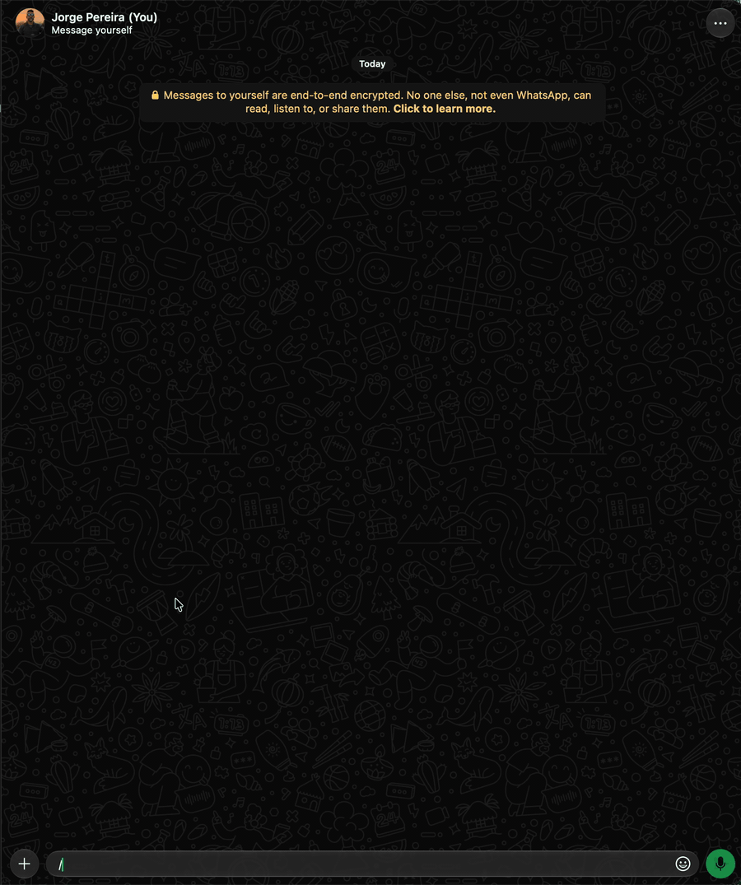

# `/join` · admin

Entra em um grupo do WhatsApp pelo link de convite. Com `-info`, mostra o grupo (nome, participantes
e descrição) sem entrar. Para sair, use o [`/leave`](leave.md).



```text
/join <link do convite>  ou  /join -info|-i <link>  ou  /join -l
```

| Opção | Valor | Descrição |
|---|---|---|
| *(nenhuma)* | `<link do convite>` | O link (`https://chat.whatsapp.com/<código>`, com ou sem `https://`) ou só o código |
| `-info`, `-i` | | Mostra o grupo do convite (nome, participantes e descrição) sem entrar |
| `-list`, `-l` | | Lista os grupos em que você está, numerados (o mesmo que `/leave -l`) |

```text
/join https://chat.whatsapp.com/AbCdEfGhIjKlMnOpQrStUv
✅ Entrei em 👥 Família

/join -i chat.whatsapp.com/AbCdEfGhIjKlMnOpQrStUv
👥 *Família*
👤 12 participantes
📝 Avisos e fotos
💡 _Entre com /join chat.whatsapp.com/AbCdEfGhIjKlMnOpQrStUv_

/join -l
👥 *GRUPOS* (7)

1. 🍕 Pizza de sexta · 9 participantes
2. 📚 Clube do livro · 14 participantes
3. 🏔️ Turma da trilha 2026 · 38 participantes
4. Associação de moradores · 212 participantes
5. Festa surpresa da Ana · 1 participante
6. Amigos antigos
7. Trabalho · 40 participantes

💡 *Dicas*
/join <link> entra
/leave <nº|nome> sai
```

- Sem argumento: o `Usage:` do comando e a dica do `/join -h`.
- Não é um link nem um código: `❌ Link de convite inválido. Ex.: https://chat.whatsapp.com/AbCdEfGhIjKlMnOpQrStUv`.
- Convite inválido, expirado ou revogado: `❌ Convite inválido, expirado ou revogado.`
- Grupos que exigem aprovação de um admin podem recusar a entrada; o motivo do WhatsApp vem na
  resposta (`❌ Não consegui entrar em 👥 <grupo>: <motivo>.`).
