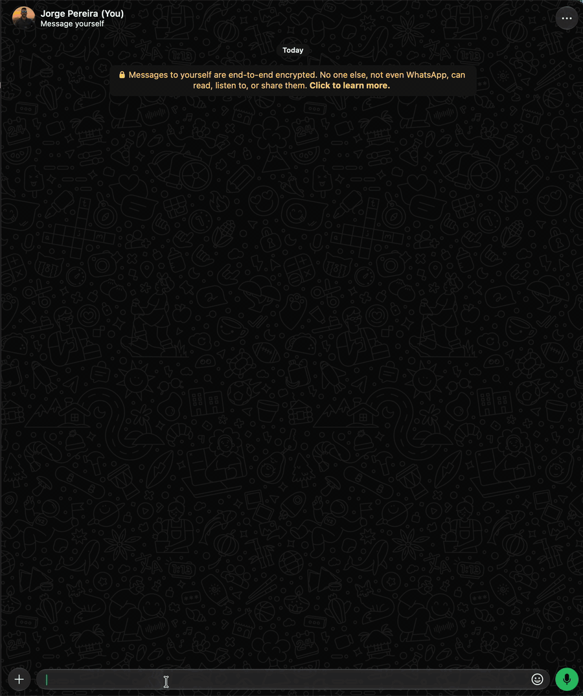

# `/show` · admin

Role `admin`: just you and the extra admins. The owner grants it to a person or group with
`/bot +u +cmd /show` ([Delegating](index.md#delegating-an-admin-command)).
Whoever receives it sees only the current chat: `-l`, `chat` and `-flush` are for the owner and the
extra admins.

With no parameters in a private chat, it lists the cache of all chats, like `/show -l`. In groups,
it redisplays the group's last deleted message.

Redisplays what's still in the cache: deleted messages (`-d`), edited ones (`-e`), deleted statuses
(`-s`) and removed or changed reactions (`-r`). Deleted messages and statuses are kept for 30 days
(setting `cache.revokedRetentionDays`), edited ones also 30 days (setting
`cache.editedRetentionDays`), and reactions, 30 days (setting `cache.reactionRetentionDays`).
Sends are spaced by `show.delayMs` (700 ms) to avoid flooding.

Channel messages (`@newsletter`) are identified with `📰 Channel: <name>`, in the deleted and edited
message notices and in the `/show` redisplay. `/show -l` marks channels with 📰; they can be
selected by name, regex or list number, like the other chats. When the channel can't be queried,
the redisplay uses the saved name. There's no contact name or phone in a channel's items. Statuses
(`status@broadcast`) follow the `-s` filter.

With the private notice turned off (`/set show.alert.deleted off`, `/set show.alert.edited off` or
`/set show.alert.reaction off`), messages are still stored and `/show` redisplays them normally.
With `/set show.alert.status off`, new status deletions are ignored: they don't generate a notice or
enter the deleted list.

| Option | Value | Description |
|---|---|---|
| `-N` | | Quantity (default 1, default limit 20, configurable up to 100 in `show.max`). E.g.: `-3` |
| `chat` | | Another chat: the list number from `-l`, part of the name, `@mention` or `/regex/`. See [The chat](#the-chat) |
| `-deleted`, `-d` | | Deleted messages (with no chat, the default) |
| `-edited`, `-e` | | Edited messages, with the text from before and after. Each edit is an item: a message edited twice shows up twice |
| `-status`, `-s` | | Deleted statuses: in a private chat, the person's; in your private chat, with no chat, everyone's |
| `-reaction`, `-r` | | Removed or changed reactions, with the previous reaction (and the new one, if changed) and the text of the message reacted to. See [Reactions](#reactions) |
| `-all`, `-a` | | The **general history** of the chat, not just the deleted ones. It never dumps a whole chat: it gives the total by month and you go down with the period (`2026-05`, `2026-05-05`, `14h`). `-N` shows the last N, `-q` searches the history and `-f -a -yes` deletes it. See [General history](#general-history--all) |
| `-list`, `-l` | `[chat]` | Lists all chats with content in the cache (in any chat), numbered for `/show <no.>`, marking the current chat with `← this chat`. With a chat (number, name, `@mention` or `/regex/`), only the ones that match. See [List](#list) |
| `-query`, `-q` | `<text\|/regex/flags>` | Searches for the ones that have the text (ignoring case and accents) or that match the regex: in this chat, in the requested chat or, in your private chat, in all of them. Without `-N`: the 5 most recent. See [Search](#search) |
| `-flush`, `-f` | | Removes from the cache the deleted ones of this chat or, with `-e`, `-s`, `-r` or chat, whatever was requested (in your private chat, with no chat: from all chats) |
| `-yes`, `-y` | | With `-flush`: removes **everything** in the scope, not just the deleted ones: deleted, edited, status and reactions, and the media files of the deleted ones and of the status ones. In your private chat, with no chat: from all chats; in another chat or with a chat (`/show -f -y /Maria/`): only that one. Only valid with `-flush` |
| `-mask`, `-m` | | Obfuscates phone numbers in the texts and captions of this run. E.g.: `+55219****44` |

With `/show -mask`, the phone numbers displayed keep the first five and the last two digits. The mask
applies to this run; the data stored in the cache stays complete.

`-d`, `-e`, `-s` and `-r` add up (`/show -d -s` brings deleted ones and statuses). With none of them,
with options but no chat you get only the deleted ones of this chat; with a chat (or in a search in
your private chat), you get everything together, by date.



```text
/show                       → in a private chat, lists the cache; in a group, the last deleted one
/show -5                    → the last 5
/show -2 -e                 → the last 2 edited
/show /^Maria/             → the last one (deleted, edited, status or reaction) of the chat that starts with "Maria"
/show -2 Maria Lucia        → the last 2 of the chat with "Maria Lucia" in the name
/show -5 -d /Carlos$/ → the last 5 deleted of the chat that ends with "Carlos"
/show -3 -e @Jorge     → the last 3 edited of the private chat with Jorge
/show -s Marcio             → Marcio's last deleted status
/show -3 -r Family         → the last 3 removed or changed reactions in the Family group
/show 2                     → from chat #2 of /show -l
/show -l                    → what's in the cache, by chat
/show -l /^Maria/          → the same, only for chats that start with "Maria"
/show -f                    → deletes this chat's deleted ones from the cache
/show -e -f                 → deletes this chat's edited ones from the cache
/show -f Work               → deletes everything from the Work chat from the cache
/show -q refund                → the deleted ones with "refund" (in your private chat: everything, from all chats)
/show -e -q "good morning" -10   → up to 10 edited ones with "good morning"
/show -5 -q /refund|invoice/i   → up to 5 deleted ones that match the regex
/show -5 -m                  → the last 5, with the numbers obfuscated
```

In your private chat, when there's nothing from this chat, the bot suggests the next steps, one per
line:

```text
/show -e
✏️ No edited messages in this chat.
💡 To see the ones from another chat: /show -l and then /show -e -N <chat>
💡 To search in all of them: /show -e -q <text|/regex/>
```

## The chat

The chat comes after the options (`-N` can come before or after it) and is searched among the ones
that have something in the cache, ignoring case and accents:

- **`2`**: the list number from the last `/show -l`. No hyphen: `-2` is the quantity.
- **`Maria Lucia`** or **`"Maria Lucia"`**: the name has all the words; the exact name wins.
- **`/^Maria/`**: a regex on the name (here, the ones that start with "Maria").
- **`@Maria`**: the mention (picked from WhatsApp's `@` list) is the private chat with the person; an
  `@` typed without picking from the list counts as a name.

In a private chat, the statuses are the person's. If more than one chat matches, the bot lists them
and waits for you to reply with just the number (within 2 minutes; with no reply, the list becomes
the notice `⌛ No number chosen…`). It works in any chat.

## Search

`-q <text>` filters by the snippet, ignoring case and accents (for edited ones, by the text from
before or after; for reactions, by the reaction or the text of the message reacted to). With spaces,
it goes in quotes (`-q "good morning"`). The scope is the usual one: this chat, the requested chat or, **in
your private chat, all chats** (and, without `-d`, `-e`, `-s` or `-r`, all types). Without `-N`, you
get the 5 most recent that match; the summary says how many were found in total.

With slashes, it's a JavaScript regex, with flags (`-q /refund|invoice/i`). It tests the text as it came:
without the `i` flag, it's case-sensitive, and accents count. The `g` and `y` flags are ignored.

```text
/show -2 -q refund
♻️ 2 deleted messages with "refund" (the 2 most recent of 4; use -N for more)

/show -5 -q /\bpix\b|invoice/i
♻️ 2 deleted messages with "/\bpix\b|invoice/i"
```

`-q` doesn't combine with `-l` or `-f`. Without the text, or with an invalid regex, the bot warns
you:

```text
/show -q
❌ Say what to search for: /show -q <text|/regex/flags>
💡 With spaces, use quotes: -q "good morning"
```

## List

`-l` shows how many there are of each type and the chats, numbered for `/show <no.>`. The tips at the
end come one per line:

```text
🗄️ Messages in the cache

🗑️ Deleted: 3 (1 with media · the oldest expires in 29 days)
✏️ Edited: 1 (the oldest expires in 30 days)
📸 Status: 1 (the oldest expires in 30 days)
😶 Reactions: 0

1. 👥 Family — 🗑️ 2 (last 9/30/2026, 10:02:11) ← this chat
2. 👤 Beltrano — 🗑️ 1 · 📸 1 (last 9/30/2026, 09:40:05)
3. 👥 Work — ✏️ 1 (last 9/30/2026, 11:15:42)

💡 /show <number, name, @mention or /regex/> shows the ones of a chat: deleted, edited, status and reactions together.
   -d, -e, -s and -r filter
   -N for more (max. 20)
   -l <chat> lists only the matching ones
   -f removes this chat's from the cache (in your private chat: everyone's)
```

With a chat (`/show -l <no., name, @mention or /regex/>`), `-l` shows only the chats that match (all of
them, without asking which one), keeping the number from the full list, and the counts per type
become just theirs. The title shows the chat name when only one matches; with several, what was
typed. With `@mention`, the person's private chat and statuses are included:

```text
/show -l work
🗄️ Messages in the cache of: Work

🗑️ Deleted: 0
✏️ Edited: 1 (the oldest expires in 30 days)
📸 Status: 0
😶 Reactions: 0

3. 👥 Work — ✏️ 1 (last 9/30/2026, 11:15:42)

💡 /show <number, name, @mention or /regex/> shows the ones of a chat: deleted, edited, status and reactions together.
   …
```

## General history (`-all`)

**Even if you delete messages on your phone or on WhatsApp Web, the bot keeps everything.** It saves each
message that arrives (text, and the media in `cache/media`) as soon as it comes, for
`cache.messageRetentionHours` (90 days in this setup; the media, `cache.messageMediaRetentionHours`).
Deleting on your phone doesn't tell the bot anything, so the message stays in the history and `/show -a`
brings it back, with the photo, the voice note or the file. (When the *other person* deletes for everyone,
the bot also notices and marks it `🗑️`: that is `-d`.) What the bot never saw (it was off or disconnected) isn't there.

A chat can have thousands of messages, so `-a` **never dumps the whole chat**: with more messages than
`show.max` (20), it gives the total and the count by month, and you go down with the period, one level at a time.
Every answer ends with the command for the next level.

```text
/show -a /Fulano/
🗄️ History · Fulano
4,213 messages (312 with media), from 2026-08-12 to 2026-11-19

2026-11 · 987 · 🖼️ 60
2026-10 · 1,460 · 🖼️ 112
2026-09 · 1,211 · 🖼️ 98
2026-08 · 555 · 🖼️ 42
💡 To read, repeat with the period: /show -a /Fulano/ 2026-11
   Day: 2026-05-05 (or 05/05/2026, today, yesterday) · month: 2026-05 · hour: 14h
💡 Even if you delete messages on the phone or on WhatsApp Web, the bot keeps the history
(and the media) for 90 days (setting cache.messageRetentionHours): you can recover everything from here.

/show -a /Fulano/ 2026-11
🗄️ Fulano · 2026-11
987 messages (60 with media)

2026-11-19 · 41 · 🖼️ 3
2026-11-18 · 63 · 🖼️ 5
…
💡 To read, repeat with the period: /show -a /Fulano/ 2026-11-19

/show -a /Fulano/ 2026-11-19
🗄️ Fulano · 2026-11-19
41 messages (3 with media)

21h · 15 · 🖼️ 1
14h · 22 · 🖼️ 2
09h · 4
💡 To read, repeat with the period: /show -a /Fulano/ 2026-11-19 14h

/show -a /Fulano/ 2026-11-19 14h
💬 22 messages · Fulano · 2026-11-19 14h
💬 MESSAGE (1/22)
…            (the messages, with the media, from the oldest to the newest)
```

- **Period:** a month (`2026-11` or `11/2026`), a day (`2026-11-19`, `19/11/2026`, `19/11`, `today`,
  `yesterday`) and, together with a day, the hour (`14h` or `14:00`). The days and hours are those of
  São Paulo. The bot always writes the date as year-month-day, so there's no mix-up between month and day.
- **Few messages:** when the month, the day or the whole chat has up to `show.max` messages, they come out
  directly. `/show -a /Fulano/ yesterday` shows yesterday's if it's few, or the hours if not.
- **Parts:** an hour with more than `show.max` messages comes in parts: `… 14h` (part 1/3), `… 14h p2`, `… 14h p3`.
- **The last ones:** `/show -a -5 /Fulano/` shows the last 5 messages; with a period, the last 5 of it.
- **Search:** `-q` searches the text (and the transcriptions of the voice notes already made) and gives the
  same by-month summary only for what matches: `/show -a -q invoice /Fulano/`, then `… 2026-10`, and so on.
- **Without a chat:** in a group, the group's history; in your private chat, it lists the chats with history
  (`/show -a`) or, with a period, covers all of them (`/show -a yesterday`).
- **Delete:** `/show -f -a /Fulano/ 2026-05 -yes` deletes the messages of that period (and their media files).
  Without `-yes`, it only says how many would go. Without a period, it's the whole history of the chat.
- Statuses aren't in the history (see `-s`), and `-a` doesn't combine with `-d`, `-e`, `-s`, `-r` and `-l`.

```text
/show -a                         → in your private chat: the chats with history
/show -a /Fulano/                → by month
/show -a /Fulano/ 2026-11-19     → the hours of the day (or the messages, if few)
/show -a -10 /Fulano/            → the last 10
/show -a -q boleto               → searches in the chat where you typed it
/show -a /Family/ today          → today's of the group
/show -f -a /Fulano/ 2026-05     → says how many would go
/show -f -a /Fulano/ 2026-05 -y  → deletes May's (messages and media files)
```

## Output examples

With a chat and without `-d`, `-e`, `-s` or `-r`, the summary counts each type:

```text
/show -5 Beltrano
🗄️ 2 messages (🗑️ 1 · 📸 1) (asked for 5, found 2)
💬 Chat: Beltrano
```

The **Name** is the contact's name in your address book; only people who aren't in it show up with
their own profile name (the one the person chose). The bot records the name at the moment the
message arrives, so the ones already stored stay as they were.

An edited message redisplayed with `-e`:

```text
✏️ EDITED MESSAGE (1/1)

👥 Group: Work
👤 Name: Fulano
📱 Number: +5521999999999
📅 Sent at: 9/30/2026, 11:14:03
✏️ Edited at: 9/30/2026, 11:15:42
📝 Before: "meeting at 2pm"
💬 After: "meeting at 3pm"
```

## Reactions

WhatsApp only notifies the new reaction from whoever reacted. That's why the bot stores each
person's current reaction on each message and, when it's **removed** or **changed** to another one,
it stores the previous one for `/show -r` and notifies you in your private chat (turn it off with
`/set show.alert.reaction off`; the reaction is still stored). Your own reactions and channel
reactions (which are anonymous) are ignored. A reaction made before the bot was running doesn't
generate anything when removed: the bot doesn't know what it was.

The text of the message reacted to comes from the cache, as it was at the time; if it had already
left the cache, the notice says `(not in the cache)`. Each change is an item: changing twice generates
two.

The mentions in the text (`@265472113143884`, WhatsApp's internal id) come out with the **name**:
the one in your address book, the profile name for someone who isn't in it, or the phone number.
This also applies to the deleted and edited message alerts and to `/show`; the database keeps the
original text plus the ids of the mentions (`messages.mentions`, from the message itself), and the
name is looked up when displaying. An edit that mentions new people adds their ids too. Messages saved before this have no ids: when the bot connects, it fills them in from the group
members (the most recent 5000, once); whoever is not found keeps the old guess, trying the number as
both an internal id and a phone.

```text
😶 REACTION REMOVED DETECTED

👥 Group: Family
👤 Name: Fulano
📱 Number: +5521999999999
📅 Reacted at: 9/30/2026, 11:14:03
🗑️ Removed at: 9/30/2026, 11:15:42
😶 Reaction: 😂
💬 On the message: "the boss will love it"
```

When changed, the title and the reaction line show both:

```text
🔄 REACTION CHANGED (1/1)

…
🔄 Changed at: 9/30/2026, 11:15:42
😶 Reaction: 👍 → ❤️
💬 On your message: "I arrive at 8"
```

To stop receiving notices from someone (or from a group), use [`/mute -r`](mute.md).
