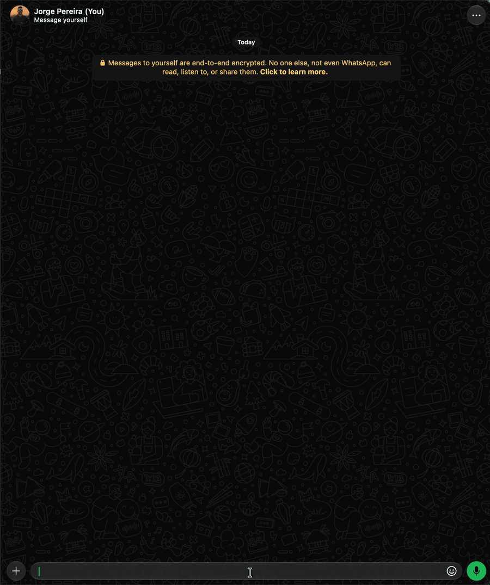
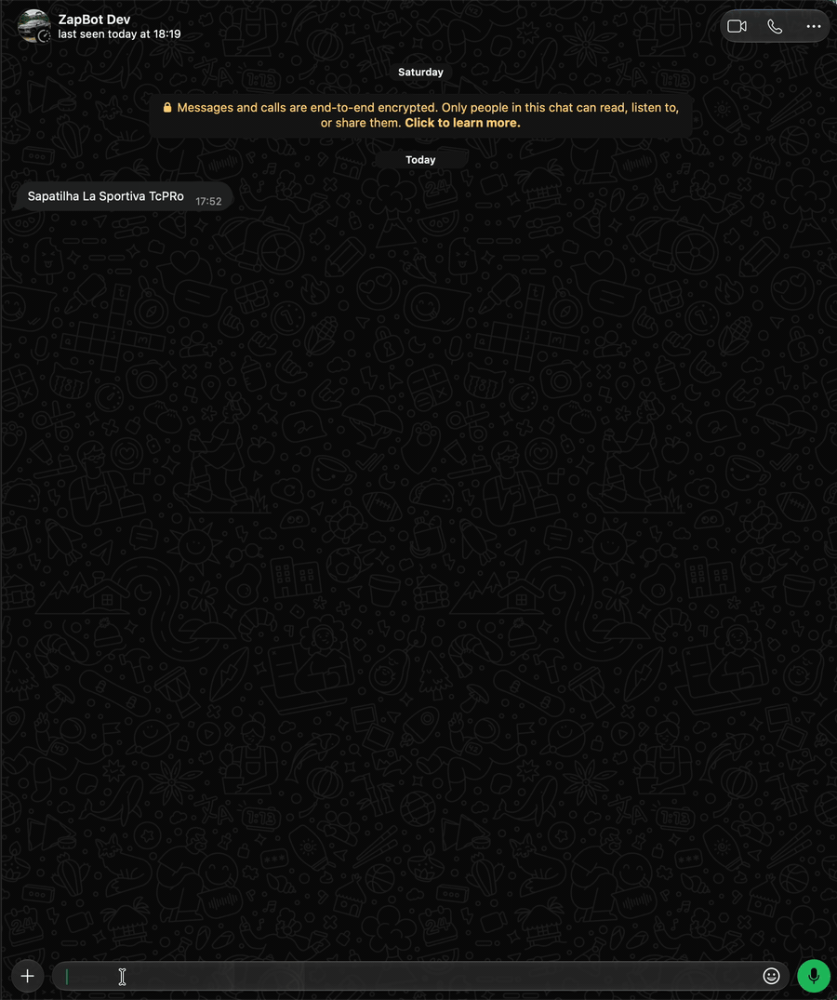

# Demonstração

O bot funcionando de verdade, no WhatsApp, com comandos reais.

## Aquecimento

`/ping`, `/version` e `/help` · [documentação](commands/help.md)

## /show

Reexibe o que foi apagado · [documentação](commands/show.md)

## /monitor

Quem está online · [documentação](commands/monitor.md)

## /join e /leave

Entrar e sair de grupos · [documentação](commands/join.md)

## /sticker

Figurinhas, inclusive de texto · [documentação](commands/sticker.md)

## /get

Baixar vídeos · [documentação](commands/get.md)

## /crypto

Cotações · [documentação](commands/crypto.md)

## /cron

Agendar mensagens · [documentação](commands/cron.md)

## /watch

Vigiar mensagens · [documentação](commands/watch.md)

## /stats

Estatísticas do chat · [documentação](commands/stats.md)

## /batch e /alias

Vários comandos de uma vez · [documentação](commands/batch.md)

## Bobagens

