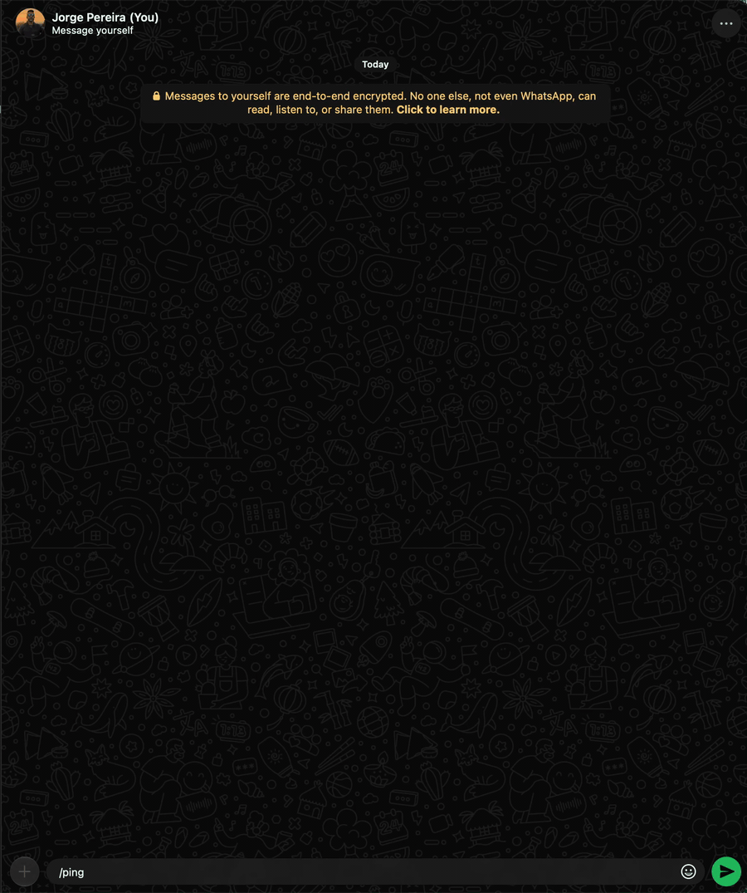
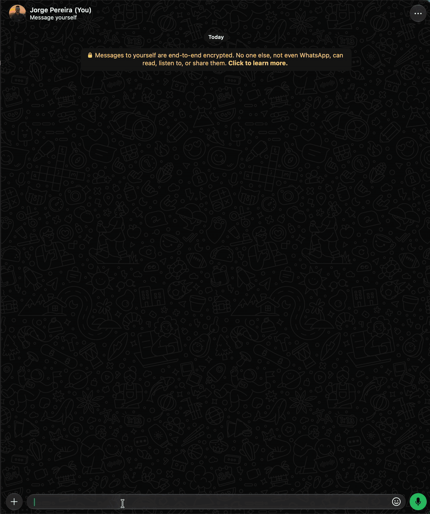
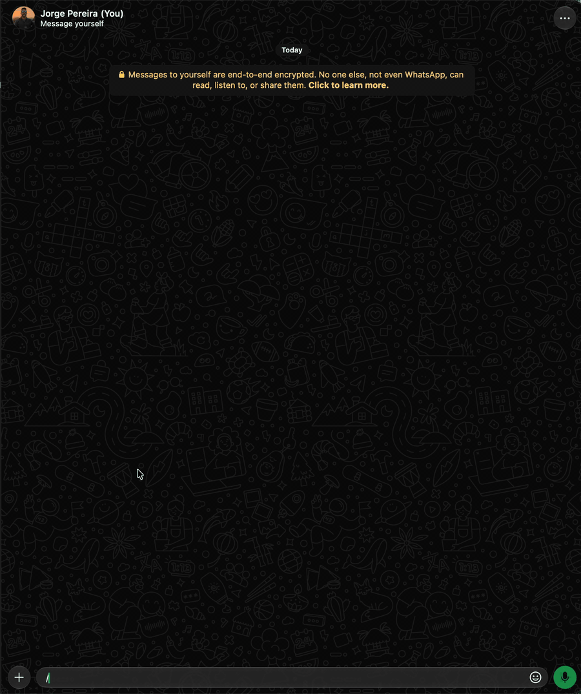
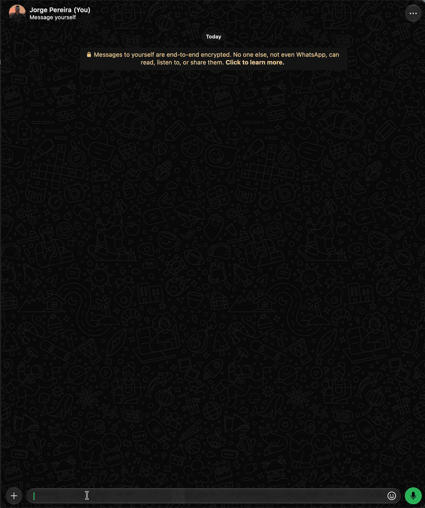
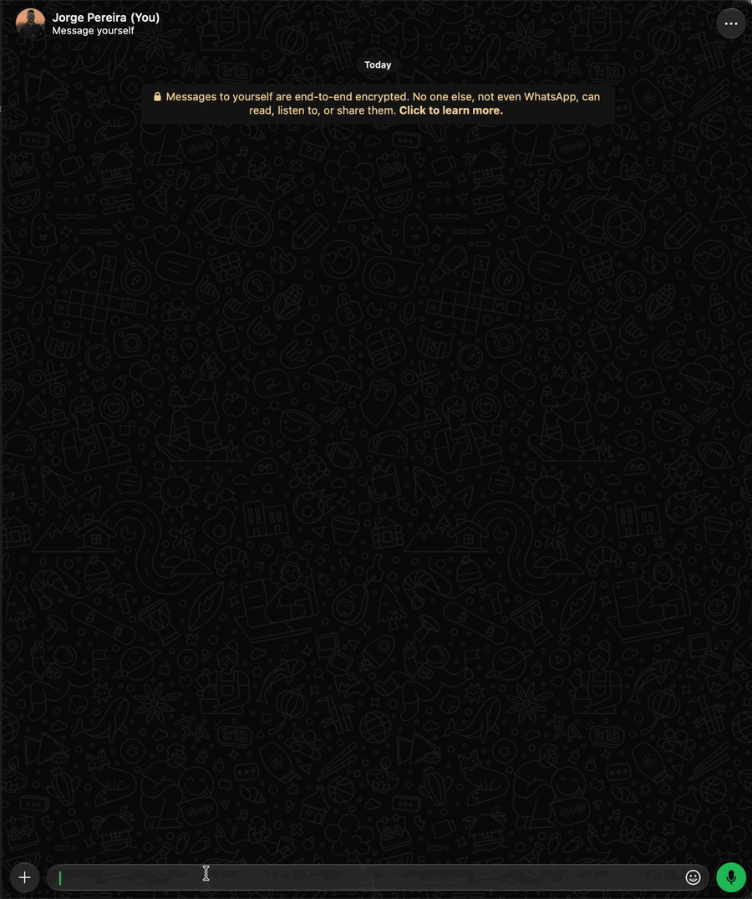
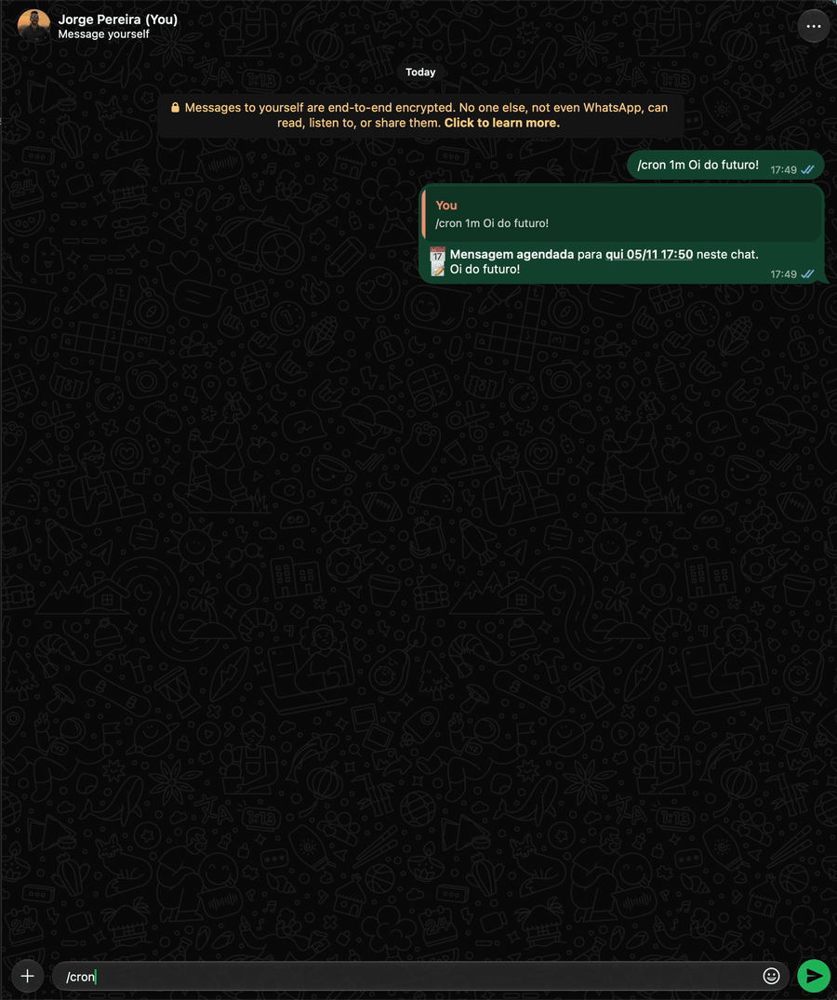
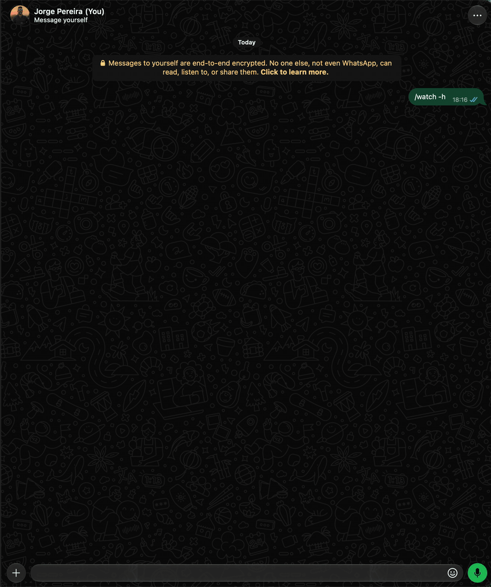
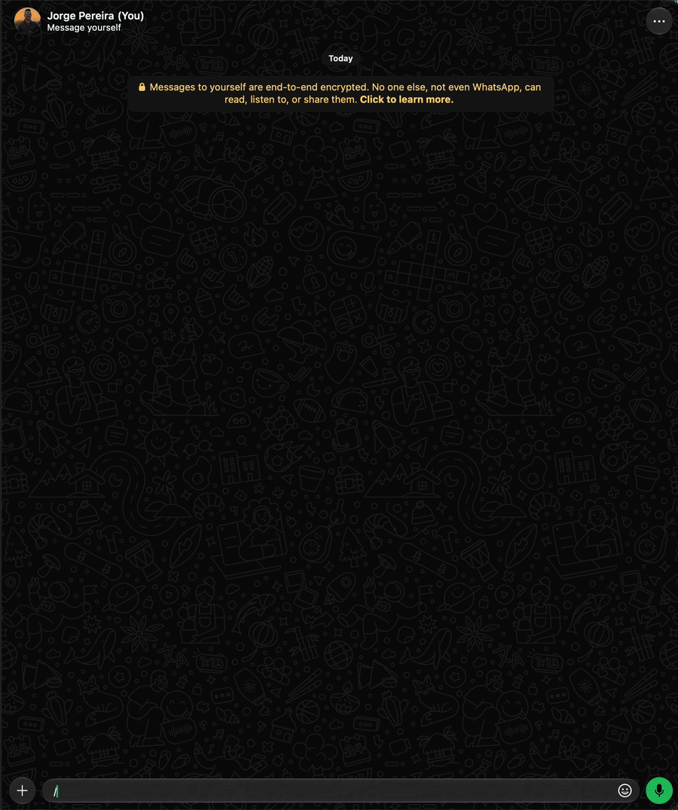
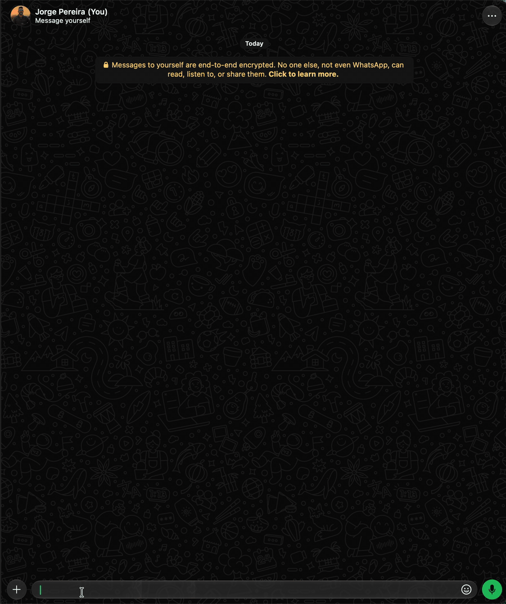

# Demo

The bot working for real, on WhatsApp, with real commands.

## Warm-up

`/ping`, `/version` and `/help` · [documentation](commands/help.md)

## /show

Shows again what was deleted · [documentation](commands/show.md)

## /monitor

Who's online · [documentation](commands/monitor.md)

## /join and /leave

Join and leave groups · [documentation](commands/join.md)

## /sticker

Stickers, including text ones · [documentation](commands/sticker.md)

## /get

Download videos · [documentation](commands/get.md)

## /crypto

Quotes · [documentation](commands/crypto.md)

## /cron

Schedule messages · [documentation](commands/cron.md)

## /watch

Watch messages · [documentation](commands/watch.md)

## /stats

Chat statistics · [documentation](commands/stats.md)

## /batch and /alias

Several commands at once · [documentation](commands/batch.md)

## Silly stuff

