# Demonstração

O bot funcionando de verdade, no WhatsApp, com comandos reais.

## Aquecimento

`/ping`, `/version` e `/help` · [documentação](comandos/help.md)

[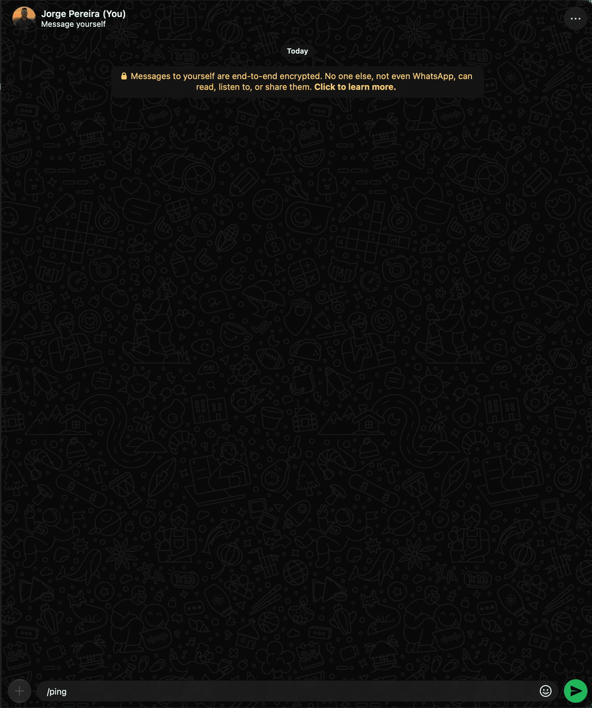](assets/demo/01-aquecimento.gif)

## /show

Reexibe o que foi apagado · [documentação](comandos/show.md)

[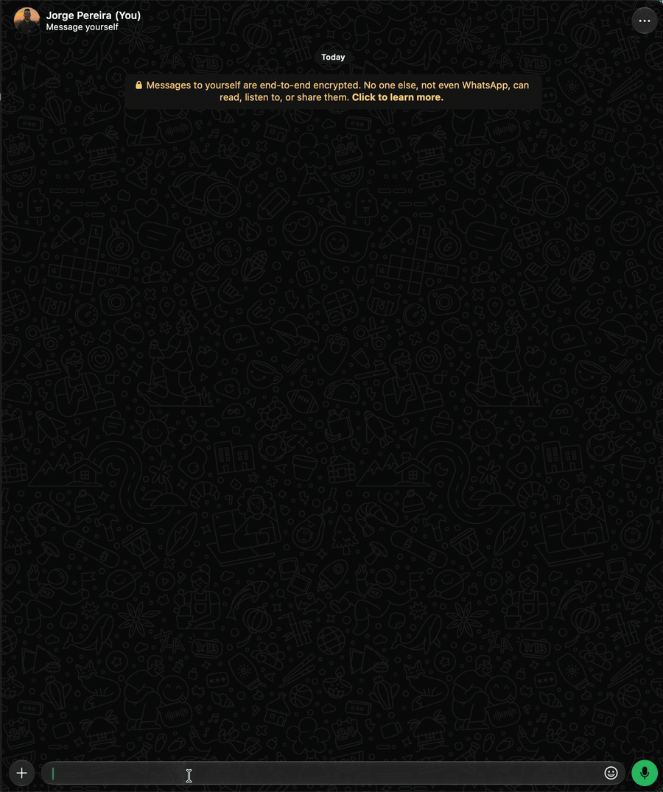](assets/demo/02-show.gif)

## /monitor

Quem está online · [documentação](comandos/monitor.md)

[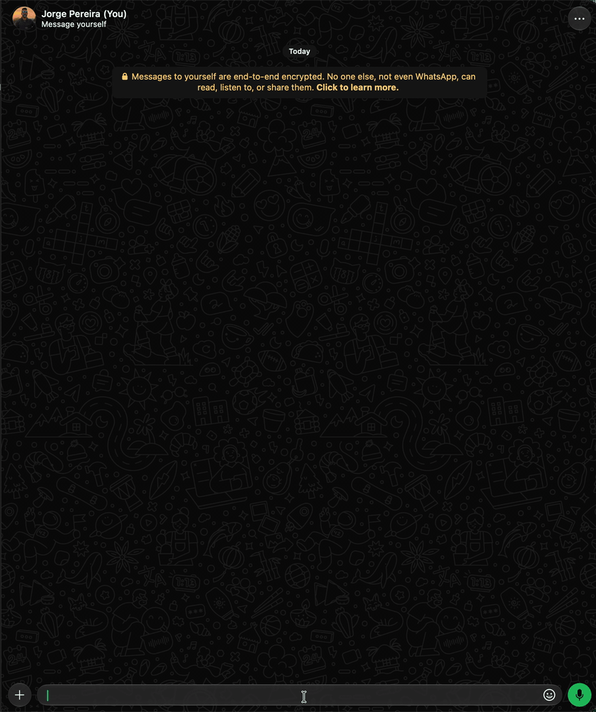](assets/demo/03-monitor.gif)

## /join e /leave

Entrar e sair de grupos · [documentação](comandos/join.md)

[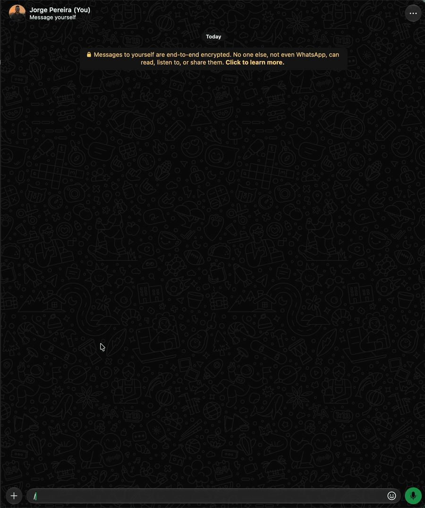](assets/demo/04-join-leave.gif)

## /sticker

Figurinhas, inclusive de texto · [documentação](comandos/sticker.md)

[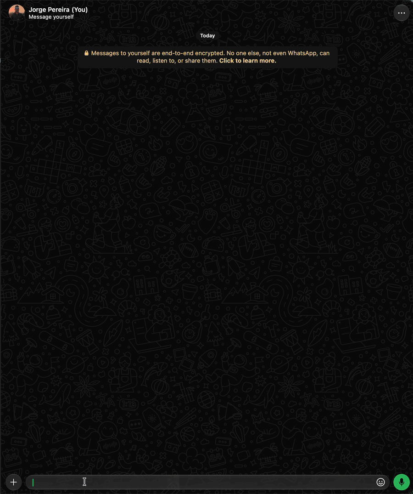](assets/demo/05-sticker.gif)

## /get

Baixar vídeos · [documentação](comandos/get.md)

[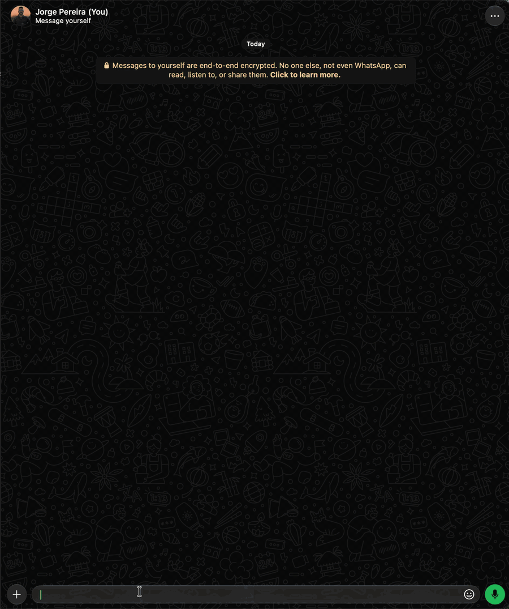](assets/demo/06-get.gif)

## /crypto

Cotações · [documentação](comandos/crypto.md)

[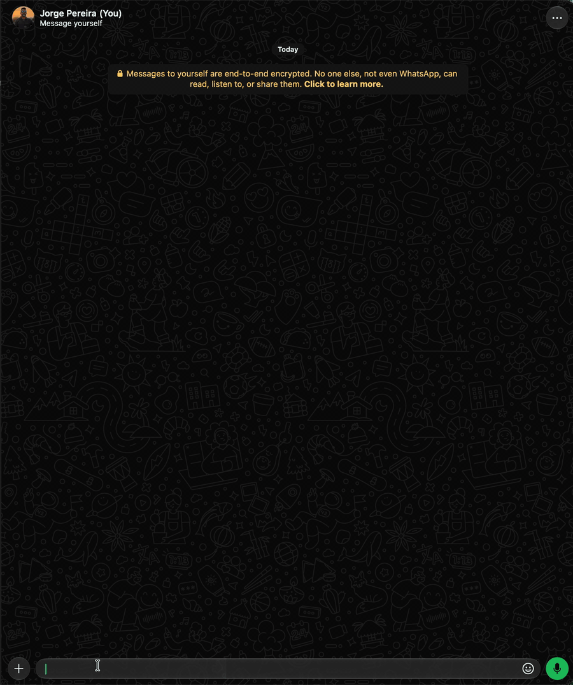](assets/demo/07-crypto.gif)

## /cron

Agendar mensagens · [documentação](comandos/cron.md)

[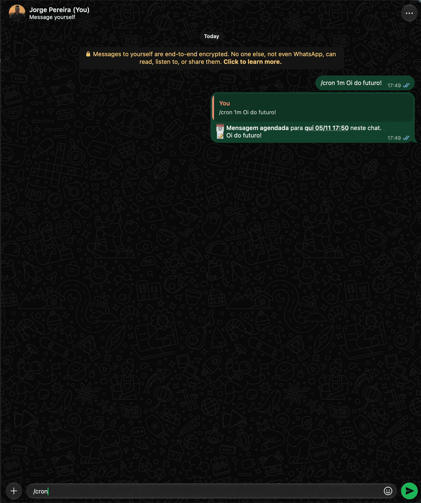](assets/demo/09-cron.gif)

## /watch

Vigiar mensagens · [documentação](comandos/watch.md)

[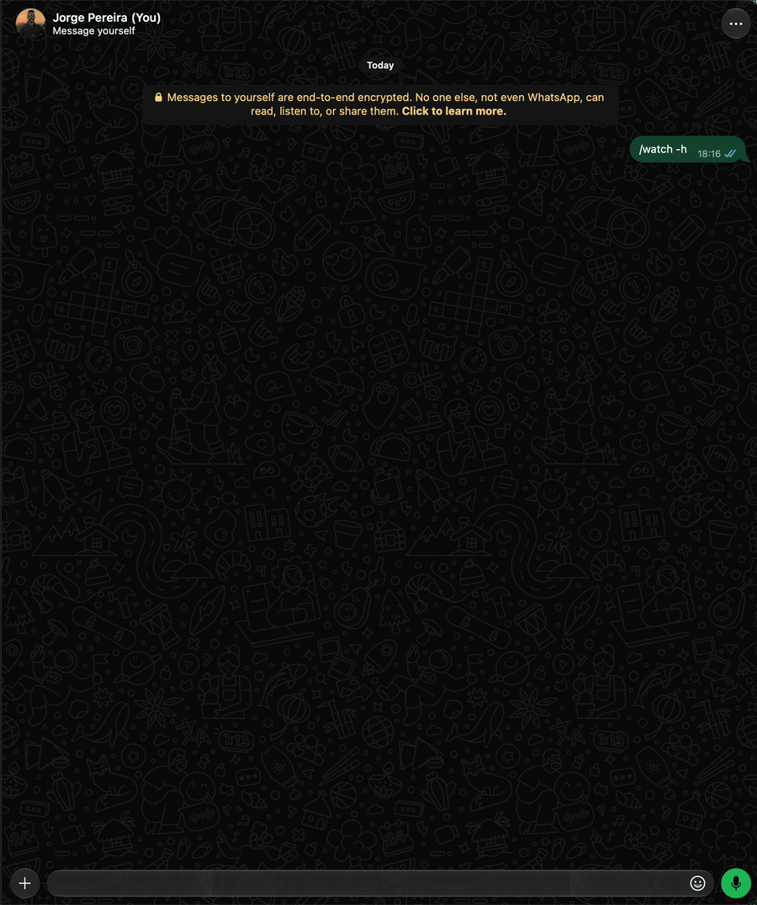](assets/demo/10-watch.gif)

## /stats

Estatísticas do chat · [documentação](comandos/stats.md)

[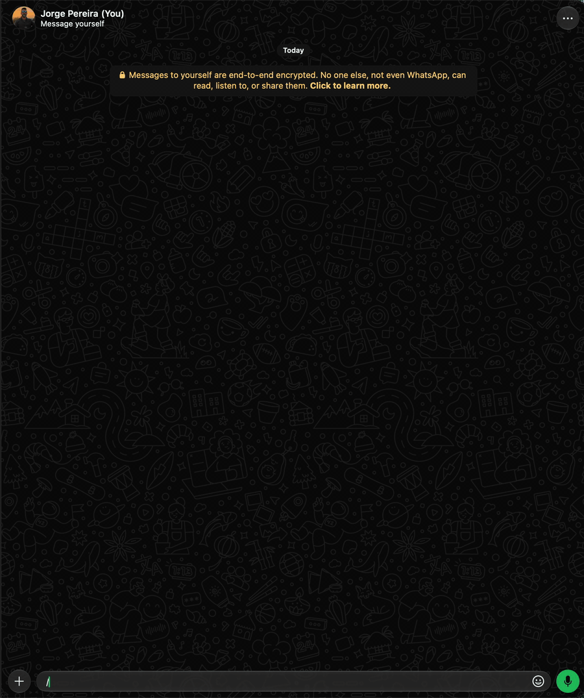](assets/demo/11-stats.gif)

## /batch e /alias

Vários comandos de uma vez · [documentação](comandos/batch.md)

[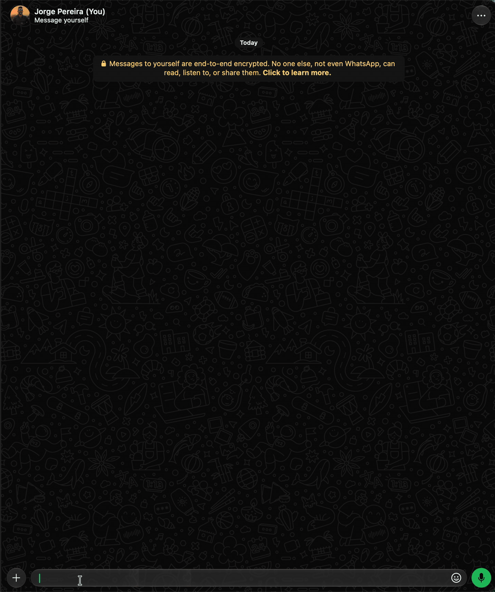](assets/demo/12-batch-alias.gif)

## Bobagens

[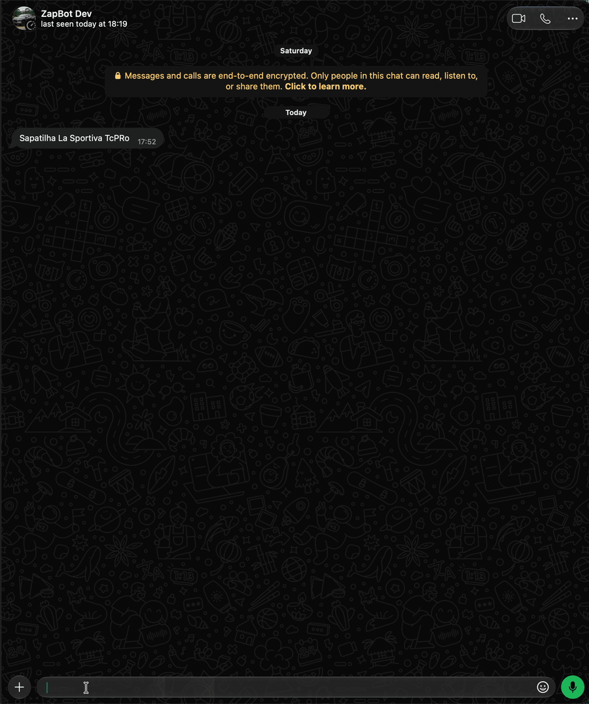](assets/demo/13-bobagens.gif)
