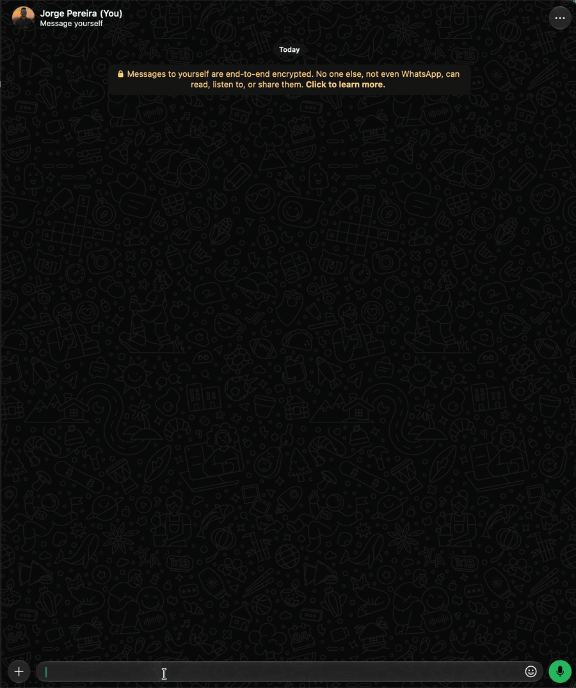
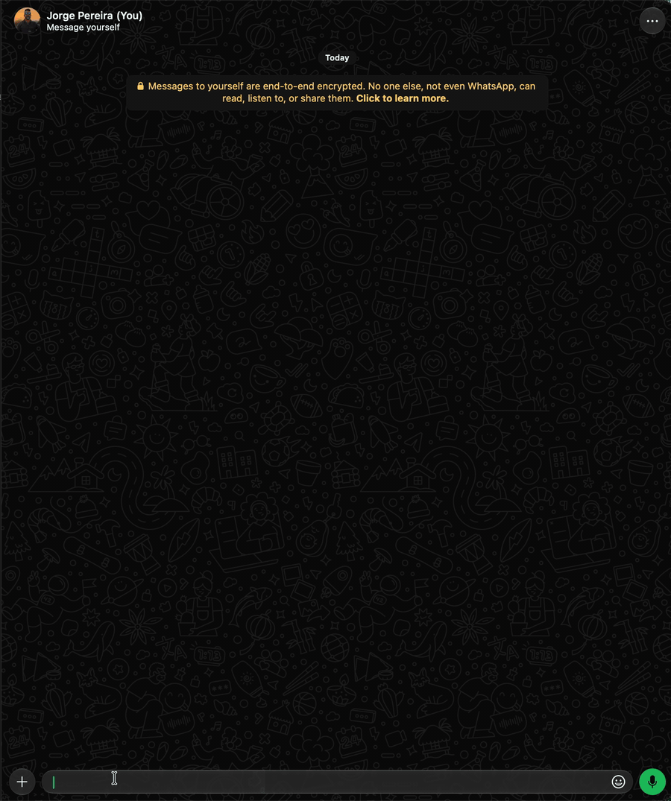
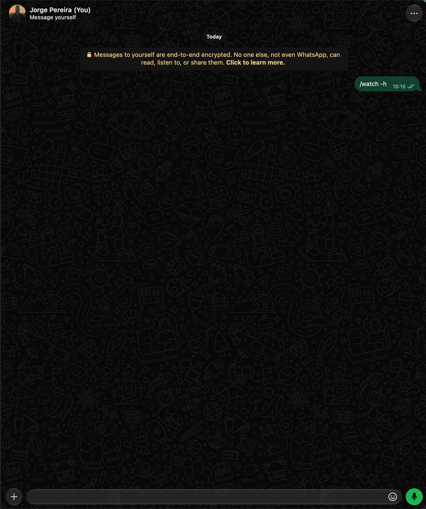

<p align="center">
  
</p>

# ZapBot

[](https://github.com/jpereira/zapbot/actions/workflows/ci.yml)

> 🇧🇷 **Leia em português (pt_BR): [Português](https://jpereira.github.io/zapbot/pt-BR/).**

A WhatsApp bot written in Node.js that runs on top of a real WhatsApp Web session. It recovers
deleted and edited messages (and statuses), downloads videos from social networks, creates stickers,
watches messages by text/regex and alerts you in your private chat, brings news, weather and CVEs,
talks to ChatGPT and a few more fun things, all through commands typed in the chat itself (`/help`,
`/get`, `/show`, `/news`, `/gpt`...).

Persistent shortcuts (`/alias`) save a command with its arguments under a name you choose, with an
optional description:

```text
/alias dimdim -desc "Shows the dollar price" /rates USD     → registers the shortcut
/dimdim                                                     → runs /rates USD
/help alias                                                 → lists your shortcuts
```

The bot shows the command that was called before the result. A shortcut can also chain several
commands in one text, as in `/cron`:

```text
/alias carteira Orca {/defi orca}\n Prjx {/defi prjx}
```

The idea comes from the old IRC days: ZapBot is inspired by the old
[eggdrops](https://www.eggheads.org/), the bots that stood watch in channels, answering commands,
keeping track of what happened and looking after the place. Here the channel is the WhatsApp group,
and commands start with `/`.

## Demo

<p align="center">
  <a href="assets/demo/01-aquecimento.gif" target="_blank" rel="noopener"></a>
  <a href="assets/demo/02-show.gif" target="_blank" rel="noopener"></a>
  <a href="assets/demo/03-monitor.gif" target="_blank" rel="noopener"></a>
  <a href="assets/demo/05-sticker.gif" target="_blank" rel="noopener"></a>
  <a href="assets/demo/07-crypto.gif" target="_blank" rel="noopener"></a>
  <a href="assets/demo/10-watch.gif" target="_blank" rel="noopener"></a>
</p>

`/ping`, `/show`, `/monitor`, `/sticker -txt`, `/crypto` and `/watch`. All scenes in
[Demo](demonstracao.md).

**Main features:**

- Recovers deleted or edited messages and statuses, and removed reactions: [`/show`](comandos/show.md)
- 👀 Monitors up to 5 contacts, with a configurable interval and a limited history of observed
  last-seen times and online alerts: [`/monitor`](comandos/monitor.md)
- Downloads videos with yt-dlp and ffmpeg: [`/get`](comandos/get.md)
- Creates stickers: [`/sticker`](comandos/sticker.md)
- Watches messages by text or regex: [`/watch`](comandos/watch.md)
- Schedules messages: [`/cron`](comandos/cron.md)
- Stores notes, with `#tag`, images and an alert at a date/time: [`/notes`](comandos/notes.md)
- Runs several commands in a single message: [`/batch`](comandos/batch.md)
- Shows prices and price alerts: [`/rates`](comandos/rates.md),
  [`/crypto`](comandos/crypto.md)
- Tracks DeFi positions (Orca, Project X, Liquidswap, Morpho, Aave V3): [`/defi`](comandos/defi.md)
- Integrates ChatGPT: [`/gpt`](comandos/gpt.md), [`/tldr`](comandos/tldr.md),
  [`/draw`](comandos/draw.md) (images and GIFs)
- Looks up CVEs, news and weather: [`/cve`](comandos/cve.md), [`/news`](comandos/news.md),
  [`/weather`](comandos/weather.md)
- Backs up the database: [`/backup`](comandos/backup.md)
- Controls permissions per user and group, with flood protection:
  [`/bot`](comandos/bot.md)

Where to start:

- [Installation](instalacao.md): requirements, installing from the latest release, and updating.
- [Configuration](configuracao.md): `config/.env`, API keys and email.
- [Commands](comandos/index.md): all commands, with options and examples.
- [Operation](operacao.md): day-to-day use, container health and troubleshooting.

## How it works

```text
 ┌────────────── container zapbot (node:24-trixie-slim) ──────────────┐
 │                                                                    │
 │  app.js ──► whatsapp-web.js ──► Puppeteer ──► Chromium             │──► WhatsApp Web
 │    │                                          (headless)           │
 │    ├──► SQLite  (cache/zapbot.db)  messages, settings              │
 │    ├──► cache/media  media to recover deleted messages             │
 │    ├──► yt-dlp + ffmpeg  the /get command                          │
 │    ├──► HTTP APIs (axios)  /gpt /weather /cve /news /giphy ...     │
 │    └──► SMTP (nodemailer)  QR Code and email alerts                │
 │                                                                    │
 │ volumes:  wwebjs_auth  → WhatsApp session (.wwebjs_auth)           │
 │           app_cache    → SQLite database + media (cache/)          │
 └────────────────────────────────────────────────────────────────────┘
```

- **WhatsApp session**: [`whatsapp-web.js`](https://github.com/wwebjs/whatsapp-web.js) opens
  WhatsApp Web in a headless Chromium and pairs with your phone as a *linked device*. The session
  is saved in the `wwebjs_auth` volume, so the QR Code only needs to be read the first time (or
  when the session is revoked). The library version is pinned in `package-lock.json` for
  reproducible installs. Local tweaks live in `patches/` and are applied by
  `scripts/aplicar-patches.js` during installation, using `git apply`.
  To install outside Docker: `PUPPETEER_SKIP_DOWNLOAD=true npm install`.
- **Bot number = your number**: the bot acts as the account that read the QR Code. Messages that
  *you* send (from any device) also go through the bot.
- **Persistence**: every received message is written to SQLite (media goes to `cache/media`).
  When someone deletes a message "for everyone", the bot finds the copy in the database and resends
  it **to your private chat** (the chat with yourself; turn the alert off with
  `/set show.alert.deleted off`, the message stays stored). Deleted messages are kept for 30 days
  (setting `cache.revokedRetentionDays`) and can be redisplayed with `/show`. Deleted statuses
  (texts/photos/videos) are also recovered, with the title `📸 DELETED STATUS DETECTED` and
  redisplayed with `/show -s`. With `/set show.alert.status off`, new status deletions are ignored:
  they neither generate an alert nor enter the deleted list.
- **Edited**: when someone edits a message, the bot stores the text from before and after (table
  `message_edits`) and alerts you **in your private chat** with the title
  `✏️ EDITED MESSAGE DETECTED` (turn the alert off with `/set show.alert.edited off`; the edit
  stays stored). Edits are kept for 30 days (setting `cache.editedRetentionDays`) and can be
  redisplayed with [`/show -e`](comandos/show.md). Your own edits are ignored.
- **Reactions**: when someone removes a reaction (or swaps it for another), the bot alerts you **in
  your private chat** with the title `😶 REACTION REMOVED DETECTED` (or
  `🔄 REACTION CHANGED DETECTED`), with the previous reaction and the text of the message that was
  reacted to (turn the alert off with `/set show.alert.reaction off`; the reaction stays stored).
  They are kept for 30 days (setting `cache.reactionRetentionDays`) and can be redisplayed with
  [`/show -r`](comandos/show.md#reactions).
- **Muting**: [`/mute`](comandos/mute.md) cuts the alerts for deleted, edited, status and reaction
  events from a person, a group or a community (the message stays stored); when you reply to an
  alert, it mutes where it came from. Someone who is muted also doesn't generate a `/watch` alert in
  your private chat. [`/unmute`](comandos/unmute.md) undoes it.
- **Automatic cleanup**: every 10 minutes the bot removes from the database/disk regular messages
  older than 68 h (the maximum window WhatsApp allows for deleting; the text is kept longer with
  `cache.messageRetentionHours` and the media with `cache.messageMediaRetentionHours`), deleted and
  edited ones, and reactions older than 30 days, `/watch` hits older than 30 days (setting
  `watch.hitsRetentionDays`), `/stats` counters older than 90 days (setting `stats.retentionDays`),
  polls older than 90 days (setting `enquete.retentionDays`) and alerts skipped by `/mute` older
  than 30 days.
- **Contact monitor**: [`/monitor`](comandos/monitor.md) checks up to five people, one at a time,
  in random order and waiting 1 to 15 seconds between checks. The minimum interval per person is
  five minutes by default (`monitor.pool`). It keeps up to 30 distinct timestamps per person
  (`monitor.maxRecords`) in the `monitor_contacts` and `monitor_history` tables. `/monitor` and
  `/monitor -l` show the observed history; `/monitor -l /Maria/` filters one person.
  `/monitor -add /Maria/ -alerta` or `/monitor -alerta /Maria/` enables online alerts in the bot
  owner's private chat, once per observed transition. `/monitor -rm all` clears the local
  registrations and histories. `/set monitor.enabled false` pauses the checks without deleting data.
  Timestamps may come from the cache and aren't confirmed; there is no guarantee that every access
  is recorded or that WhatsApp won't block the account.
- **Statistics**: each new message (and each deleted/edited one) adds 1 to a counter per chat, day,
  hour and sender (table `stats`), used by [`/stats`](comandos/stats.md). Numbers only, no text;
  they are kept for 90 days (setting `stats.retentionDays`). Bot replies, your private chat and
  statuses are not counted. Turn it off with `/set stats.enable off`.
- **Price alerts**: `/rates -alerta USD > 5.30` and `/crypto -alerta BTC < 90000` store the rule
  in the `price_alerts` table; every 5 minutes (setting `alerta.intervalMin`) the bot checks the
  prices and alerts **your private chat** (or, with one or more `-to`, contacts, groups, numbers or
  email) when the rule is met; with `-msg`, a text of yours goes at the start of the alert. See
  [Price alerts](comandos/rates.md#price-alerts).
- **Notes**: [`/notes`](comandos/notes.md) stores texts (and media: image, document, audio, video) in the
  `notes` table, each with an ID and, if you want, a `#tag` (tag descriptions live in
  `note_tags`). `-alerta` alerts about a note at a date/time (once; the note stays), in your
  private chat or at the `-to` destinations, with one check per minute.
- **DeFi**: [`/defi`](comandos/defi.md) reads on-chain the registered liquidity positions on Orca,
  Project X and Liquidswap (by wallet) (table `defi_positions`) and, with `-alerta`, checks every 10
  minutes (setting `defi.alerta.intervalMin`) and alerts (in your private chat or at the `-to`
  destinations) when a position leaves the range, when it comes back and, with `-taxas`, when the
  fees to collect pass a value. `/defi morpho` and `/defi aave` show a wallet's position, loans and
  risk on Morpho (through the official API) and on Aave V3 (in the contracts, on-chain).
- **Polls**: the votes of your account's polls (`vote_update` event) go to the `polls` and
  `poll_votes` tables, and [`/poll -r`](comandos/poll.md#result) shows the tally. They are
  kept for 90 days (setting `enquete.retentionDays`).
- **Schedule**: the reminders and messages of [`/cron`](comandos/cron.md) live in the `schedules` table; every 30 s the bot sends what is due (repeating ones
  move on to the next time). A `{/command}` in the text runs at send time and its reply takes its
  place.
- **Daily status**: with [`/bot -status 06h`](comandos/bot.md#bot-status), a report of the last
  24 h (uptime, cache, watch, deleted, edited, `/mute`) arrives in your private chat every day.
- **Backup**: every day, at 3 am (setting `backup.hour`), the bot stores a compressed copy of the
  database in `cache/backups`; [`/backup`](comandos/backup.md) also sends the daily backup to the
  `backup.to` destination, when set. The command lists, restores and sends the files (to your
  private chat, by email or, with one or more `-to`, to other chats).
- **Watch**: messages received from other accounts, outside recognized commands, are tested against
  the [`/watch`](comandos/watch.md) rules (setting `watch.rules`); on a match, the hit is stored in
  the `watch_hits` table and you are alerted **in your private chat** (or at the rule's `-to`
  destinations: other chats or emails). Someone muted with `/mute` doesn't generate the private
  alert; the hit is stored all the same.
- **Settings (`settings`)**: general settings that can change at runtime (debug, `/crypto` coins,
  limits...) live in the generic SQLite `settings` table (`key` → `value` in JSON) and are changed
  with [`/set`](comandos/set.md). At boot the defaults are written, if they don't exist yet, and
  everything is loaded into memory. See [Settings](settings.md).
- **Language**: the `zapbot.lang` setting (`en_US`, the default, or `pt_BR`) picks the language of
  the help, the replies, the alerts, the errors, and the dates and numbers. See
  [Language](configuracao.md#language).
- **Commands**: defined in
  [`src/comandos/definicoes/`](https://github.com/jpereira/zapbot/tree/main/src/comandos/definicoes)
  (name, aliases, options, help, permission) and implemented in `src/comandos/` (one file per
  command; see [Code structure](desenvolvimento.md#code-structure)). The ones that query the
  internet (`/gpt`, `/weather`, `/cve`, `/news`...) use the services in the
  [External services](configuracao.md#external-services) table.
- **Control**: [`/bot`](comandos/bot.md) shows the status (the 24 h report and the users), turns all
  commands on/off (`-on`/`-off`) and says who can use the bot: you, the
  [extra admins](comandos/bot.md#extra-admins) (`+a`/`-a`) and the
  [users](comandos/bot.md#users) (`+u`/`-u`: people and groups, with each one's commands limited
  by `+cmd`/`-cmd`, and with delegated `admin` commands, if you want); `-reset` goes back to the
  default, `-status 06h` sends the report every day (to your private chat, other chats or by
  email), `-info` shows the versions of what the bot uses and `-test` checks cache, disk, database,
  WhatsApp, internet, SMTP, IMAP and programs. Anyone who isn't an admin gets
  [flood protection](comandos/bot.md#flood-protection). [`/whois`](comandos/whois.md) tells
  each person's level in the chat.
- **Reconnection**: on an outage the client restarts by itself, except when the reason requires
  manual action (`LOGOUT`, `CONFLICT`, `UNPAIRED`...). Without internet, it retries, with
  increasing wait, until it connects ([Internet outage](operacao.md#internet-outage)).
- **Health (heartbeat)**: every 30 s the bot checks that WhatsApp Web is responding and writes
  `/tmp/zapbot-heartbeat.json`; Docker's `HEALTHCHECK` marks the container as `unhealthy` if the
  file stops being updated. See [Container health](operacao.md#container-health-heartbeat).
- **Startup notice**: when it's ready, the bot sends
  `🤖 ZapBot <version> (git+<commit>/<tag or HEAD>) started.` to `PHONE_NUMBER` (the commit is
  the one of the code that's running; see [`/version`](comandos/version.md)).
- **Email alerts**: crash, outage, reconnection, authentication failure and other events also go by
  email, through the same SMTP as the QR Code (see [Email alerts](emails.md#email-alerts)).
  Enabled by default (setting `email.alerts`).
