# Web interface

The bot can serve a **web interface** (off by default) to look at, and to manage, what it keeps: the history of every
chat in the style of WhatsApp Web (with the **deleted** and the **edited** messages highlighted), the notes, the
alerts, the shortcuts, the schedule, charts of your conversations and the settings.

!!! danger "It shows every message of your account"
    Whoever signs in reads everything the bot has stored. Use a long password, keep the interface on
    `127.0.0.1` (the default) and, to open it to the network, put an **HTTPS reverse proxy** in front.

All the pictures on this page are made with **invented data** (names, numbers and messages do not exist), in the
dark theme unless it says otherwise. The interface follows the `zapbot.lang` setting (English or Portuguese) and the
button at the bottom of the left bar switches it; the Portuguese page of this manual has the same pictures in Portuguese.

Use [`/web`](commands/web.md) in your private chat to manage access, sessions and 2FA.

## Quick start

```text
/set zapbot.web.login jorge.admin
/set zapbot.web.password a-long-password-here
/set zapbot.web.enabled on
```

Restart the bot: the interface starts with it, on `http://127.0.0.1:3200`. The **login** is the name you choose (3 to
40 characters: letters, digits, `.`, `-`, `_` or `@`) and the **password** has at least 8 characters; the bot stores
only the password's **hash** (scrypt), and `/set` shows it hidden. Without a login or without a password the interface
does not start (the log says which one is missing).


In `config/.env`, `ZAPBOT_WEB_ENABLED=true` (or `false`) decides over the `zapbot.web.enabled` setting, and
`ZAPBOT_WEB_PORT` and `ZAPBOT_WEB_HOST` over the port and the address
([the variables](configuration.md#web-interface-optional)).

Compose publishes the port on the **Docker host's loopback**. To connect from a different computer
while keeping that port private, create an SSH tunnel and open `http://127.0.0.1:3200` in your browser.

```bash
ssh -N -L 3200:127.0.0.1:3200 user@docker-host
```

After editing the environment files, apply the configuration with
`docker compose -f docker/docker-compose.yml up -d zapbot` from the project root.

## Two-step login (2FA)

With the 2FA on, the login asks for the **6-digit code** of an authenticator app (Google Authenticator, Authy, 1Password...)
besides the name and the password. The bot makes the secret, shows the **QR code** in the chat and only turns the 2FA on
after you **prove the app works** with a code, so a failed scan never locks you out:

```text
/set zapbot.web.totp new
/set zapbot.web.totp 123456
```

1. Type `/set zapbot.web.totp new` in **your private chat** (the messages with yourself). The bot sends an image with the
   **QR code** and, in the caption, the same secret as text, in groups of four (`ABCD EFGH ...`). Nothing is turned on yet.
2. In the app, **scan the QR code**, or choose *enter a setup key* and type that code.
3. **Confirm**: type `/set zapbot.web.totp` followed by the 6-digit code the app shows now (`123456` above). If it is right,
   the bot answers `✅ 2FA is on`, saves the secret and deletes the QR message. If it is wrong, it says so and you try
   again; after 5 wrong codes, or after 10 minutes, the QR code is discarded and everything stays as it was.
4. Open the interface: the login now asks for name, password and the code of the app. A wrong code counts as a wrong
   password.


- It only works in **your own private chat** and only by you; anywhere else the bot refuses and nothing is made. The
  message with the code you typed is deleted and kept masked in the history.
- What the bot sends is **never saved**: not in the messages table, not in the media folder. It also **deletes the QR
  message after 3 minutes** (WhatsApp keeps it until then): scan it right away.
- With the 2FA already on, `/set zapbot.web.totp 123456` only tells whether the code is right, which is a way to test
  the app at any time. `/set zapbot.web.totp qr` shows the QR code and the code again; `new` again makes another secret
  (the old one keeps working until the new one is confirmed); `/set -reset zapbot.web.totp` turns the 2FA off.
- The code depends on the clock of the server and of the phone: a wrong time makes every code fail.

## The startup message

When the interface is on, the message the bot sends you at start (`🤖 ZapBot ... started.`) ends with
`🌐 Web interface running at http://192.168.1.253:3200`. The address is the `zapbot.web.url` setting, or the
`ZAPBOT_WEB_URL` variable, or the machine's IP with the port. In Docker fill in one of the first two: the container
does not know the IP of the server.

The title of the browser tab and the login screen show the version that is running
(`ZapBot 1.0.26 (devel) (git+abc1234/HEAD)`), which helps to know whether a deploy reached the server.

## The sections at a glance

The icons on the left open each part (on a phone they are a bar at the bottom):

| Icon | Section | What it is for |
|---|---|---|
| 🏠 | Home | What the bot keeps: storage, counters, retention and the last 30 days |
| 💬 | History | The chats and their messages, with the deleted and the edited ones marked |
| 📝 | Notes | Everything of [`/notes`](commands/notes.md): tags, notes, images, protected tags |
| 🔔 | Alerts | Price alerts, [`/watch`](commands/watch.md) rules and [`/monitor`](commands/monitor.md) contacts, with their histories |
| ⚡ | Shortcuts | The [`/alias`](commands/alias.md) list |
| ⏰ | Schedule | What [`/cron`](commands/cron.md) has scheduled |
| 📊 | Statistics | Charts of the counters of [`/stats`](commands/stats.md) |
| ⚙️ | Settings | A panel for the web interface settings, then every other setting |

At the bottom of the bar, the buttons switch the **theme** (automatic, light, dark) and the **language** (English or
Portuguese; it follows the bot's `zapbot.lang` until you pick another), and the last one signs out. The browser
remembers theme, language and the order of the messages. Every list has a **Filter** box (it searches the rows on the
screen) and an **Update** button, with the time of the last update, that reloads it with a progress bar.

## Login and session

The page asks for the name and the password (and, with `zapbot.web.totp`, the 6-digit code); a wrong one in any of them
gives the same answer, so it does not tell which was wrong. The session is a random token in an `HttpOnly` +
`SameSite=Strict` cookie, kept in memory: restarting the bot signs everybody out. It lasts `zapbot.web.sessionHours` (12
by default). More in [Security](#security).

The session expires after 30 minutes without interaction. Automatic message refresh does not
renew it. Set the interval with `/web -timeout 15` or `/set zapbot.web.sessionTimeout 15`.
Use `0` to disable idle expiry. The absolute `zapbot.web.sessionHours` limit still applies.

## Home

What the bot keeps, the same numbers as [`/cache`](commands/cache.md) and `/status`: the **storage** (a colored bar
and the legend, with size and number of files: database, media, notes, contact photos, backups and temporary files),
how many chats, messages, deleted, edited, reaction changes, notes, tags and protected tags there are, the span of
the history, the retention of each kind and the chats with the most messages (click one to open it). The messages of
the counters are the real ones: WhatsApp notices do not count.


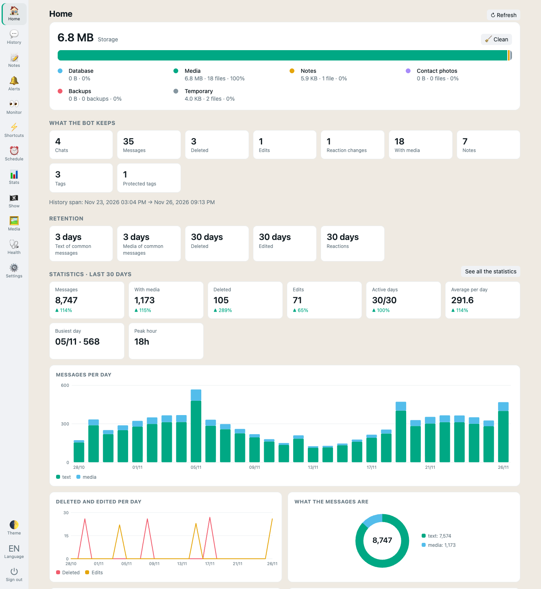

## History

### The chats

The list on the left goes from the most recent chat, with the photo, the last message and, in a red badge, how many
messages were deleted. The name is the one in your address book; without it, the profile name (pushname); without it,
the number (`+5521...`); a group shows its name. The first box looks for a name or a number; the second looks for a
text in **all** the chats, and a click on a result opens that chat with the same search.


The **Status** chat stays pinned at the top of the list with a distinct color.
In **Status**, each post has a card with its author, date and time in the header. The media and
caption appear below. The history uses the data available in the cache. For new statuses, the bot records the publication time
when WhatsApp supplies it.

### The messages

The whole history the bot has in the database: text, photos, videos, audio, voice notes, **stickers**, documents,
locations, emojis and reactions. The transcriptions the bot made of audio show below the message.

- **Deleted**: the message stays inside a **red dashed rectangle**, with `🗑️ deleted at <date>` below it (the media,
  if still in the cache, is shown too).
- **Edited**: inside an **amber rectangle** with `✏️ edited` and, below it, the **diff** of each edit: the text
  *before* (what was removed, crossed out in red) and *after* (what was added, in green).
- **Replies** show the quoted message above the text (the quote is saved from now on: older messages have none).
  **Mentions** (`@5521...`) show the contact name. A message whose **reaction** was changed or removed shows each
  change under it.
- **Media**: images, videos and audio play on the page, each one with a **Download** link; a document is always a
  download. A media that already left the cache (`cache.messageMediaRetentionHours`) is flagged.
- **New messages** come by themselves every `zapbot.web.refreshSeconds` (15 s) when you are at the end of the chat, and
  the messages load `zapbot.web.pageSize` at a time.


When you open a chat, a notice starts the conversation: `History of Fulano: <first message> → <last message>`, with how
many messages, deleted and edited there are.

**Reaction history**, below the original message, shows who changed or removed a reaction,
the emojis and the time. When automatic refresh is enabled, reactions on visible messages
also update while you are reading older messages.

### Reading the history

- **Order** (the list in the toolbar): *newest first* (the default: the most recent at the top, the older ones as
  you scroll down), *newest at the bottom*, like WhatsApp (the older ones load when you scroll up), or *oldest
  first*, from the start to the end.
- **Period**: pick `From` and `To` (date and time) and click *Apply*, or use *Today*, *7 days*, *30 days* and *All*.
  The notice and the counter below the name show the period being read.
- **Search the messages**: type a text and press Enter (it looks in the text and in the transcriptions).
- **Load more**: in the *newest first* and *oldest first* orders the end of the page has a *Load more* button, besides
  the scroll.

### Select, export and clear

- **Export PDF**: the button in the toolbar makes a PDF of the chat in the period on the screen (up to 5000
  messages): who said what and when, the deleted and the edited ones marked, with the text before and after of each
  edit.
- **Select messages**: *Select* lets you click the messages you want (they get a ● mark) and *Export selected* makes a
  PDF with only them.
- **Clear the history of a chat**: the 🧹 in the header of the chat deletes its messages (and their media) from the
  cache, **except** the deleted ones, the edited ones (with the text before) and the ones with reactions. The window
  tells how many go and how many stay, and asks you to type the name of the chat; nothing is deleted before that.

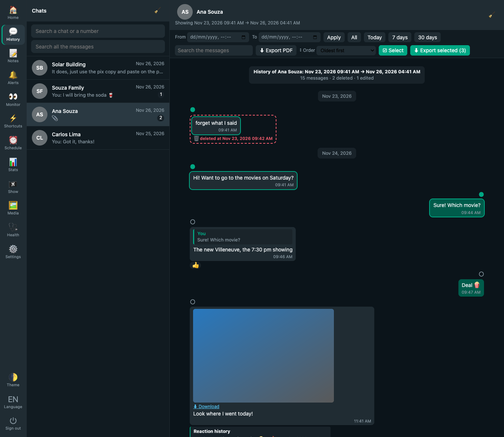

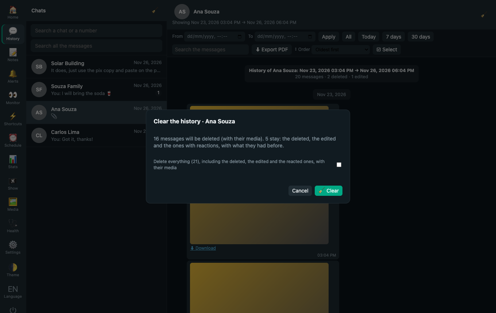

### Notices of WhatsApp

When someone changes phone, WhatsApp puts a notice in the chat. The history shows it as a centered line (`🔒 Maria's
security code changed`, with the name when the bot knows who it is; otherwise `a participant's`), and the other
notices of the system (a group event, a call) as `ℹ️ ...`. They never make a chat appear in the list (a contact with
only a changed security code is not listed), never move a chat up in it and never count in the totals. With
`zapbot.web.warnChangedPhone off` the security code lines are hidden inside the chats too.

### On a phone

The same page fits a narrow screen: the left bar becomes a bar at the bottom, the chat list and the chat take turns
(the *Back* button returns to the list) and the toolbar breaks in lines.

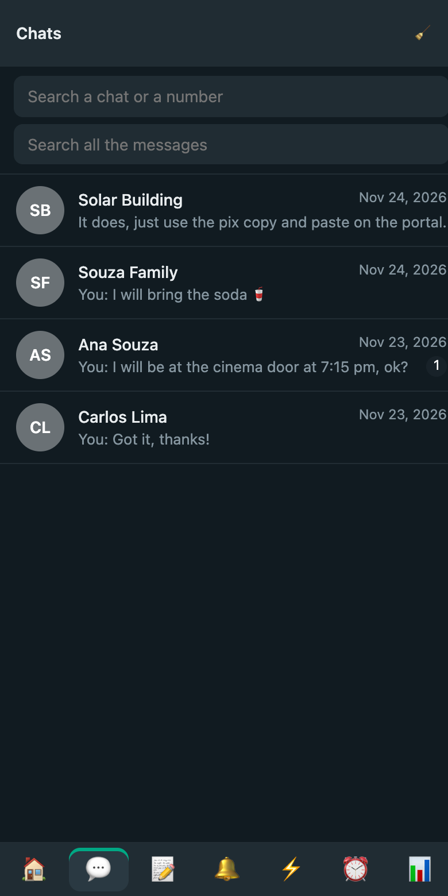


Only what the bot has in the database is shown: the text of the common messages stays for
`cache.messageRetentionHours` (68 h by default; up to 90 days), and the deleted, edited and reacted ones for their own
retention ([`/cache`](commands/cache.md), [`/show`](commands/show.md)). To keep more history, raise those settings.

## Notes

All the content of [`/notes`](commands/notes.md). The list of **tags** on the left has the description and how many
notes each one has (`All notes` and `(no tag)` too) and a search box for the text of the notes. A click on a tag
shows its notes as cards: the date, the alert, the text (the first line is the title, the links are clickable) and the
**images** (click to open them big), with a **Download** link for the image or the file. **⬇ PDF** exports the tag (or
all of them) as the same PDF of `/notes -pdf`, with the images.


### New tags and notes

- **＋ New tag** asks for a name and a description, like `/notes -desc #tag <text>`, and creates a tag that shows up
  in the list even with no notes. Inside a tag, ✏️ changes the description (empty removes it) or the name (the notes
  follow). **🗑️** removes it: an empty tag goes at once (it asks first); one with notes needs you to **type its name**
  to confirm, the same way the 🧹 of the history does, and then deletes every note in it, their media, the tag's
  description and its lock, if it was protected — the same as `/notes -rm #tag -yes` in WhatsApp, and a bit more (that
  command leaves the description and the lock behind; this does not).
- **＋ New note** adds a note to the tag, with an alert at a date and time if you want. On each card, ✏️ edits the text,
  the tag and the alert, and 🗑️ deletes the note (and its file).

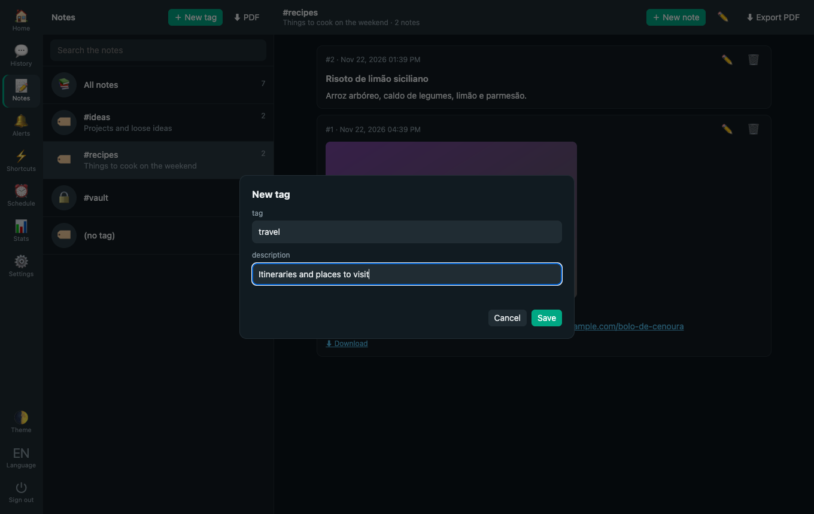

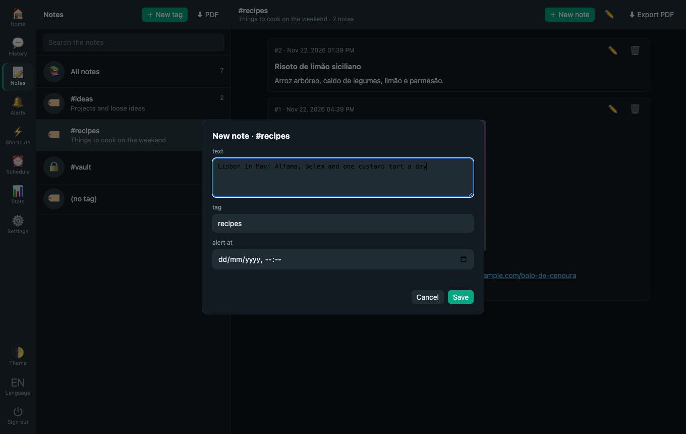

### Protected tags

A tag protected by [`/notes -lock`](commands/notes.md#protected-tags--lock) comes **locked** 🔒: no text and no file,
only the lock. Type the password of the tag to read it. The key stays only in memory, tied to **that login**, and it
locks again after `notes.lockMinutes` without use (or with *Lock now*, or on logout). It is an unlock of the page
only: it does not open the tag in the chat, and the other way around. The text and the images are decrypted in memory
(nothing decrypted is written to the cache), 5 wrong passwords block the tag for 15 minutes and the PDF of a locked
tag stays out until you unlock it. A protected tag cannot be renamed here (`/notes -move` in WhatsApp does it).

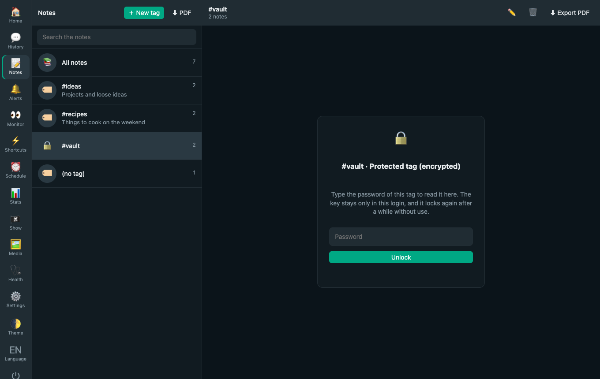

## Alerts

Three tables: the price alerts, the `/watch` rules and the monitored contacts. Each one has **＋ Add** and, in each row,
✏️ edit and 🗑️ delete.

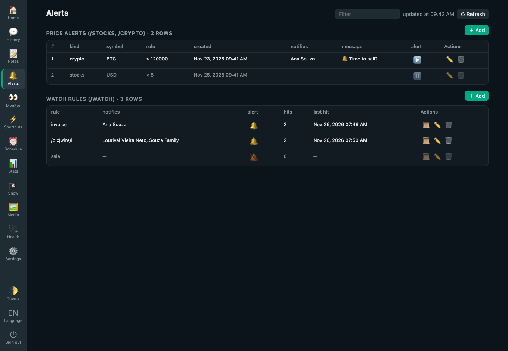

### Price alerts

The alerts of [`/stocks`](commands/stocks.md) and [`/crypto`](commands/crypto.md): symbol, rule (`BTC > 90000`), where
it notifies and the message. A price keeps its cents (`6.20`). Adding or editing goes through the same code as the
command, so the checks are the same: a symbol that does not exist, the price that cannot be read and the "already met"
rule are refused with the same text. An edit keeps the date the alert was created.

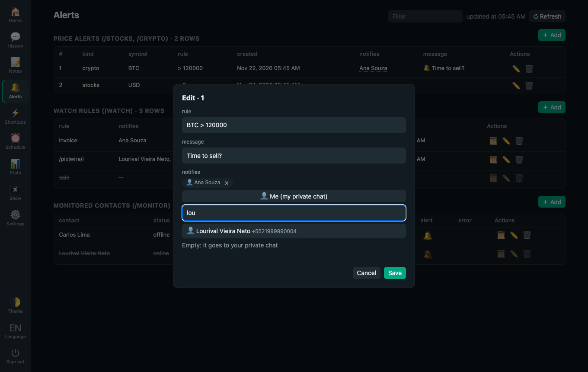

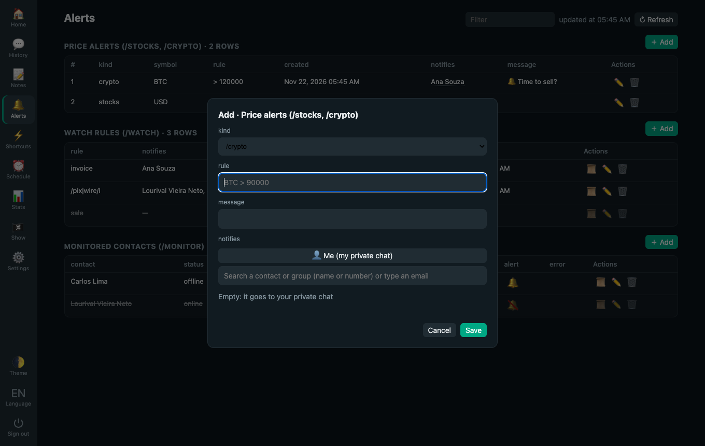

### /watch rules

The rules of [`/watch`](commands/watch.md) (a text, or `/regex/flags`; an invalid or risky regex is refused), where each
one notifies, how many matches it has had and the date of the last. The **📜** button opens the **history of the rule**:
every message that matched, with when, the chat, who said it and the text.

A click on the chat or on the text of a match **opens that chat in the History, at the message**: it has an
**orange outline**, the part that matched is **highlighted**, and a `🔎 /watch: <rule>` line says which rule it was
(more than one, if several matched). These marks show whenever you read that chat, not only when you come from
here.


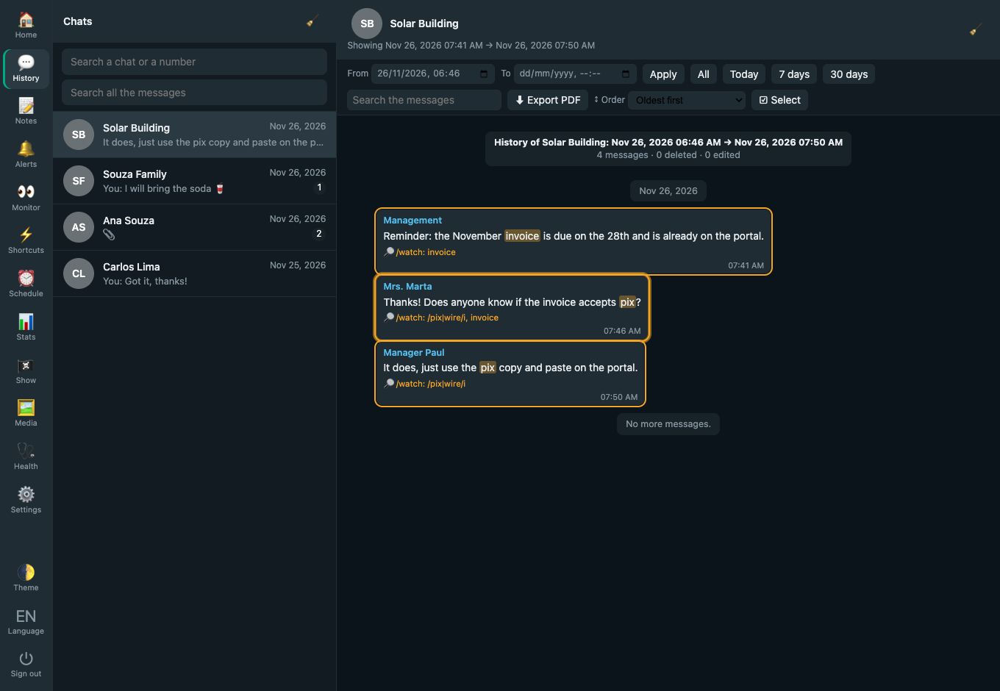

### Monitored contacts

The contacts of [`/monitor`](commands/monitor.md) with the status, the last time they were seen, the last check and the
error, if any. **＋ Add** picks a contact of your address book (the limit is the `monitor.max` setting) and ✏️ edits the
name and the alert. The **📜** button opens what the monitor read of the contact: each "last seen", with the time it
was read, and a 🗑️ to remove one reading.

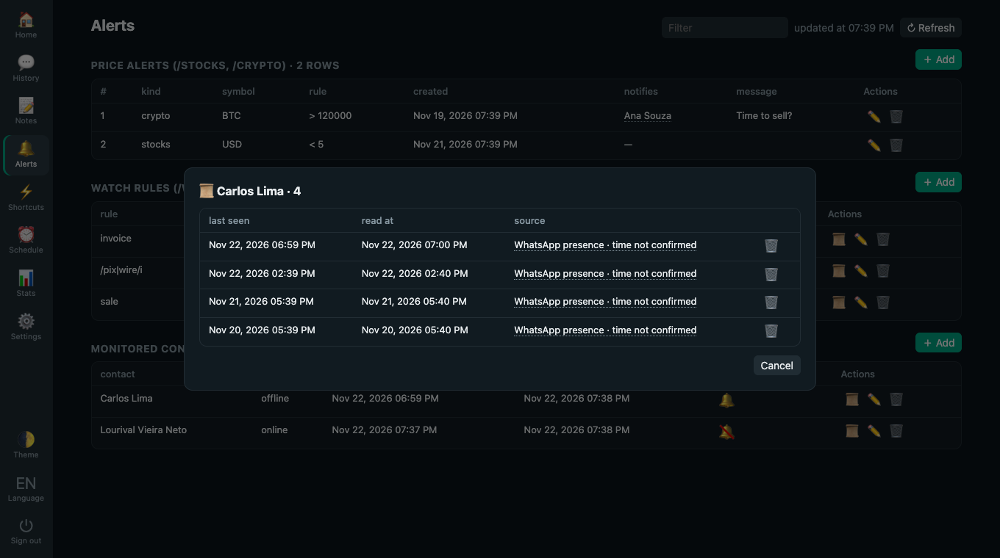

### The alert column and who is notified

Everything that can be turned on and off has the **same cell, in the `alert` column**, and **a click on it toggles**:

- in the `/watch` table, 🔔 is the **notice of the rule** on and 🔕 off. With it off the matches keep being saved (and
  the history of the rule keeps growing), but nobody is told;
- in the `/monitor` table, 🔔 is the alert of the contact (you are told when it comes online) and 🔕 off;
- in the schedule, ▶️ is a message that is running and ⏸️ a paused one.

Off or paused, the **whole row goes duller, with the text struck through** (it still works; nothing is hidden, just
dimmer), so a glance at the table already tells which rules, contacts and messages are not doing anything right now.
The bell/play button itself, and the row's own 🗑️/✏️/📜 buttons, stay as they are.

The price alerts and the `/watch` rules have a **contact picker** in the field *notifies*. Type part of a name (or a
number) and the matching contacts and groups of your address book show up; click one to add it (several are fine), or
type an email address. **👤 Me** adds your own account. Empty means your private chat. The same picker chooses the
contact of the `/monitor`.

## Shortcuts

The [`/alias`](commands/alias.md) list: the shortcut, the command, the description and the flags (🔇 quiet and 🔒 only
you). Adding and editing use the same checks as `/alias`: a name that is a command is refused and, if an edit is
refused, the old shortcut stays.


## Schedule

What [`/cron`](commands/cron.md) has scheduled: the kind (message or reminder), when, the repeat, the chat, the text and
the ▶️ / ⏸️ state. In the form (new or existing) the **chat** is chosen with the contact picker: one chat, several (the
first one is the chat and all of them receive it) or none (your own chat). Emails are not accepted here: a scheduled
message goes to WhatsApp.


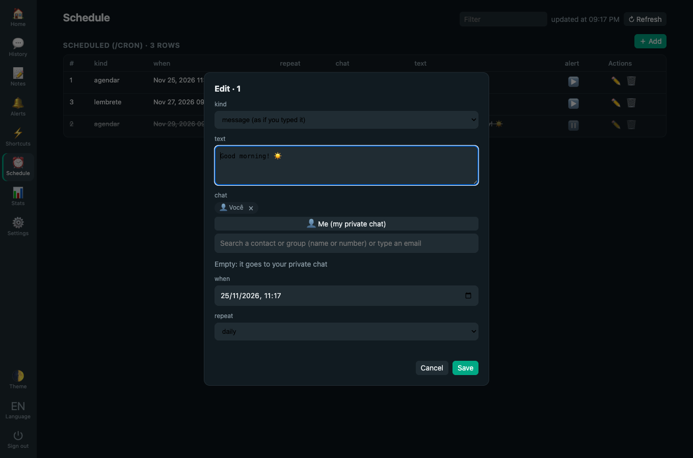

## Statistics

Charts of the counters of [`/stats`](commands/stats.md) for 7, 30, 90 or 365 days. Cards with messages, media,
deleted, edits, active days, the average per day, the busiest day and the peak hour, each one with the **change against
the previous period** (▲ / ▼); messages per day (text and media stacked); deleted and edited per day (lines); the split
between text and media (donut); messages by hour; a **weekday x hour heatmap** of when the chats are busy; and the
ranking of the chats (click to open one) and of the people. Hover a bar or a cell to see the number.

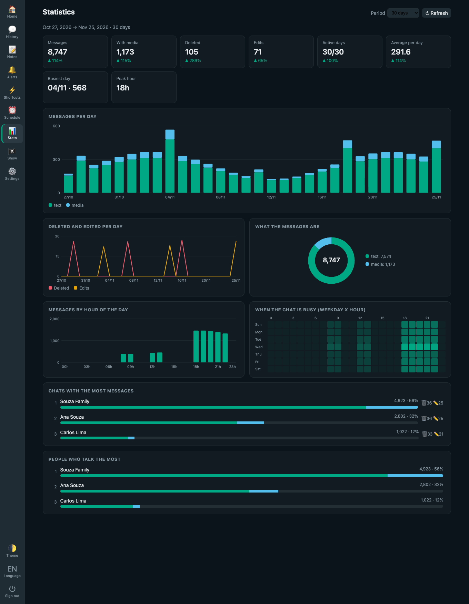

## Settings

On top, a **panel only for the web interface** (the `zapbot.web.*` settings), so you adjust it without searching a long
list. Below, the table with **all the other settings**.

### The web panel

Four cards: **Access** (`enabled`, `host`, `port`, `url`, `trustProxy`), **Login and session** (`login`, `password`,
`totp`, `sessionHours`, `sessionTimeout`), **Screen** (`pageSize`, `refreshSeconds`) and **Warnings** (`warnAccess`,
`warnChangedPhone`). Next to the title, the address to open the interface.

- a **switch** for the on/off settings and a box for numbers and text: it saves when you leave the box, with a
  `✔ saved` (or the error of the same checks of `/set`);
- ↺ goes back to the default of a setting that was changed;
- ⟳ marks what only applies when the bot restarts (`enabled`, `host`, `port`);
- 🔒 marks what only `/set` in WhatsApp changes: the login, the password (shown as `••••••••`) and the TOTP secret;
- 🔧 marks a setting that a variable of `config/.env` decides (`ZAPBOT_WEB_ENABLED`, `ZAPBOT_WEB_HOST`,
  `ZAPBOT_WEB_PORT`): it shows the variable and its value, read-only, because the variable wins over the setting.


### The other settings

Every other setting with its value, its default and what it does. ✏️ edits (the same validation of `/set`: a wrong value
is refused with the same text) and ↺ goes back to the default. The secret ones (keys, passwords, hashes) appear masked,
and `bot.login` cannot be changed here.


## Buttons and icons

| Icon | Where | What it does |
|---|---|---|
| ＋ | the title of a list | Adds a row (a form opens) |
| ✏️ | each row | Edits it, with the same checks as the command |
| 🗑️ | each row | Deletes it (it asks first); in the Settings, ↺ goes back to the default |
| 📜 | `/watch` and `/monitor` rows | Opens the history of the rule or of the contact |
| 🔔 / 🔕 | the `alert` column | On / off; a click toggles |
| ▶️ / ⏸️ | the schedule | Running / paused; a click toggles |
| 🧹 | the header of a chat | Clears its history, keeping the deleted, edited and reacted messages |
| 👤 | the contact picker | A contact or a group; *Me* is your own account |
| 🔒 | tags and settings | Protected tag; setting only `/set` changes |
| 🔧 | the web panel | A setting that an environment variable decides |
| ⟳ | the web panel | It only applies when the bot restarts |

## Security

- **Only with the password**: every request but the page and the login needs the session. The session is a random
  token in an `HttpOnly` + `SameSite=Strict` cookie, kept in memory, and lasts `zapbot.web.sessionHours`.
- **5 wrong passwords block the address for 15 minutes**, and every failure and every login is logged with the login
  name that was tried (never the password).
- **You are warned in WhatsApp**: a wrong password (of the login or of a protected tag) sends `⚠️ ZapBot-Web: wrong
  password from <address> (attempt 2 of 5)` to the chat with yourself, and the block sends `🚫 ZapBot-Web: ... is
  blocked for 15 minutes`. A burst from the same address in 15 seconds is joined into one notice. The password typed
  is never in the notice.
- **Opening the page also warns you**: when someone who is not logged in opens the address of the interface, you get
  `⚠️ ZapBot-Web: someone opened the login page from <address>` with the first 100 characters of the browser's name.
  The flood limits: **one notice per address every 10 minutes** (the other visits are counted and told in the next
  one) and **at most 5 notices in 10 minutes** from any address (the rest is only counted). Only the page counts, not
  its files or the API, and a browser that is already logged in does not warn. Turn it off with
  `zapbot.web.warnAccess off`.
- **Changes are only the ones you can see**: the page can change shortcuts, alerts, `/watch` rules, monitored
  contacts, the schedule, notes and settings, always through the same code of the commands, and **never** the login, the
  password and the TOTP secret (only `/set` in WhatsApp). It cannot send messages to other people. Every change is
  logged, without the values. The POSTs only take JSON.
- **Isolated page**: no inline script (strict CSP), `nosniff`, no framing, and the media is served with a `sandbox` CSP:
  a stored HTML file never runs, it downloads. The media only comes from the cache folder (a path outside it is never
  served).
- **Second factor (optional)**: with `zapbot.web.totp` set, the login also asks for the 6-digit code of an authenticator
  app. `/set zapbot.web.totp new` makes the secret and shows the QR code in your private chat, and the 2FA only turns on when you type the code of the app (see
  [Two-step login (2FA)](#two-step-login-2fa)). A wrong code counts as a wrong password.
- **Behind a proxy**, turn on `zapbot.web.trustProxy` and set `ZAPBOT_WEB_TRUSTED_PROXIES` to the
  comma-separated IP addresses of the proxies that connect directly to ZapBot. In Docker, use
  the addresses seen from inside the container. Configure the proxy to replace `X-Forwarded-For`
  or append its client's address, and to overwrite `X-Forwarded-Proto`. ZapBot uses the last address
  to count login attempts and adds `Secure` to the cookie when the proxy reports `https`.
- **Protected notes** open on the page only with the password of the tag, in memory, and what is decrypted is never
  written to the cache. **What the bot sends in the chats with a decrypted note is never saved** in the database
  (`notes.lockPrivateOnly` says where the notes open in WhatsApp).

## Reference of the settings

| Setting | Default | What it does |
|---|---|---|
| `zapbot.web.enabled` | `off` | Turns the interface on (takes effect after restarting) |
| `zapbot.web.login` | *(empty)* | The login name you choose (3 to 40 characters). Empty: it does not start |
| `zapbot.web.password` | *(empty)* | The password; the bot stores its hash. Empty: it does not start |
| `zapbot.web.host` | `127.0.0.1` | Address it listens on |
| `zapbot.web.port` | `3200` | Port |
| `zapbot.web.url` | *(empty)* | The address you open it at, shown in the startup message |
| `zapbot.web.sessionHours` | `12` | How long a login lasts |
| `zapbot.web.pageSize` | `100` | Messages loaded at a time |
| `zapbot.web.refreshSeconds` | `15` | How often it looks for new messages (`0`: never) |
| `zapbot.web.sessionTimeout` | `30` | Idle minutes before logout (`0` disables it) |
| `zapbot.web.totp` | *(empty)* | Base32 secret of the 6-digit code asked besides the password |
| `zapbot.web.trustProxy` | `off` | Reads forwarded headers from peers listed in `ZAPBOT_WEB_TRUSTED_PROXIES` |
| `zapbot.web.warnAccess` | `on` | Warns you (⚠️) when someone opens the login page and is not logged in (flood limits above) |
| `zapbot.web.warnChangedPhone` | `on` | Shows the notices that someone's security code changed inside the chats |

## Docker and environment variables

In Docker the image already exposes the port `3200` and listens on every interface inside the container
(`ZAPBOT_WEB_HOST=0.0.0.0`); the `docker/docker-compose.yml` publishes it only on the **host's** `127.0.0.1`
(`127.0.0.1:3200:3200`). To reach it from another machine, use an SSH tunnel (`ssh -L 3200:127.0.0.1:3200 host`), an
HTTPS reverse proxy in front, or, knowing the risk, `ZAPBOT_WEB_BIND=0.0.0.0` in `docker/.env` (which is not in git).
Without it, `http://<server-ip>:3200` does not answer: the port is only on the server's own `127.0.0.1`.

| Variable | Where | What it does |
|---|---|---|
| `ZAPBOT_WEB_ENABLED` | `config/.env` | `true` / `false`: turns the interface on or off, over `zapbot.web.enabled` |
| `ZAPBOT_WEB_URL` | `config/.env` or `docker/.env` | The address shown in the startup message (the `zapbot.web.url` setting wins over it) |
| `ZAPBOT_WEB_HOST` | `config/.env` | The address it listens on, over `zapbot.web.host` (the image sets `0.0.0.0`) |
| `ZAPBOT_WEB_PORT` | `docker/.env` | The port, over `zapbot.web.port`; in Compose the published port follows it |
| `ZAPBOT_WEB_BIND` | `docker/.env` | Compose only: where the host publishes the port (`127.0.0.1` by default) |

After changing one of them, run the deploy again: the variables are read when the bot starts.

## Questions and problems

| The problem | What to check |
|---|---|
| The page does not open | `zapbot.web.enabled`, the login and the password have to be set (`/set`), and the bot restarted. The log tells which one is missing |
| It opens on the server but not from another machine | By default it only listens on `127.0.0.1`; see Docker above (`ZAPBOT_WEB_BIND`, a tunnel or a proxy) |
| `ZAPBOT_WEB_ENABLED=true` did nothing | The variable has to reach the container (`config/.env` is read by the compose) and the bot has to be redeployed; the Settings page shows 🔧 when it is being used |
| *Blocked for 15 minutes* | 5 wrong passwords from that address. Wait, or restart the bot (the blocks are in memory) |
| The history of a chat is short | Only what is in the database is shown; see the retention settings in [`/cache`](commands/cache.md) |
| A contact does not show in the list of chats | Chats with only WhatsApp notices (a security code that changed) are not listed |
| The numbers of the Home are lower than the notices I see | The counters count real messages; notices of the system do not count |
| The picker finds no contact | It searches the address book and the groups of the connected WhatsApp; type at least 2 letters or a full number |
