# Web interface

The bot serves a **web interface** (on by default) to look at, and to manage, what it keeps: the history of every
chat in the style of WhatsApp Web (with the **deleted** and the **edited** messages highlighted), the notes, the
alerts, the shortcuts, the schedule, charts of your conversations and the settings.

!!! danger "It shows every message of your account"
    Whoever signs in reads everything the bot has stored. Use a long password, keep the interface on
    `127.0.0.1` (the default) and, to open it to the network, put an **HTTPS reverse proxy** in front.

All the pictures on this page are made with **invented data** (names, numbers and messages do not exist), in the
dark theme unless it says otherwise. The interface follows the `zapbot.lang` setting (English or Portuguese) and the
button at the bottom of the left bar switches it; the Portuguese page of this manual has the same pictures in Portuguese.

Use [`/web`](commands/web.md) in your private chat to manage access, sessions and 2FA.

## First setup in a few clicks

No file to edit, no command to type: **start the bot and open one link**.

1. **Start it.** The web comes up with the bot (on by default). The first time, with no login yet, the log shows a
   link that works **once, for 24 hours**:

   ```text
   ╔══════════════════════════════════════════════════════════╗
   ║ 🔐 ZapBot web: configure the access (login and password) in a few clicks:
   ║    http://192.168.1.253:3200/setup#a8F3kQ…
   ║    It works once, for 24 h. Lost it? /web -setup in your private chat makes a new one.
   ╚══════════════════════════════════════════════════════════╝
   ```

   (`docker logs zapbot | grep -A2 "configure the access"` finds it; with the SMTP set, it also goes by email.)

2. **Open it and choose your login and password.** A strength meter helps (12 characters at least); the link dies
   right there, and you are in.

   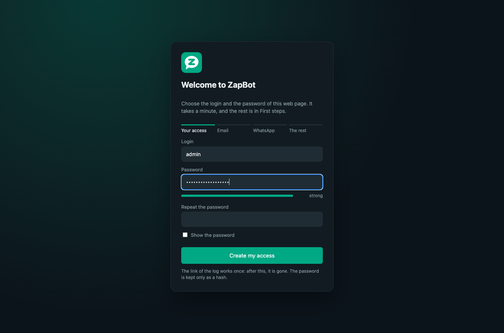

3. **Set up the email, right there.** A button fills in the server of Gmail, Yahoo, iCloud or Zoho; you type the
   login, the app password and who receives, and **🔌 Test the connection** (or **✉️ Send a test email**) proves it
   before you go on. From then on, the bot emails you the WhatsApp QR Code when it needs pairing again, the alerts
   and the backups. No SMTP? **Skip for now**: First steps remind you. If `config/.env` already sets the email, the
   step says so, and *Use the ones of this page* makes the page win ([email from the web](emails.md#email-from-the-web)).

   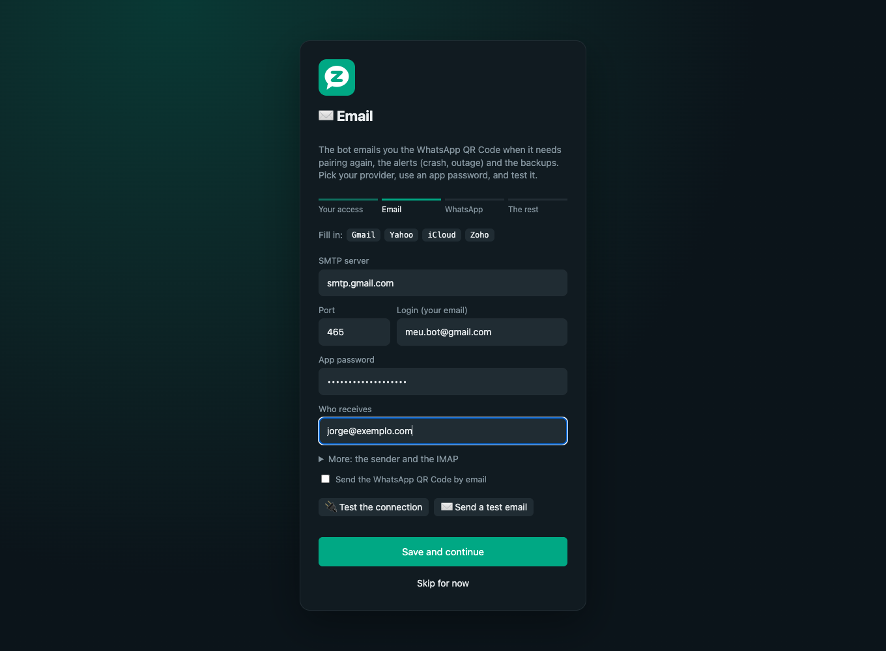

4. **WhatsApp.** Already paired, the step just says so; if not, it opens Health, where the QR Code is.

5. **Follow the First steps.** Home shows what is left, each with its button, until all of it is done (or you hide
   it): pair WhatsApp with the **QR Code on the page** (Health), check the **address** of the web, set up the
   **email** (SMTP and IMAP, with buttons for Gmail, Yahoo, iCloud and Zoho), turn on the **two-step
   verification** with the QR Code of an authenticator app, the **notices on this device**, and **who can use the bot**.

   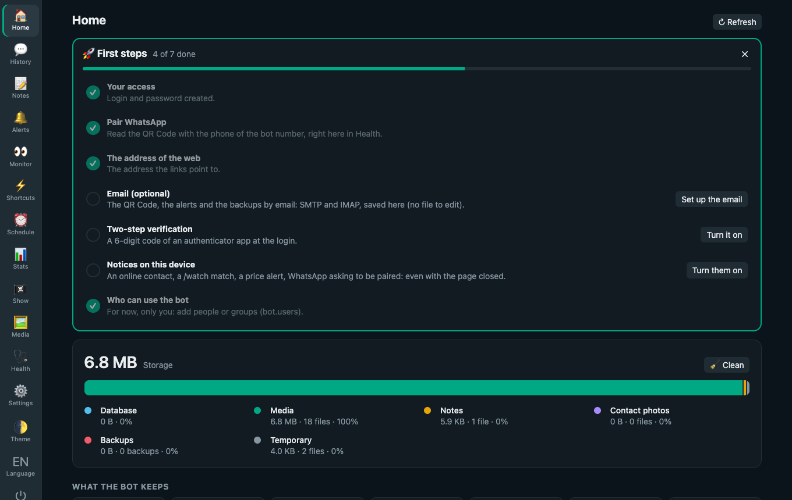

That is a whole install from the browser: from `docker compose up` to a paired bot, with the email and the 2FA,
without opening a file or reading a log again.

**Why a link, and not a generated password:** no password ever goes to the log. The link is random, works once and
expires; only its hash is kept. **Lost the link, or forgot the password?** `/web -setup` in your private chat on
WhatsApp sends a new one (whoever uses it replaces the login and the password, and the open sessions close). With
no WhatsApp paired yet, restarting the bot shows a new link.

**The other way**, still there: `/set zapbot.web.login <name>` and `/set zapbot.web.password <password>` in
WhatsApp, or `/web -login` and `/web -p`. `ZAPBOT_WEB_ENABLED="false"` in `config/.env` turns the web off.

The address of the links is `ZAPBOT_WEB_URL` (or `zapbot.web.url`): **in Docker, fill it in**, since the container
does not know the IP of the server (the First steps warn when it is missing). By default only the machine itself
reaches the web (`127.0.0.1`); `ZAPBOT_WEB_BIND=0.0.0.0` in `docker/.env` opens it to the network, and then prefer
HTTPS ([Tailscale serve](#from-the-phone-over-the-internet-tailscale) or a proxy with a certificate).

### Change the password and turn on the 2FA, from the page

**Settings › 🔑 Access** has **Change the password** (the current one is asked again; the login can change too) and
**Two-step verification › Turn it on**, which shows the QR Code for Google Authenticator, Authy or 1Password and turns
on only after the 6-digit code of the app. Either way, the other sessions close and your private chat and the email
are told (`🔐 ZapBot-Web: the web password was changed … from 192.168.1.10`).

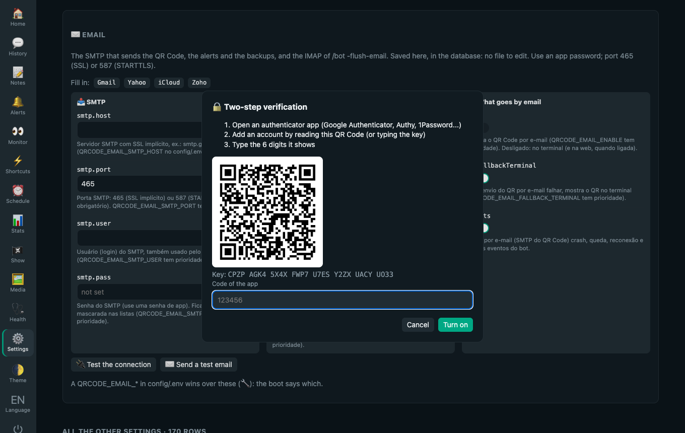

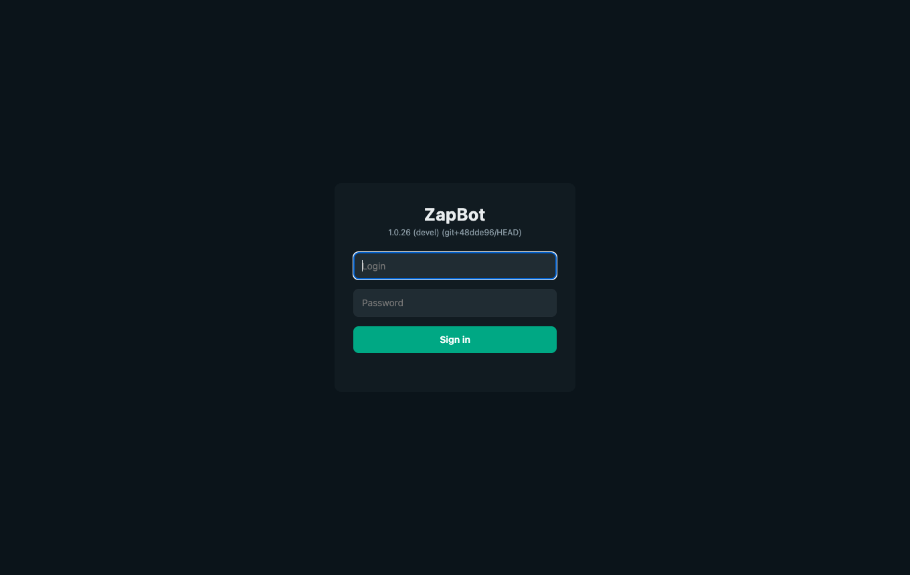

In `config/.env`, `ZAPBOT_WEB_ENABLED=true` (or `false`) decides over the `zapbot.web.enabled` setting, and
`ZAPBOT_WEB_PORT` and `ZAPBOT_WEB_HOST` over the port and the address
([the variables](configuration.md#web-interface-optional)).

Compose publishes the port on the **Docker host's loopback**. To connect from a different computer
while keeping that port private, create an SSH tunnel and open `http://127.0.0.1:3200` in your browser.

```bash
ssh -N -L 3200:127.0.0.1:3200 user@docker-host
```

After editing the environment files, apply the configuration with
`docker compose -f docker/docker-compose.yml up -d zapbot` from the project root.

## Two-step login (2FA)

With the 2FA on, the login asks for the **6-digit code** of an authenticator app (Google Authenticator, Authy, 1Password...)
besides the name and the password. The bot makes the secret, shows the **QR code** in the chat and only turns the 2FA on
after you **prove the app works** with a code, so a failed scan never locks you out:

```text
/set zapbot.web.totp new
/set zapbot.web.totp 123456
```

1. Type `/set zapbot.web.totp new` in **your private chat** (the messages with yourself). The bot sends an image with the
   **QR code** and, in the caption, the same secret as text, in groups of four (`ABCD EFGH ...`). Nothing is turned on yet.
2. In the app, **scan the QR code**, or choose *enter a setup key* and type that code.
3. **Confirm**: type `/set zapbot.web.totp` followed by the 6-digit code the app shows now (`123456` above). If it is right,
   the bot answers `✅ 2FA is on`, saves the secret and deletes the QR message. If it is wrong, it says so and you try
   again; after 5 wrong codes, or after 10 minutes, the QR code is discarded and everything stays as it was.
4. Open the interface: the login now asks for name, password and the code of the app. A wrong code counts as a wrong
   password.


- It only works in **your own private chat** and only by you; anywhere else the bot refuses and nothing is made. The
  message with the code you typed is deleted and kept masked in the history.
- What the bot sends is **never saved**: not in the messages table, not in the media folder. It also **deletes the QR
  message after 3 minutes** (WhatsApp keeps it until then): scan it right away.
- With the 2FA already on, `/set zapbot.web.totp 123456` only tells whether the code is right, which is a way to test
  the app at any time. `/set zapbot.web.totp qr` shows the QR code and the code again; `new` again makes another secret
  (the old one keeps working until the new one is confirmed); `/set -reset zapbot.web.totp` turns the 2FA off.
- The code depends on the clock of the server and of the phone: a wrong time makes every code fail.

## The startup message

When the interface is on, the message the bot sends you at start (`🤖 ZapBot ... started.`) ends with
`🌐 Web interface running at http://192.168.1.253:3200`. The address is the `zapbot.web.url` setting, or the
`ZAPBOT_WEB_URL` variable, or the machine's IP with the port. In Docker fill in one of the first two: the container
does not know the IP of the server.

The title of the browser tab and the login screen show the version that is running
(`ZapBot 1.0.27 (git+abc1234/v1.0.27)`), which helps to know whether a deploy reached the server.

## The sections at a glance

The icons on the left open each part (on a phone they are a bar at the bottom):

| Icon | Section | What it is for |
|---|---|---|
| 🏠 | Home | What the bot keeps: storage, counters, retention and the last 30 days |
| 💬 | History | The chats and their messages, with the deleted and the edited ones marked |
| 📝 | Notes | Everything of [`/notes`](commands/notes.md): tags, notes, images, protected tags |
| 🔔 | Alerts | Price alerts and [`/watch`](commands/watch.md) rules, with their histories |
| 👀 | Monitor | The [`/monitor`](commands/monitor.md) contacts: presence, time online, who was online together and habits |
| ⚡ | Shortcuts | The [`/alias`](commands/alias.md) list |
| ⏰ | Schedule | What [`/cron`](commands/cron.md) has scheduled |
| 📊 | Statistics | Charts of the counters of [`/stats`](commands/stats.md) |
| 🏴‍☠️ | Show | What [`/show`](commands/show.md) keeps (deleted, edited, reactions, statuses, channels) and who is muted |
| 🖼️ | Media | Every picture, video, audio, sticker and document kept, by chat, kind and period, with the space |
| 🩺 | Health | WhatsApp, memory, the event loop, the periodic checks, the regex queue and the last errors |
| ⚙️ | Settings | A panel for the web interface settings, then every other setting |

At the bottom of the bar, the buttons switch the **theme** (automatic, light, dark) and the **language** (English or
Portuguese; it follows the bot's `zapbot.lang` until you pick another), and the last one signs out. The browser
remembers theme, language and the order of the messages. Every list has a **Filter** box (it searches the rows on the
screen) and an **Update** button, with the time of the last update, that reloads it with a progress bar.

## Login and session

The page asks for the name and the password (and, with `zapbot.web.totp`, the 6-digit code); a wrong one in any of them
gives the same answer, so it does not tell which was wrong. The session is a random token in an `HttpOnly` +
`SameSite=Strict` cookie, kept in memory: restarting the bot signs everybody out. It lasts `zapbot.web.sessionHours` (12
by default). More in [Security](#security).

The session expires after 30 minutes without interaction. Automatic message refresh does not
renew it. Set the interval with `/web -timeout 15` or `/set zapbot.web.sessionTimeout 15`.
Use `0` to disable idle expiry. The absolute `zapbot.web.sessionHours` limit still applies.

## Home

What the bot keeps, the same numbers as [`/cache`](commands/cache.md) and `/status`: the **storage** (a colored bar
and the legend, with size and number of files: database, media, notes, contact photos, backups and temporary files),
how many chats, messages, deleted, edited, reaction changes, notes, tags and protected tags there are, the span of
the history, the retention of each kind and the chats with the most messages (click one to open it). The messages of
the counters are the real ones: WhatsApp notices do not count.

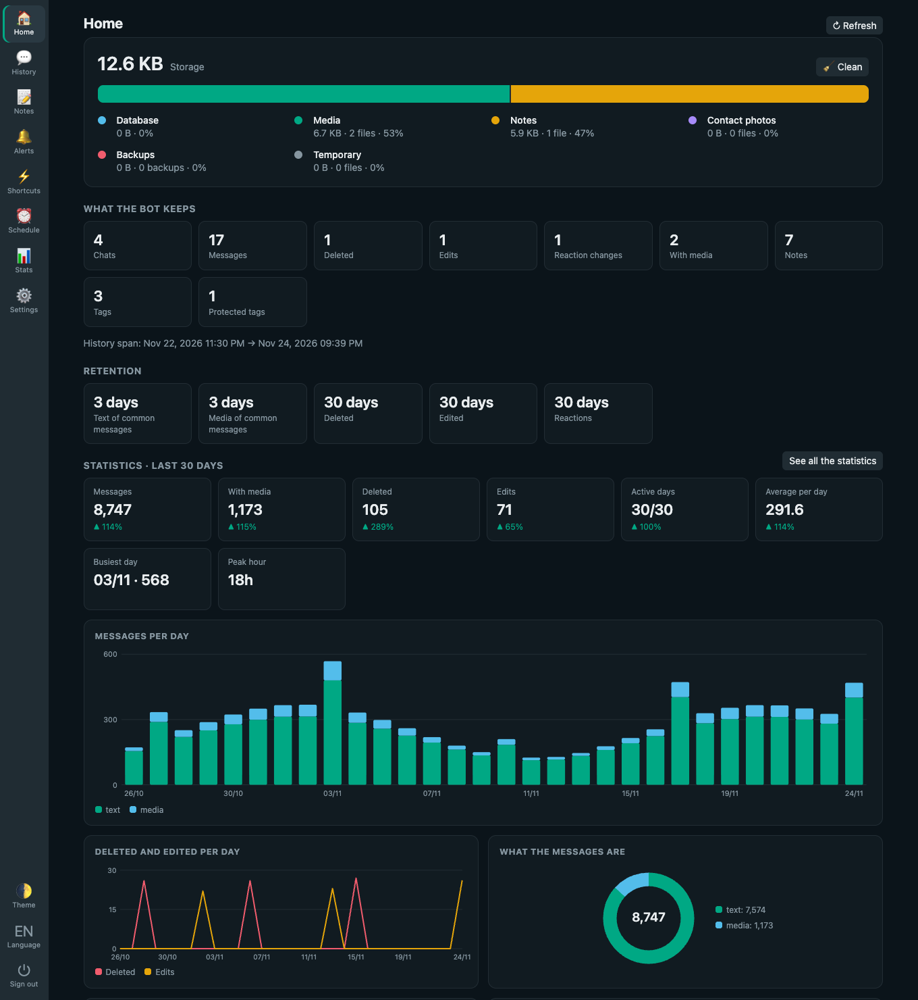

The **🧹 Clean** of the storage is the [`/cache`](commands/cache.md) with boxes: what is past the retention windows
(`-clean`), the media (`-media`), the temporary files, the contact photos and the backups (`-backup`), each with its
size; tick the ones you want. **Everything** is the `/cache -all` (every message, media, temporary files and backups),
with a warning in red. The notes are never part of it.

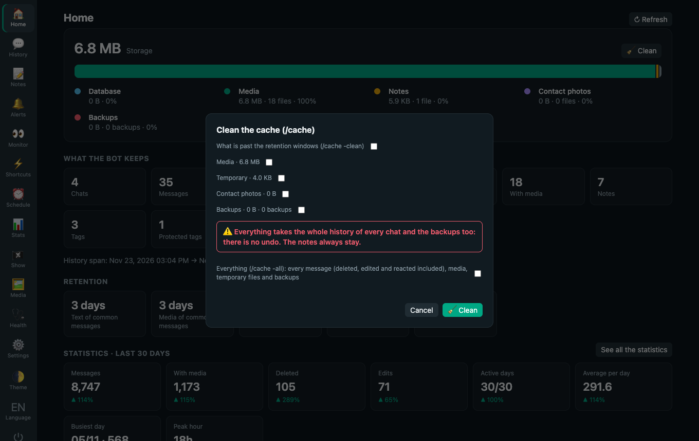


## History

### The chats

The list on the left goes from the most recent chat, with the photo, the last message and, in a red badge, how many
messages were deleted. The name is the one in your address book; without it, the profile name (pushname); without it,
the number (`+5521...`); a group shows its name. The first box looks for a name or a number; the second looks for a
text in **all** the chats, and a click on a result opens that chat with the same search.

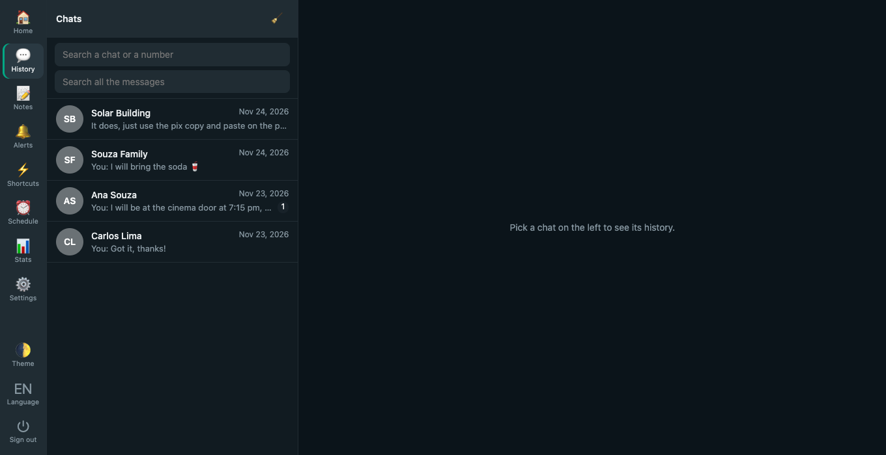

The **Status** chat stays pinned at the top of the list with a distinct color.
In **Status**, each post has a card with its author, date and time in the header. The media and
caption appear below. The history uses the data available in the cache. For new statuses, the bot records the publication time
when WhatsApp supplies it.

In a one-to-one chat, click the name or photo in the header to open the contact details.
The panel shows the phone number, About text, verification badge and available business
details. It also links to the contact’s latest saved Status when one is available.

### The messages

The whole history the bot has in the database: text, photos, videos, audio, voice notes, **stickers**, documents,
locations, emojis and reactions. The transcriptions the bot made of audio show below the message.

- **Deleted**: the message stays inside a **red dashed rectangle**, with `🗑️ deleted at <date>` below it (the media,
  if still in the cache, is shown too).
- **Edited**: inside an **amber rectangle** with `✏️ edited` and, below it, the **diff** of each edit: the text
  *before* (what was removed, crossed out in red) and *after* (what was added, in green).
- **Replies** show the quoted message above the text (the quote is saved from now on: older messages have none).
  **Mentions** (`@5521...`) show the contact name. A message whose **reaction** was changed or removed shows each
  change under it.
- **Media**: images, videos and audio play on the page, each one with a **Download** link; a document is always a
  download. A media that already left the cache (`cache.messageMediaRetentionDays`) is flagged.
- **New messages** come by themselves every `zapbot.web.refreshSeconds` (15 s) when you are at the end of the chat, and
  the messages load `zapbot.web.pageSize` at a time.

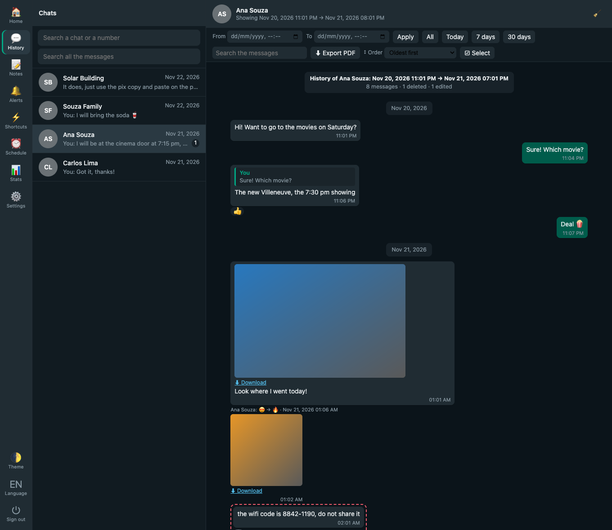

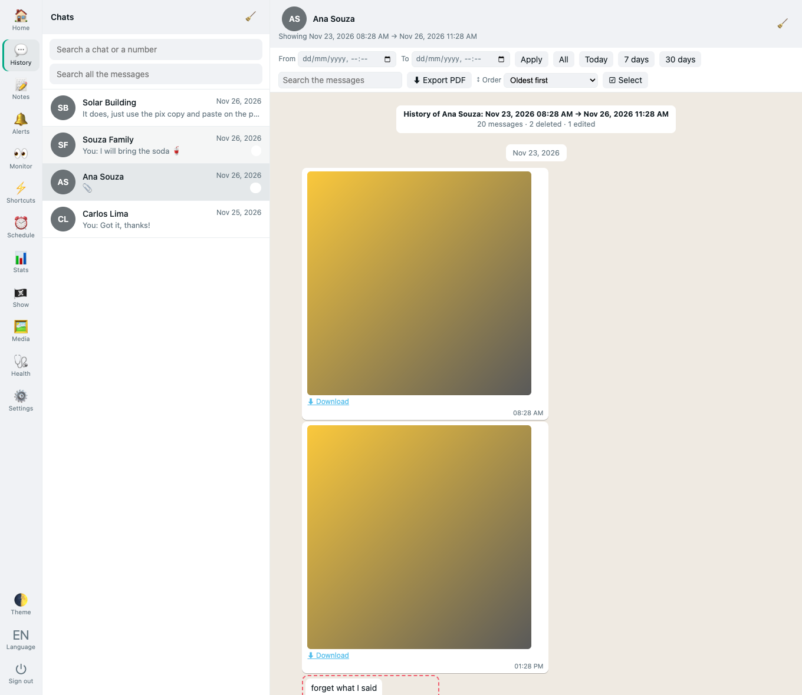

When you open a chat, a notice starts the conversation: `History of Fulano: <first message> → <last message>`, with how
many messages, deleted and edited there are.

**Reaction history**, below the original message, shows who changed or removed a reaction,
the emojis and the time. When automatic refresh is enabled, reactions on visible messages
also update while you are reading older messages.

### Reading the history

- **Order** (the list in the toolbar): *newest first* (the default: the most recent at the top, the older ones as
  you scroll down), *newest at the bottom*, like WhatsApp (the older ones load when you scroll up), or *oldest
  first*, from the start to the end.
- **Period**: pick `From` and `To` (date and time) and click *Apply*, or use *Today*, *7 days*, *30 days* and *All*.
  The notice and the counter below the name show the period being read.
- **Search the messages**: type a text and press Enter (it looks in the text and in the transcriptions).
- **Load more**: in the *newest first* and *oldest first* orders the end of the page has a *Load more* button, besides
  the scroll.

### Select, export and clear

- **Export PDF**: the button in the toolbar makes a PDF of the chat in the period on the screen (up to 5000
  messages): who said what and when, the deleted and the edited ones marked, with the text before and after of each
  edit.
- **Select messages**: *Select* lets you click the messages you want (they get a ● mark) and *Export selected* makes a
  PDF with only them.
- **Clear the history of a chat**: the 🧹 in the header of the chat deletes its messages (and their media) from the
  cache, **except** the deleted ones, the edited ones (with the text before) and the ones with reactions. The window
  tells how many go and how many stay; ticking **Delete everything** takes those too, with their media, edits and
  reactions (the `/watch` hits stay). Nothing is deleted before you confirm.
- **Clear every chat at once**: the 🧹 next to *Chats*, at the top of the list, is the same window for the whole
  history, with a warning in red that it takes every chat (only a [`/backup`](commands/backup.md) brings it back).


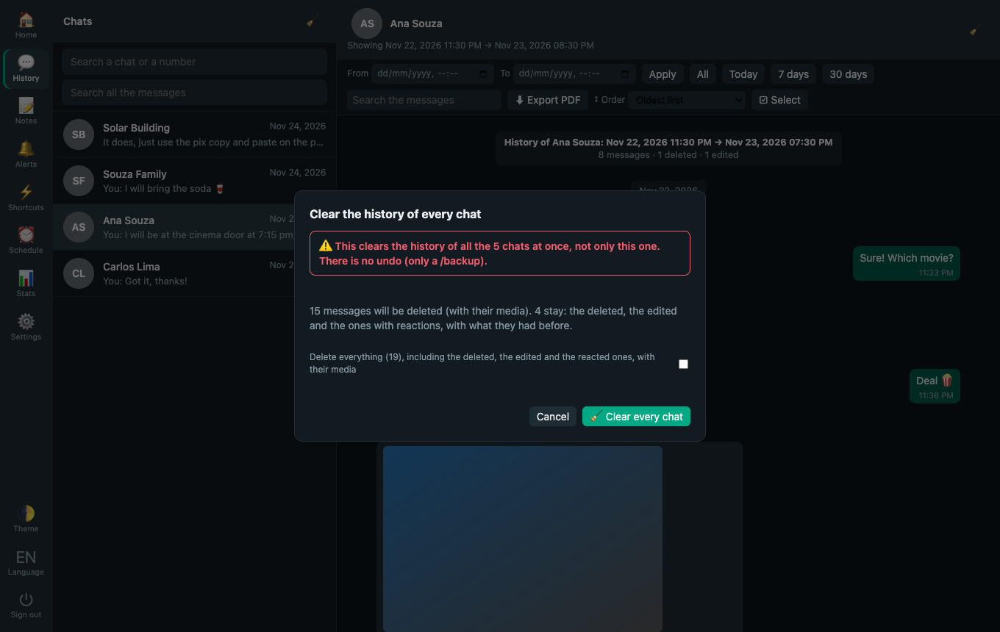

### Notices of WhatsApp

When someone changes phone, WhatsApp puts a notice in the chat. The history shows it as a centered line (`🔒 Maria's
security code changed`, with the name when the bot knows who it is; otherwise `a participant's`), and the other
notices of the system (a group event, a call) as `ℹ️ ...`. They never make a chat appear in the list (a contact with
only a changed security code is not listed), never move a chat up in it and never count in the totals. With
`zapbot.web.warnChangedPhone off` the security code lines are hidden inside the chats too.

### On a phone

The same page fits a narrow screen: the left bar becomes a bar at the bottom, the chat list and the chat take turns
(the *Back* button returns to the list) and the toolbar breaks in lines.


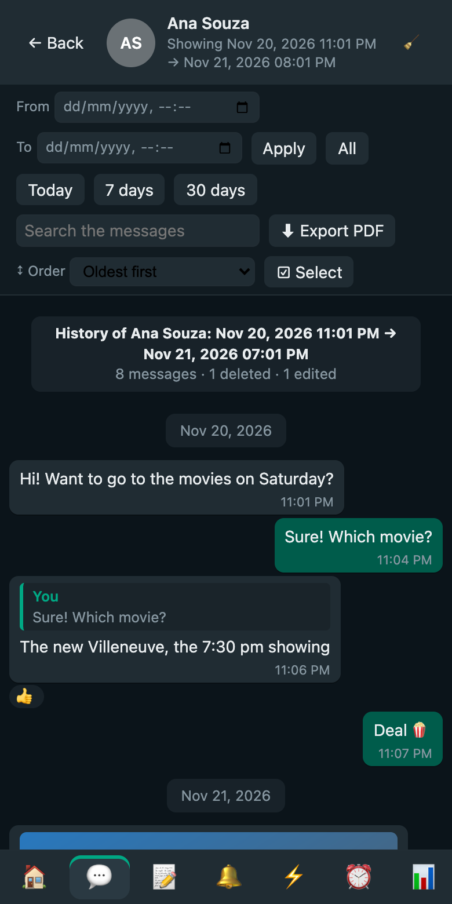

The other pages work the same way on a phone: the Monitor stacks its cards and the timelines fit the width, and the
Media shows three per row, with **☑️ Select** in place of Shift.

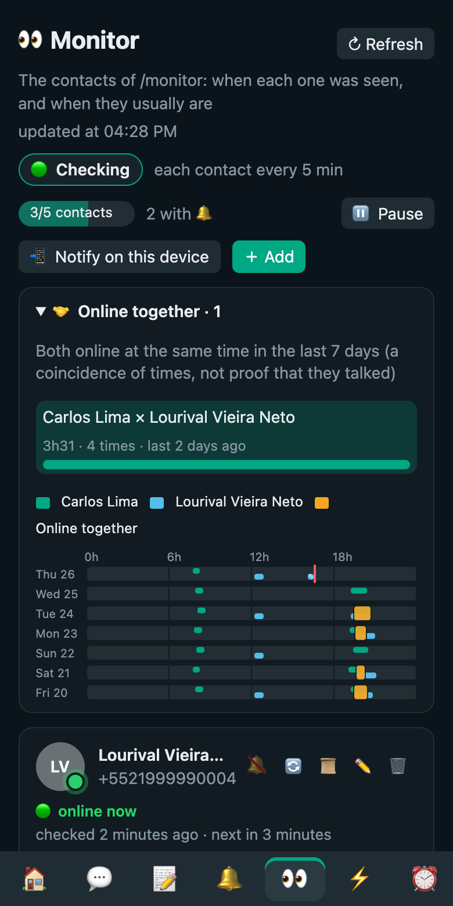

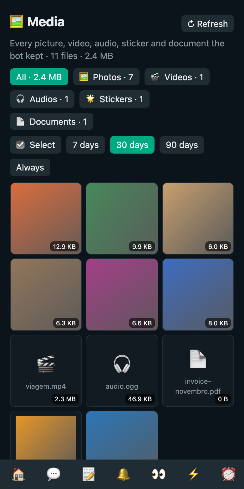

Only what the bot has in the database is shown: the text of the common messages stays for
`cache.messageRetentionDays` (3 days by default; up to 90), and the deleted, edited and reacted ones for their own
retention ([`/cache`](commands/cache.md), [`/show`](commands/show.md)). To keep more history, raise those settings.

## Notes

All the content of [`/notes`](commands/notes.md). The list of **tags** on the left has the description and how many
notes each one has (`All notes` and `(no tag)` too) and a search box for the text of the notes. A click on a tag
shows its notes as cards: the date, the alert, the text (the first line is the title, the links are clickable) and the
**images** (click to open them big), with a **Download** link for the image or the file. **⬇ PDF** exports the tag (or
all of them) as the same PDF of `/notes -pdf`, with the images.

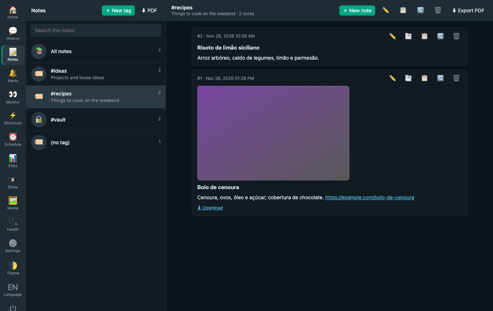

### New tags and notes

- **＋ New tag** asks for a name and a description, like `/notes -desc #tag <text>`, and creates a tag that shows up
  in the list even with no notes. Inside a tag, ✏️ changes the description (empty removes it) or the name (the notes
  follow). **🗑️** removes it: an empty tag goes at once (it asks first); one with notes opens a window that tells
  how many notes go, the same way the 🧹 of the history does, and, once you confirm, deletes every note in it, their media, the tag's
  description and its lock, if it was protected — the same as `/notes -rm #tag -yes` in WhatsApp, and a bit more (that
  command leaves the description and the lock behind; this does not).
- **📋** duplicates the tag: it asks for the new name (it has to be free) and copies every note to it, with its file and
  the description, but without the alerts (the originals already notify). The original tag stays as it was. A
  protected tag is not copied.
- **↪️** moves every note of the tag to another one, picked from the list of tags (or a new name): if it already has
  notes, the two merge, like `/notes -move #tag #tag2`. The description goes along when the other tag has none.
- **＋ New note** adds a note to the tag, with an alert at a date and time if you want. On each card, ✏️ edits the text,
  the tag and the alert, 📑 duplicates the note in the same tag, 📋 copies it to another tag and ↪️ moves it (both
  pick the tag from the list, or take a new name). The copies keep the text and the file, without the alert; a move
  takes everything. 🗑️ deletes the note (and its file). Copying or moving to or from a protected tag is not done here.


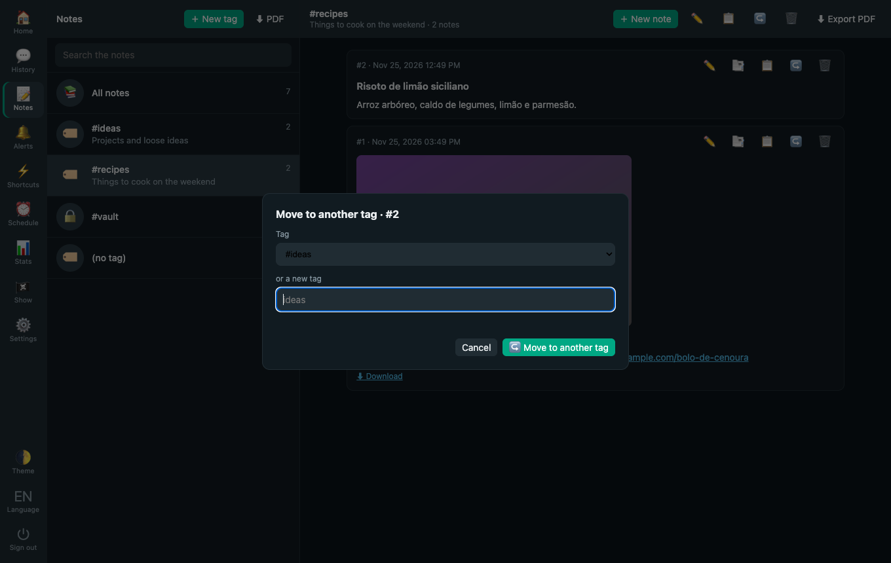

### Protected tags

A tag protected by [`/notes -lock`](commands/notes.md#protected-tags--lock) comes **locked** 🔒: no text and no file,
only the lock. Type the password of the tag to read it. The key stays only in memory, tied to **that login**, and it
locks again after `notes.lockMinutes` without use (or with *Lock now*, or on logout). It is an unlock of the page
only: it does not open the tag in the chat, and the other way around. The text and the images are decrypted in memory
(nothing decrypted is written to the cache), 5 wrong passwords block the tag for 15 minutes and the PDF of a locked
tag stays out until you unlock it. A protected tag cannot be renamed here (`/notes -move` in WhatsApp does it).


## Alerts

Two tables: the price alerts and the `/watch` rules (the monitored contacts have their own page, [Monitor](#monitor)).
Each one has **＋ Add** and, in each row, ✏️ edit and 🗑️ delete.


### Price alerts

The alerts of [`/stocks`](commands/stocks.md) and [`/crypto`](commands/crypto.md): symbol, rule (`BTC > 90000`), where
it notifies and the message. A price keeps its cents (`6.20`). Adding or editing goes through the same code as the
command, so the checks are the same: a symbol that does not exist, the price that cannot be read and the "already met"
rule are refused with the same text. An edit keeps the date the alert was created.


### /watch rules

The rules of [`/watch`](commands/watch.md) (a text, or `/regex/flags`; an invalid or risky regex is refused), where each
one notifies, how many matches it has had and the date of the last. The **📜** button opens the **history of the rule**:
every message that matched, with when, the chat, who said it and the text.

A click on the chat or on the text of a match **opens that chat in the History, at the message**: it has an
**orange outline**, the part that matched is **highlighted**, and a `🔎 /watch: <rule>` line says which rule it was
(more than one, if several matched). These marks show whenever you read that chat, not only when you come from
here.

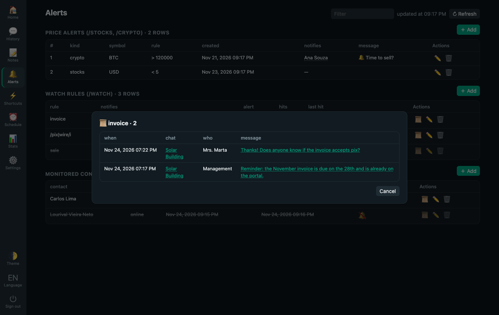


**Try it before saving.** The form of a rule tries it, while you type, on the **last 3000 messages received** (the
ones the `/watch` would have seen: not yours, not commands): how many it would match, in which chats, and each match
with the part that matched highlighted (a click opens it in the History). An invalid or risky regex shows the same
error the command gives. Above it, buttons insert the usual pieces: **/…/i** turns the text into a regex (escaped),
`\b`, `a|b`, `\d+`, `.*` and `(?:…)`. Too many matches warn you: each one is a notice.

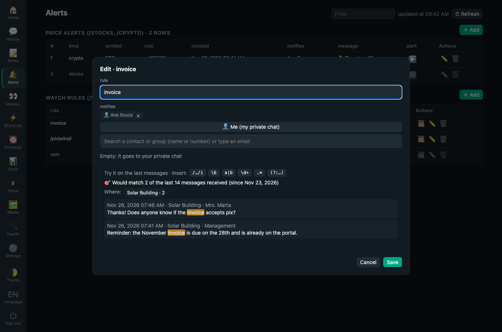

### The alert column and who is notified

Everything that can be turned on and off has the **same cell, in the `alert` column**, and **a click on it toggles**:

- in the `/watch` table, 🔔 is the **notice of the rule** on and 🔕 off. With it off the matches keep being saved (and
  the history of the rule keeps growing), but nobody is told;
- in the price alerts, ▶️ is an alert being checked and ⏸️ a paused one (the same as `-alert -pause` / `-resume`);
- in the schedule, ▶️ is a message that is running and ⏸️ a paused one.

Off or paused, the **whole row goes duller, with the text struck through** (it still works; nothing is hidden, just
dimmer), so a glance at the table already tells which rules, alerts and messages are not doing anything right now.
The bell/play button itself, and the row's own 🗑️/✏️/📜 buttons, stay as they are.

The price alerts and the `/watch` rules have a **contact picker** in the field *notifies*. Type part of a name (or a
number) and the matching contacts and groups of your address book show up; click one to add it (several are fine), or
type an email address. **👤 Me** adds your own account. Empty means your private chat. The same picker chooses the
contact of the [Monitor](#monitor).

## Monitor

The contacts of [`/monitor`](commands/monitor.md), one card each, **online first** and then the most recently seen.
Above them, the loop: 🟢 checking, ⏸️ paused (`monitor.enabled` off or the bot paused), ⏳ waiting for WhatsApp or 🚫
`/monitor` disabled, the interval (`monitor.pool`), how many of the `monitor.max` slots are used and **⏸️ Pause** /
**▶️ Resume**, which turns `monitor.enabled` off and on without deleting anything. **＋ Add** picks a contact of your
address book (it is off when the list is full).

Each card has:

- the photo with a **presence dot**: green is online, grey offline and dashed not known (the contact hides it, or it was
  not read yet);
- *online now* or *seen 40 minutes ago*, the status the monitor read, when it was checked and **when the next check
  is** (the times keep moving while the page is open, with the full date on hover);
- **when it is usually seen**: the one or two hours with the most readings (*usually seen around 08h and 19h*);
- the **last 7 days** as a strip, a tick for each time it was seen;
- **⏱️ Online**: the time online today, in 7 days and per visit, and a **timeline of the last 7 days** (a row per day,
  24 h wide, a bar for each time it was online, striped while it still is, with a red mark at now);
- **🔥 When it is seen**, a weekday × hour heatmap of every reading (it remembers which ones you opened);
- the error of the last check, if any.

And the buttons: **🔔 / 🔕** toggles the online alert, **🔄** checks it in the next round of the loop (about 10 s, past
the `monitor.pool` wait), **📜** opens each reading (with a 🗑️ to remove one), **💬** opens the chat with the contact in
the History, **✏️** edits the name and the alert and **🗑️** stops monitoring it (with its history). The filter shows
up with more than three contacts. The page reloads itself every minute while no window is open and you are not typing
in the filter.

The heatmap only has what the monitor kept: `monitor.maxRecords` readings per contact (30 by default). Raise it for a
sharper picture of the habits.

### Time online and online together

Each check that sees a contact **online** opens a session (or stretches the open one); the check that sees it
**offline** closes it at its *last seen*, when that is later than the start (more precise than the check). The
sessions are kept for 30 days. Checks every `monitor.pool` seconds see only part of it: a short visit between two
checks is not there, and a contact that hides its *online* has no sessions. With no check for two rounds (the monitor
paused, WhatsApp down), an open session ends at its last check instead of growing over the gap.

**🤝 Online together**, above the cards, lists the pairs of monitored contacts that were online **at the same time**
in the last 7 days, the most first: how long, how many times, the last one, and *🟢 together now* when both are
online. A click on a pair draws the two on the same 7 days, with **where they overlap in orange**. It is a
coincidence of times, not proof that they talked.

**📲 Notify on this device** (when the browser can, see [The installable app](#the-installable-app-and-the-notices-on-the-device))
turns on the notices of the bot in this browser: an *online* alert arrives as a notification, even with the page closed.

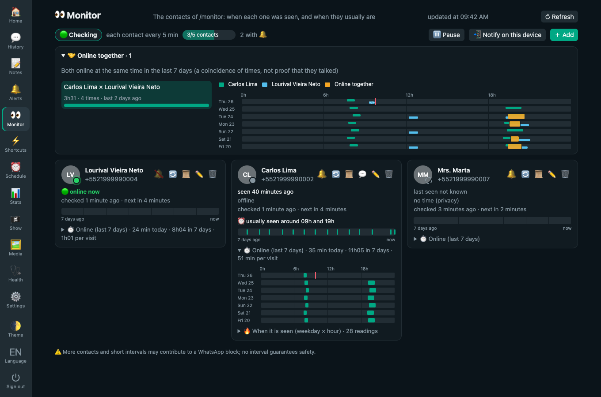

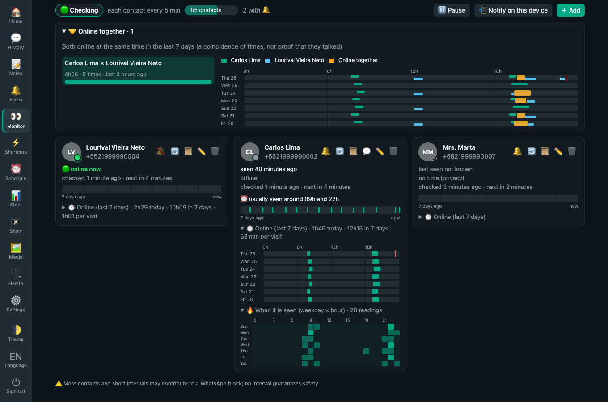

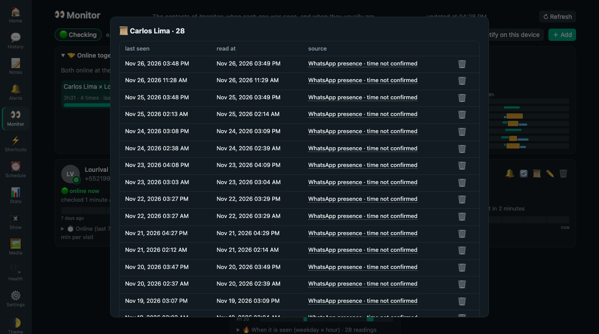

## Shortcuts

The [`/alias`](commands/alias.md) list: the shortcut, the command, the description and the flags (🔇 quiet and 🔒 only
you), each a button that flips it right in the list (🔊 answers normally, 🔓 anyone can use it). Adding and editing use the same checks as `/alias`: a name that is a command is refused and, if an edit is
refused, the old shortcut stays.

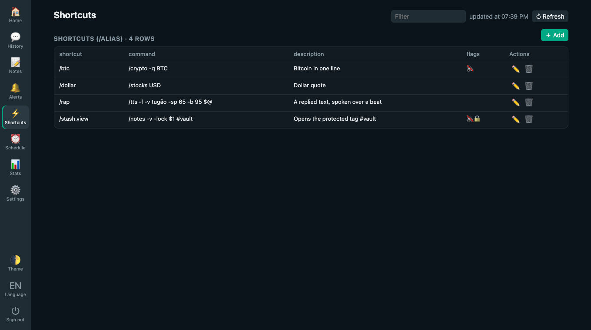

**▶️ Test** in the form: while you type, each stage of the command is **checked** (✅ ok, ❌ it does not exist, its
options are wrong or it does not read a pipe, ⚠️ checked but not run here), and **▶️ Test** runs it as if you typed it
in your private chat, showing **what it would answer** (the text with the WhatsApp marks, a picture, an audio you can
play), with **nothing sent**. Only what changes nothing runs: what [`/cron`](commands/cron.md) can run, or a command
that reads a pipe (`/tts`, `/translate`, `/qr`...), and never with an option `/cron` refuses (`-alert`, `-rm`...).

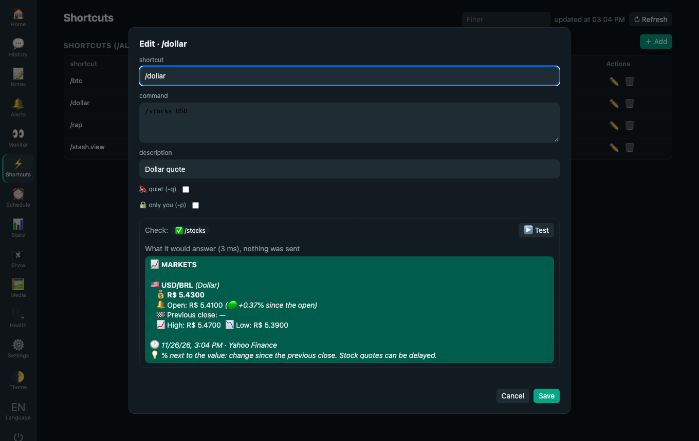

## Schedule

What [`/cron`](commands/cron.md) has scheduled: the kind (message or reminder), when, the repeat, the chat, the text and
the ▶️ / ⏸️ state. In the form (new or existing) the **chat** is chosen with the contact picker: one chat, several (the
first one is the chat and all of them receive it) or none (your own chat). Emails are not accepted here: a scheduled
message goes to WhatsApp.

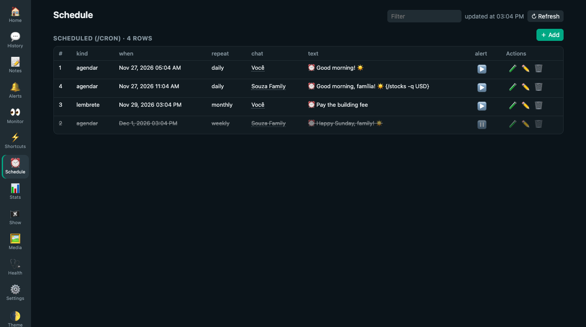


**🧪 Test now** (each row, and **🧪 Test** in the form, with what is typed and not saved yet) builds the message **as it
will go out**: its `{/commands}` run for real, as at the scheduled time and as in its first chat (a `/stats` is the
group's), and the window shows where it goes, when, the text with the WhatsApp marks, the media and the commands that
failed. **Nothing is sent** and the schedule is not touched (the same as `/cron -test <no.>`). A text that starts with
`/` (`/stocks USD`) goes out as text and does not run (the bot never runs what it sends itself): the window warns and
shows the braces that would run it (`{/stocks USD}`). **↻ Run again** builds it again.

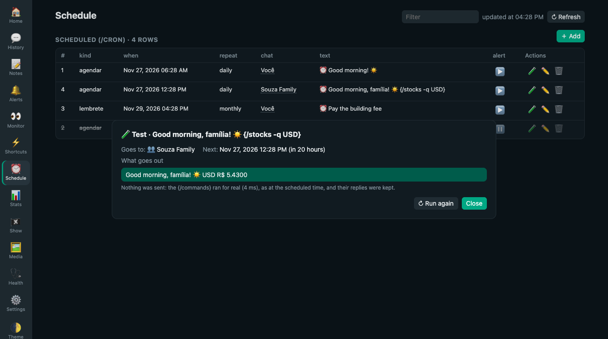

## Statistics

Charts of the counters of [`/stats`](commands/stats.md) for 7, 30, 90 or 365 days. Cards with messages, media,
deleted, edits, active days, the average per day, the busiest day and the peak hour, each one with the **change against
the previous period** (▲ / ▼); messages per day (text and media stacked); deleted and edited per day (lines); the split
between text and media (donut); messages by hour; a **weekday x hour heatmap** of when the chats are busy; and the
ranking of the chats (click to open one) and of the people. Hover a bar or a cell to see the number.


## Show

What [`/show`](commands/show.md) keeps, in one place. On top, the four notices of `/show` in your private chat
(deleted, edited, reactions, statuses): click to turn one on or off (the same as `show.alert.*`). Then a tab per kind,
with the count: **deleted**, **edited** (before and after), **reactions** (the old one → the new one), deleted
**statuses** and deleted **channel** posts, newest first, with a search in the text, the chat and the person.

Each item has the photo (click it: the contact card, and there the photo in full size), the name (click it: only that
person's items), the chat (click it: the History opens at that message), when it happened and what was recovered (the
text and the media; click an image to see it big). 🔇 mutes the person (the same as [`/mute`](commands/mute.md), every
notice, no deadline) and 🔊 unmutes; 🗑️ takes the item out of the cache. To take out several at once, click the items
(Shift+click picks a range; **All**, above the list, picks every one) and then 🧹. On the side, who deletes, edits and reacts the most, with the counts and the
🔇: click a person to see only theirs (the box stays highlighted; click again to see everyone).

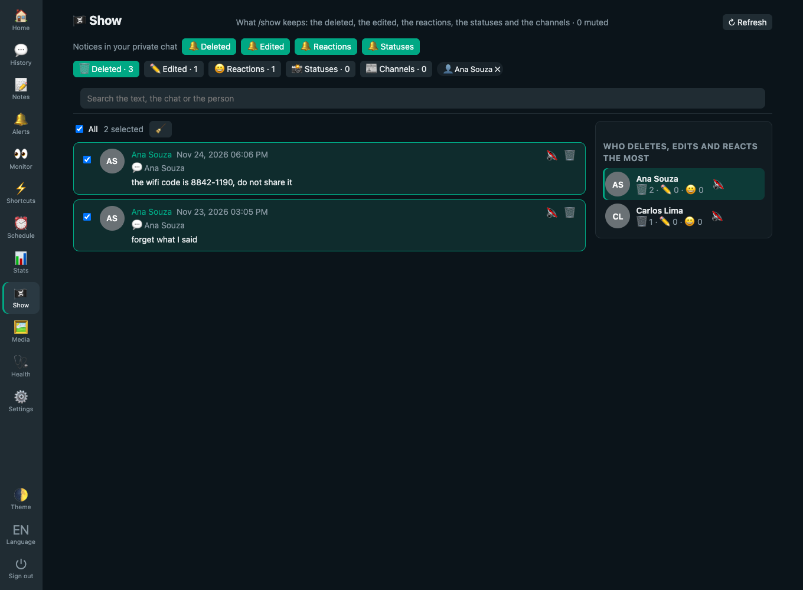

## Media

Every picture, video, audio (voice notes too), sticker and document the bot kept, **the newest first**, with the size
of each one. The chips filter by **kind** (each with how many there are), the next ones by **period** (7, 30, 90 days
or always), and the panel on the right lists **the chats that take the most space**: a click shows only that chat.

A click opens the **viewer**: the picture or the video (the audio plays), the chat, who sent it, the date, the size and
the caption, with **←/→** (the keyboard arrows too) for the next ones, **💬 Open in the chat** (at the message),
**⬇️ Download** and **🧹 Free this file**. Freeing takes the file off the disk; the message stays in the history, with
its media missing. **☑️ Select** (or Shift/Ctrl+click) picks several to free at once. The deleted messages have a red
dashed frame and a 🗑️. A document shows as a **sheet with its extension** (PDF red, DOC blue, XLS green, PPT orange,
ZIP brown...), and a file the cleanup takes in less than a day has a ⏳. A **video shows a frame of it**, with ▶ and
its duration, and a picture a small copy (360 px) instead of the whole file: both are made the first time they are
seen (ffmpeg and sharp, two at a time) and kept in `cache/tmp/thumbs`. The search box finds by the **name**, the
**caption** or the **chat**; in the viewer, **Delete** frees the file.

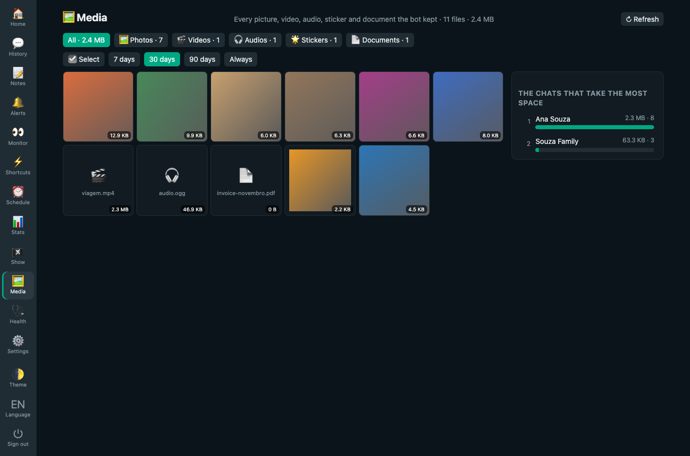

**☰ List** shows a row per file: the name, the **size**, the **type** (MIME), the date, the chat and **when the
cleanup takes it** (`cache.messageMediaRetentionDays`; a deleted message, `cache.revokedRetentionDays`; red under a
day). A click on a column header sorts by it (again: the other way), over every page, so *Size ▼* gives the biggest
files first. The browser remembers grid or list.

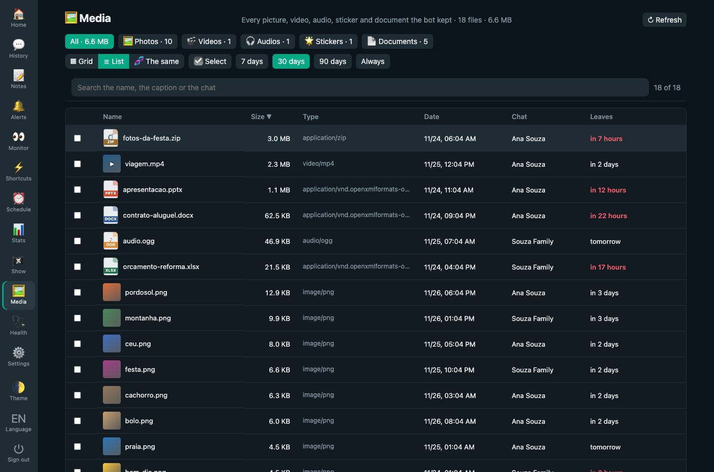

**🧬 The same** groups the files that have **the same content** (the same picture forwarded to three chats, the same
PDF in two groups): only files of the same size are read, and their SHA-1 decides. Each group shows the messages that
have it and how much joining frees. **🔗 Join the copies** turns each copy into a **hard link** of the oldest one: the
space is freed and **every message keeps its media**; the cleanup still removes each one on its own date (removing one
link does not take the others). A joined copy has a 🔗, and the panel of chats says what the files take on disk for
real.

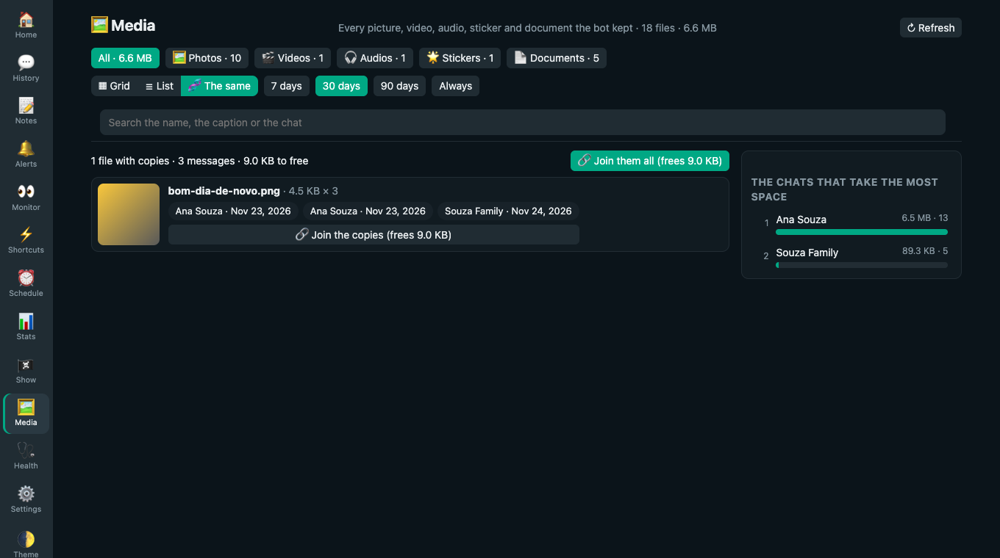

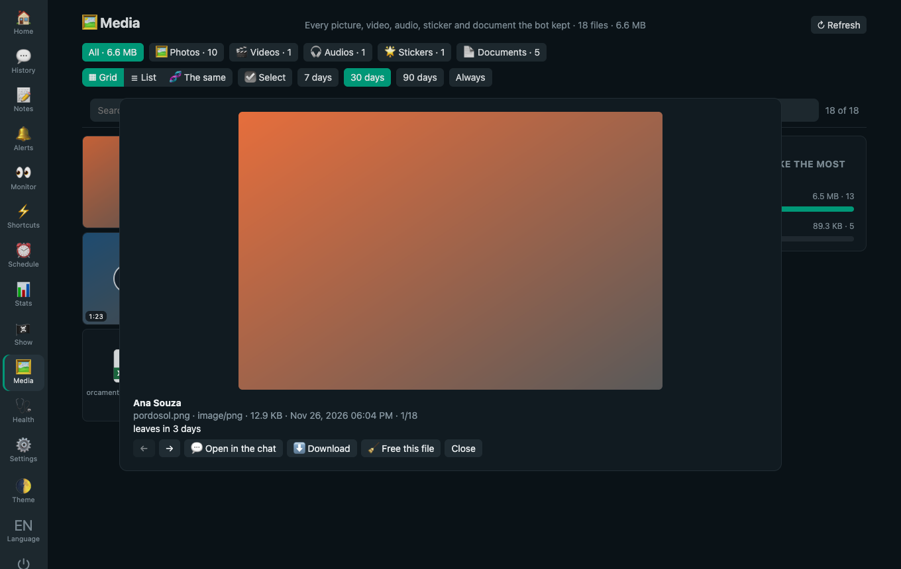

## Health

How the bot is doing **right now**, updated every 10 seconds, with a verdict on top (✅ all good, ⚠️ worth a look,
🚨 something is wrong) and why:

- **WhatsApp**: connected (since when), connecting, down or restarting, the last drop and the failed attempts;
- **the process**: up since, memory (RSS and the JS heap), the **event loop delay** (p99, mean and max: above 500 ms the
  bot is slow to answer), the load and the free memory of the host, and the version;
- **the periodic checks** (`/cron`, `/monitor`, the price, `/notes` and `/defi` alerts): idle or running, **stuck**
  (red, after 10 minutes), how many rounds and how long the last one took;
- **the regex worker** of `/watch` and the searches: how many are waiting and how many were answered "no match"
  (queue full or past the deadline);
- **the last 50 errors of the log**, already masked as the log shows them (a click opens the whole text).

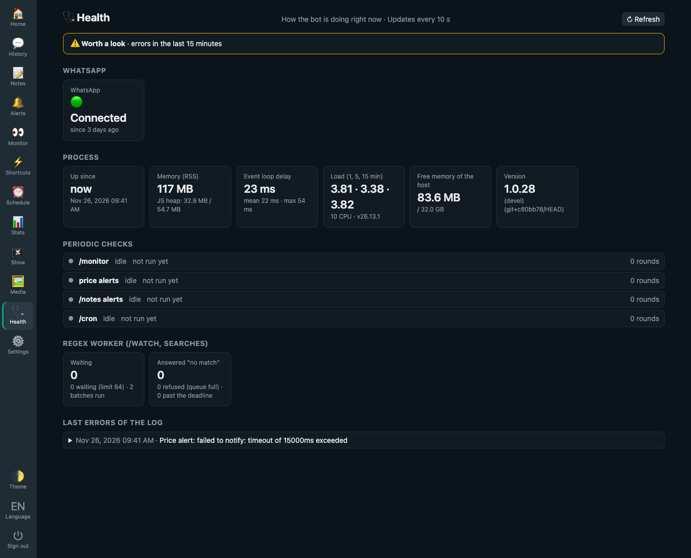

### Pairing from the web

When WhatsApp loses the session and asks for a QR Code, the web shows it, **wherever else it goes** (the terminal,
the email): a bar **📲 WhatsApp needs to be paired** on top of every page leads to Health, where the WhatsApp card
becomes the **QR Code**, with the steps on the phone (*Settings › Linked devices › Link a device*), its number and
time. WhatsApp renews it about every 20 seconds: the page follows (it checks every 3 s while waiting) and, once read,
the card turns into 🟢 Connected. The phones with the **📲 WhatsApp needs to be paired** notice on (Settings › 📲 This
device) get a notification at the first code of each wait, which opens Health.

The QR Code **links a device to the account**: it only comes behind the web login, as an image that is never
cached (the code is never in the JSON of the page), and each one shown goes to the log with the address that opened
it (`Web: the WhatsApp QR Code #2 was shown to 192.168.1.10`). The terminal and the email give its **direct address**,
`<web>/qr` (`QR Code #2: also on the web: https://zap.example.com/qr`), which opens Health through the login. To have
it **only on the web**, set `QRCODE_WEB_ONLY="true"` (see [where the QR shows up](installation.md#authentication-qr-code-in-the-terminal-or-by-email)).

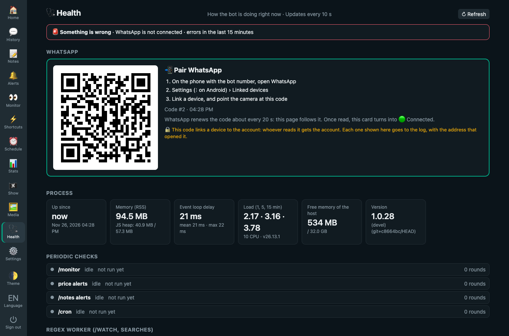

**🔌 Disconnect (logout)**, in the WhatsApp card while it is connected, unlinks the bot from the account (the same as
*Linked devices › Log out* on the phone) and the new QR Code shows up right there, to pair again: the same number or
another one. It asks **Yes / No** first; until the code is read, the bot does not answer, nor sends the
schedule, the alerts or the monitor. The log and the email say who asked (`WhatsApp: logout asked by the web
(192.168.1.10)`).

A logout made **on the phone** does the same: the bot restarts by itself and shows a new QR Code (in the terminal,
the email and here), with the email **📲 WhatsApp logged out: new QR Code**. Only another instance opening the same
session (`CONFLICT`) still waits for you, so the two do not keep taking it from each other.

## The installable app and the notices on the device

The page can be **installed as an app** (Chrome, Edge, Android: **⬇️ Install the app** in Settings → 📲 This device;
iPhone: Safari → Share → *Add to Home Screen*): its own icon and window, and shortcuts to the Monitor, the Notes and
the History. Installed or not, the notes you open **stay available offline** (a 📴 bar says when there is no
network); the notes of a **protected tag never** do, not even unlocked, and everything kept is forgotten at the logout.

**📲 This device** also turns on the **notices of the bot in this browser**, even with the page closed: a monitored
contact that came online, a `/watch` match (a click opens the message), a price alert and an access to the page. Pick
which ones; **Send a test** checks it. Each browser is one subscription; the push service of the browser only carries
it, **encrypted end to end** (the standard Web Push, with the bot's own keys, made the first time). A browser that
leaves is removed by itself.

The notices and the service worker need the page on **https** (or on `localhost`): with
[Tailscale serve](#from-the-phone-over-the-internet-tailscale) or a proxy with a certificate it just works; on plain
`http://<ip>:3200` the panel says so.

## Settings

On top, a **panel only for the web interface** (the `zapbot.web.*` settings), so you adjust it without searching a long
list. Below, the table with **all the other settings**.

### The web panel

Four cards: **Access** (`enabled`, `host`, `port`, `url`, `trustProxy`), **Login and session** (`login`, `password`,
`totp`, `sessionHours`, `sessionTimeout`), **Screen** (`pageSize`, `refreshSeconds`) and **Warnings** (`warnAccess`,
`warnChangedPhone`). Next to the title, the address to open the interface.

- a **switch** for the on/off settings and a box for numbers and text: it saves when you leave the box, with a
  `✔ saved` (or the error of the same checks of `/set`);
- ↺ goes back to the default of a setting that was changed;
- ⟳ marks what only applies when the bot restarts (`enabled`, `host`, `port`);
- 🔒 marks what only `/set` in WhatsApp changes: the login, the password (shown as `••••••••`) and the TOTP secret;
- 🔧 marks a setting that a variable of `config/.env` decides (`ZAPBOT_WEB_ENABLED`, `ZAPBOT_WEB_HOST`,
  `ZAPBOT_WEB_PORT`): it shows the variable and its value, read-only, because the variable wins over the setting.

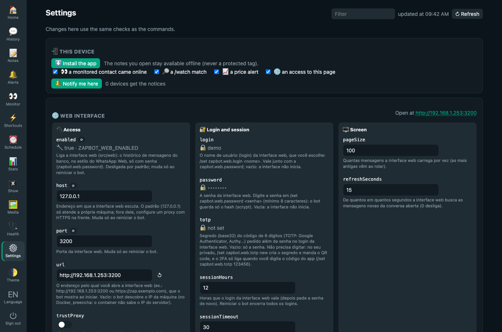

### The other settings

Every other setting with its value, its default and what it does. ✏️ edits (the same validation of `/set`: a wrong value
is refused with the same text) and ↺ goes back to the default. The secret ones (keys, passwords, hashes) appear masked,
and `bot.login` cannot be changed here.

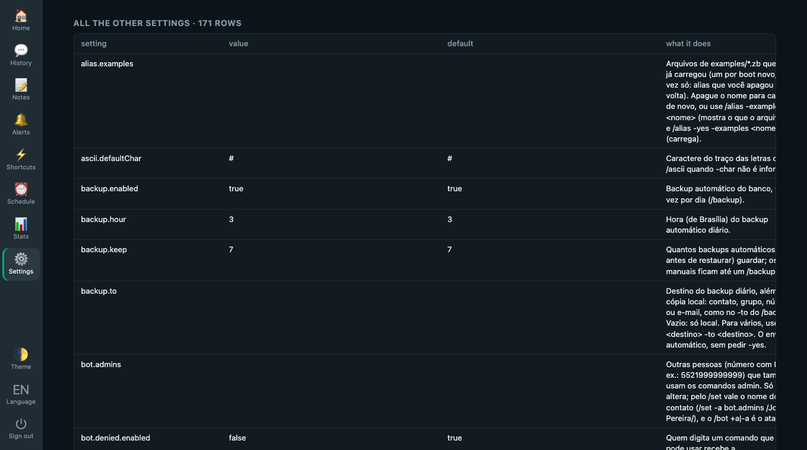

## Buttons and icons

| Icon | Where | What it does |
|---|---|---|
| ＋ | the title of a list | Adds a row (a form opens) |
| ✏️ | each row | Edits it, with the same checks as the command |
| 🗑️ | each row | Deletes it (it asks first); in the Settings, ↺ goes back to the default |
| 📜 | `/watch` rows and Monitor cards | Opens the history of the rule or of the contact |
| 🔔 / 🔕 | the `alert` column and the Monitor cards | On / off; a click toggles |
| 🔄 | the Monitor cards | Checks the contact in the next round of the loop |
| ▶️ Test | the shortcut form | Runs the command and shows what it would answer, without sending |
| 🧪 | the schedule | Builds the message as it will go out, its {/commands} run, without sending |
| ☑️ | the Media | Picks several files (on the phone, where there is no Shift) |
| 📲 | the Monitor and the Settings | Turns the notices on this device on and off |
| ▶️ / ⏸️ | the schedule | Running / paused; a click toggles |
| 🧹 | the header of a chat | Clears its history, keeping the deleted, edited and reacted messages |
| 👤 | the contact picker | A contact or a group; *Me* is your own account |
| 🔒 | tags and settings | Protected tag; setting only `/set` changes |
| 🔧 | the web panel | A setting that an environment variable decides |
| ⟳ | the web panel | It only applies when the bot restarts |

## Security

- **Only with the password**: every request but the page and the login needs the session. The session is a random
  token in an `HttpOnly` + `SameSite=Strict` cookie, kept in memory, and lasts `zapbot.web.sessionHours`.
- **5 wrong passwords block the address for 15 minutes**, and every failure and every login is logged with the login
  name that was tried (never the password).
- **You are warned in WhatsApp**: a wrong password (of the login or of a protected tag) sends `⚠️ ZapBot-Web: wrong
  password from <address> (attempt 2 of 5)` to the chat with yourself, and the block sends `🚫 ZapBot-Web: ... is
  blocked for 15 minutes`. A burst from the same address in 15 seconds is joined into one notice. The password typed
  is never in the notice.
- **Opening the page also warns you**: when someone who is not logged in opens the address of the interface, you get
  `⚠️ ZapBot-Web: someone opened the login page from <address>` with the first 100 characters of the browser's name.
  The flood limits: **one notice per address every 10 minutes** (the other visits are counted and told in the next
  one) and **at most 5 notices in 10 minutes** from any address (the rest is only counted). Only the page counts, not
  its files or the API, and a browser that is already logged in does not warn. Turn it off with
  `zapbot.web.warnAccess off`.
- **Changes are only the ones you can see**: the page can change shortcuts, alerts, `/watch` rules, monitored
  contacts, the schedule, notes and settings, and free media files, always through the same code of the commands, and **never** the login, the
  password and the TOTP secret (only `/set` in WhatsApp). It cannot send messages to other people. Every change is
  logged, without the values. The POSTs only take JSON.
- **Isolated page**: no inline script (strict CSP), `nosniff`, no framing, and the media is served with a `sandbox` CSP:
  a stored HTML file never runs, it downloads. The media only comes from the cache folder (a path outside it is never
  served).
- **Second factor (optional)**: with `zapbot.web.totp` set, the login also asks for the 6-digit code of an authenticator
  app. `/set zapbot.web.totp new` makes the secret and shows the QR code in your private chat, and the 2FA only turns on when you type the code of the app (see
  [Two-step login (2FA)](#two-step-login-2fa)). A wrong code counts as a wrong password.
- **Behind a proxy**, turn on `zapbot.web.trustProxy` and set `ZAPBOT_WEB_TRUSTED_PROXIES` to the
  comma-separated IP addresses of the proxies that connect directly to ZapBot. In Docker, use
  the addresses seen from inside the container. Configure the proxy to replace `X-Forwarded-For`
  or append its client's address, and to overwrite `X-Forwarded-Proto`. ZapBot uses the last address
  to count login attempts and adds `Secure` to the cookie when the proxy reports `https`.
- **Push notices** are encrypted for each browser (RFC 8291) and signed with the bot's keys (VAPID): the push service
  of the browser cannot read them. **Offline**, only the notes the server marks as safe stay in the browser (never a
  protected tag) and the logout forgets them.
- **The tries run nothing that changes anything**: ▶️ of a shortcut only runs what `/cron` could (no `-alert`, `-rm`...)
  and its replies are kept, never sent; the try of a `/watch` rule only reads the last messages.
- **Protected notes** open on the page only with the password of the tag, in memory, and what is decrypted is never
  written to the cache. **What the bot sends in the chats with a decrypted note is never saved** in the database
  (`notes.lockPrivateOnly` says where the notes open in WhatsApp).

## Reference of the settings

| Setting | Default | What it does |
|---|---|---|
| `zapbot.web.enabled` | `off` | Turns the interface on (takes effect after restarting) |
| `zapbot.web.login` | *(empty)* | The login name you choose (3 to 40 characters). Empty: it does not start |
| `zapbot.web.password` | *(empty)* | The password; the bot stores its hash. Empty: it does not start |
| `zapbot.web.host` | `127.0.0.1` | Address it listens on |
| `zapbot.web.port` | `3200` | Port |
| `zapbot.web.url` | *(empty)* | The address you open it at, shown in the startup message |
| `zapbot.web.sessionHours` | `12` | How long a login lasts |
| `zapbot.web.pageSize` | `100` | Messages loaded at a time |
| `zapbot.web.refreshSeconds` | `15` | How often it looks for new messages (`0`: never) |
| `zapbot.web.sessionTimeout` | `30` | Idle minutes before logout (`0` disables it) |
| `zapbot.web.totp` | *(empty)* | Base32 secret of the 6-digit code asked besides the password |
| `zapbot.web.trustProxy` | `off` | Reads forwarded headers from peers listed in `ZAPBOT_WEB_TRUSTED_PROXIES` |
| `zapbot.web.warnAccess` | `on` | Warns you (⚠️) when someone opens the login page and is not logged in (flood limits above) |
| `zapbot.web.warnChangedPhone` | `on` | Shows the notices that someone's security code changed inside the chats |

## Docker and environment variables

In Docker the image already exposes the port `3200` and listens on every interface inside the container
(`ZAPBOT_WEB_HOST=0.0.0.0`); the `docker/docker-compose.yml` publishes it only on the **host's** `127.0.0.1`
(`127.0.0.1:3200:3200`). To reach it from another machine, use an SSH tunnel (`ssh -L 3200:127.0.0.1:3200 host`), an
HTTPS reverse proxy in front, or, knowing the risk, `ZAPBOT_WEB_BIND=0.0.0.0` in `docker/.env` (which is not in git).
Without it, `http://<server-ip>:3200` does not answer: the port is only on the server's own `127.0.0.1`.

| Variable | Where | What it does |
|---|---|---|
| `ZAPBOT_WEB_ENABLED` | `config/.env` | `true` / `false`: turns the interface on or off, over `zapbot.web.enabled` |
| `ZAPBOT_WEB_URL` | `config/.env` or `docker/.env` | The address shown in the startup message (the `zapbot.web.url` setting wins over it) |
| `ZAPBOT_WEB_HOST` | `config/.env` | The address it listens on, over `zapbot.web.host` (the image sets `0.0.0.0`) |
| `ZAPBOT_WEB_PORT` | `docker/.env` | The port, over `zapbot.web.port`; in Compose the published port follows it |
| `ZAPBOT_WEB_BIND` | `docker/.env` | Compose only: where the host publishes the port (`127.0.0.1` by default) |

After changing one of them, run the deploy again: the variables are read when the bot starts.

## From the phone, over the internet (Tailscale)

You're out, on 4G, and you really want to see who deleted a message in the family group 👀. But
ZapBot is sitting in Docker on the server at home, and its web only listens on `127.0.0.1` (on
purpose: nobody from outside gets in). Opening a port on the router to the whole internet? No way.

The neat way out is [Tailscale](https://tailscale.com/download): a VPN that links your devices as if they were all on your
home network. It's free for personal use, needs no open port, works even behind your carrier's CGNAT
and only the devices logged in to **your** account see the bot. About 10 minutes and you're done:

1. **Install it on the server** (where Docker or `npm start` runs). It runs everywhere:
   - 🐧 **Linux:** `curl -fsSL https://tailscale.com/install.sh | sh` and `sudo tailscale up` (it
     gives you a link to sign in).
   - 🍎 **macOS:** `brew install --cask tailscale-app` (or the App Store) and sign in from the menu
     bar icon.
   - 🪟 **Windows:** `winget install Tailscale.Tailscale` (or the installer at
     [tailscale.com/download](https://tailscale.com/download)) and sign in from the tray icon.
2. **Publish the web only to the VPN, with HTTPS already:**

   ```bash
   sudo tailscale serve --bg 3200    # on Windows, without sudo, in an administrator terminal
   tailscale serve status            # shows the address: https://<machine>.<your-tailnet>.ts.net
   ```

   `serve` forwards to the server's own `127.0.0.1:3200`, so no touching `ZAPBOT_WEB_BIND` or the
   compose. The first time it asks you to turn HTTPS on in the account: open the link and confirm.
   On macOS, if the `tailscale` command doesn't exist, install the CLI from the app's settings.
3. **Install it on the phone:** the Tailscale app on [iPhone](https://tailscale.com/docs/install/ios) or [Android](https://tailscale.com/docs/install/android), sign in
   with the same account and turn the VPN on. If you'd rather watch someone do it, the official
   video [How to get started with Tailscale](https://www.youtube.com/watch?v=sPdvyR7bLqI) (about 10 minutes) shows it all.
4. **Open** the `https://...ts.net` address in the phone's browser and sign in with the web login.
   For the startup message to show that address: `/set zapbot.web.url https://<machine>.<your-tailnet>.ts.net`.

Done: the bot in your pocket, with nothing exposed. A few cautions:

- **Don't use `tailscale funnel`**: it opens the web to the whole internet, exactly what we're
  avoiding.
- The web's login, password and 2FA still apply: Tailscale only decides who reaches the door.
- Through `serve`, every access comes from the server's own address, and that's what shows in the
  notices and in the block after 5 wrong passwords (see *Behind a proxy* in [Security](#security)).
- Had enough? `sudo tailscale serve --https=443 off` (or `tailscale serve reset`) turns it off.

## Questions and problems

| The problem | What to check |
|---|---|
| The page does not open | `zapbot.web.enabled`, the login and the password have to be set (`/set`), and the bot restarted. The log tells which one is missing |
| It opens on the server but not from another machine | By default it only listens on `127.0.0.1`; see Docker above (`ZAPBOT_WEB_BIND`, a tunnel or a proxy); from the phone, [Tailscale](#from-the-phone-over-the-internet-tailscale) |
| `ZAPBOT_WEB_ENABLED=true` did nothing | The variable has to reach the container (`config/.env` is read by the compose) and the bot has to be redeployed; the Settings page shows 🔧 when it is being used |
| *Blocked for 15 minutes* | 5 wrong passwords from that address. Wait, or restart the bot (the blocks are in memory) |
| The history of a chat is short | Only what is in the database is shown; see the retention settings in [`/cache`](commands/cache.md) |
| A contact does not show in the list of chats | Chats with only WhatsApp notices (a security code that changed) are not listed |
| The numbers of the Home are lower than the notices I see | The counters count real messages; notices of the system do not count |
| The picker finds no contact | It searches the address book and the groups of the connected WhatsApp; type at least 2 letters or a full number |
