# Interface web

O bot pode servir uma **interface web** (desligada por padrão) para ver, e também administrar, o que ele guarda: o
histórico de todas as conversas no estilo do WhatsApp Web (com as mensagens **apagadas** e **editadas** em destaque),
as notas, os alertas, os atalhos, a agenda, gráficos das suas conversas e os settings.

!!! danger "Ela mostra todas as mensagens da sua conta"
    Quem entra lê tudo o que o bot guardou. Use uma senha longa, mantenha a interface em `127.0.0.1` (o padrão) e,
    para abri-la na rede, ponha um **proxy reverso com HTTPS** na frente.

Todas as imagens desta página foram feitas com **dados inventados** (os nomes, os números e as mensagens não
existem), no tema escuro, salvo quando disser o contrário. A interface segue o setting `zapbot.lang` (inglês ou
português) e o botão embaixo da barra da esquerda troca o idioma; a página em inglês deste manual tem as mesmas imagens
em inglês.

Use [`/web`](commands/web.md) no seu privado para gerenciar o acesso, as sessões e o 2FA.

## Início rápido

```text
/set zapbot.web.login jorge.admin
/set zapbot.web.password uma-senha-bem-longa-aqui
/set zapbot.web.enabled on
```

Reinicie o bot: a interface sobe junto com ele, em `http://127.0.0.1:3200`. O **login** é o nome que você escolhe (3 a
40 caracteres: letras, dígitos, `.`, `-`, `_` ou `@`) e a **senha** tem no mínimo 8 caracteres; o bot guarda só o
**hash** da senha (scrypt), e o `/set` a mostra escondida. Sem login ou sem senha a interface não sobe (o log diz o
que falta).

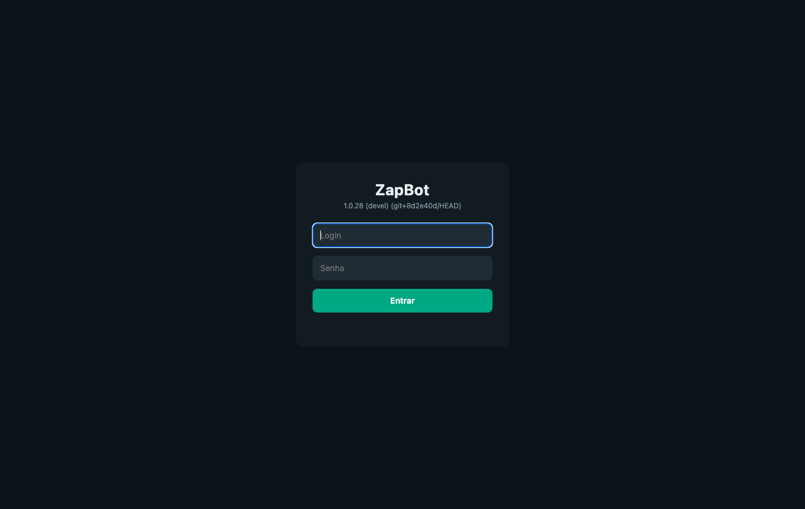

No `config/.env`, `ZAPBOT_WEB_ENABLED=true` (ou `false`) decide por cima do setting `zapbot.web.enabled`, e
`ZAPBOT_WEB_PORT` e `ZAPBOT_WEB_HOST` por cima da porta e do endereço
([as variáveis](configuration.md#interface-web-opcional)).

No Compose, a porta é publicada no loopback **do servidor Docker**. Para acessar de outro
computador sem abrir a porta na rede, crie um túnel SSH e abra `http://127.0.0.1:3200` no navegador.

```bash
ssh -N -L 3200:127.0.0.1:3200 user@docker-host
```

Depois de editar os arquivos de ambiente, aplique a configuração com
`docker compose -f docker/docker-compose.yml up -d zapbot` na raiz do projeto.

## Login em duas etapas (2FA)

Com o 2FA ligado, o login pede o **código de 6 dígitos** de um app autenticador (Google Authenticator, Authy,
1Password...) além do nome e da senha. O bot cria o segredo, mostra o **QR code** no chat e só liga o 2FA depois que você
**prova que o app funciona** com um código, então um scan que falhou nunca deixa você de fora:

```text
/set zapbot.web.totp new
/set zapbot.web.totp 123456
```

1. Digite `/set zapbot.web.totp new` no **seu privado** (as mensagens com você mesmo). O bot manda uma imagem com o
   **QR code** e, na legenda, o mesmo segredo como texto, em grupos de quatro (`ABCD EFGH ...`). Nada é ligado ainda.
2. No app, **escaneie o QR code**, ou escolha *inserir chave de configuração* e digite esse código.
3. **Confirme**: digite `/set zapbot.web.totp` seguido do código de 6 dígitos que o app mostra agora (`123456` acima).
   Se estiver certo, o bot responde `✅ 2FA ativado`, guarda o segredo e apaga a mensagem do QR code. Se estiver errado,
   ele avisa e você tenta de novo; depois de 5 códigos errados, ou de 10 minutos, o QR code é descartado e tudo
   continua como estava.
4. Abra a interface: o login agora pede o nome, a senha e o código do app. Um código errado conta como senha errada.


- Só funciona no **seu próprio privado** e só por você; em qualquer outro lugar o bot recusa e nada é criado. A
  mensagem com o código que você digitou é apagada e fica mascarada no histórico.
- O que o bot envia **nunca é guardado**: nem na tabela de mensagens, nem na pasta de mídia. Ele também **apaga a
  mensagem do QR code depois de 3 minutos** (o WhatsApp a mantém até lá): escaneie logo.
- Com o 2FA já ligado, `/set zapbot.web.totp 123456` só diz se o código está certo, o que serve para testar o app a
  qualquer hora. `/set zapbot.web.totp qr` mostra o QR code e o código de novo; `new` de novo cria outro segredo (o antigo
  continua valendo até o novo ser confirmado); `/set -reset zapbot.web.totp` desliga o 2FA.
- O código depende do relógio do servidor e do celular: uma hora errada faz todo código falhar.

## A mensagem de inicialização

Com a interface ligada, a mensagem que o bot manda para você ao iniciar (`🤖 ZapBot ... iniciado.`) termina com
`🌐 Interface web ativa em http://192.168.1.253:3200`. O endereço é o setting `zapbot.web.url`, ou a variável
`ZAPBOT_WEB_URL`, ou o IP da máquina com a porta. No Docker preencha um dos dois primeiros: o container não sabe o IP
do servidor.

O título da aba do navegador e a tela de login mostram a versão que está rodando
(`ZapBot 1.0.26 (devel) (git+abc1234/HEAD)`), o que ajuda a saber se um deploy chegou ao servidor.

## As seções de relance

Os ícones da esquerda abrem cada parte (no celular eles viram uma barra embaixo):

| Ícone | Seção | Para que serve |
|---|---|---|
| 🏠 | Início | O que o bot guarda: armazenamento, contadores, retenção e os últimos 30 dias |
| 💬 | Histórico | As conversas e suas mensagens, com as apagadas e as editadas marcadas |
| 📝 | Notas | Tudo do [`/notes`](commands/notes.md): tags, notas, imagens, tags protegidas |
| 🔔 | Alertas | Alertas de preço, regras do [`/watch`](commands/watch.md) e contatos do [`/monitor`](commands/monitor.md), com seus históricos |
| ⚡ | Atalhos | A lista do [`/alias`](commands/alias.md) |
| ⏰ | Agenda | O que o [`/cron`](commands/cron.md) tem agendado |
| 📊 | Estatísticas | Gráficos dos contadores do [`/stats`](commands/stats.md) |
| ⚙️ | Settings | Um painel dos settings da interface web e, depois, todos os outros settings |

Embaixo da barra, os botões trocam o **tema** (automático, claro, escuro) e o **idioma** (inglês ou português; ele
segue o `zapbot.lang` do bot até você escolher outro), e o último sai. O navegador lembra o tema, o idioma e a ordem
das mensagens. Toda lista tem uma caixa **Filtrar** (ela busca nas linhas da tela) e um botão **Atualizar**, com a hora
da última atualização, que recarrega a lista com uma barra de progresso.

## Login e sessão

A página pede o nome e a senha (e, com o `zapbot.web.totp`, o código de 6 dígitos); errar qualquer um dá a mesma
resposta, então ela não diz qual foi. A sessão é um token aleatório num cookie `HttpOnly` + `SameSite=Strict`, guardado
na memória: reiniciar o bot desloga todo mundo. Ela dura `zapbot.web.sessionHours` (12 por padrão). Mais em
[Segurança](#segurança).

Após 30 minutos sem interação, a sessão expira. A busca automática de mensagens não renova o
prazo. Altere com `/web -timeout 15` ou `/set zapbot.web.sessionTimeout 15`. Use `0` para
desativar o limite de inatividade. O limite total de `zapbot.web.sessionHours` continua valendo.

## Início

O que o bot guarda, os mesmos números do [`/cache`](commands/cache.md) e do `/status`: o **armazenamento** (uma barra
colorida e a legenda, com tamanho e número de arquivos: banco, mídia, notas, fotos dos contatos, backups e arquivos
temporários), quantas conversas, mensagens, apagadas, editadas, mudanças de reação, notas, tags e tags protegidas
existem, o intervalo do histórico, a retenção de cada tipo e as conversas com mais mensagens (clique em uma para abri-la).
As mensagens dos contadores são as de verdade: os avisos do WhatsApp não contam.


## Histórico

### As conversas

A lista da esquerda vai da conversa mais recente para trás, com a foto, a última mensagem e, num selo vermelho,
quantas mensagens foram apagadas. O nome é o da sua agenda; sem ele, o nome do perfil (pushname); sem ele, o número
(`+5521...`); um grupo mostra o nome dele. A primeira caixa busca um nome ou um número; a segunda busca um texto em
**todas** as conversas, e um clique num resultado abre aquela conversa com a mesma busca.

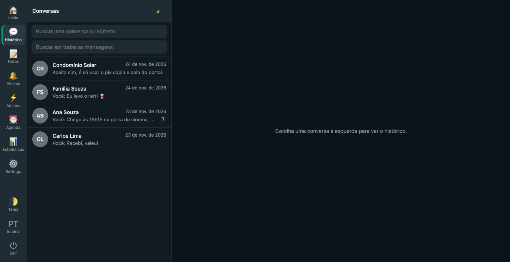

A conversa **Status** fica fixada no topo da lista, com uma cor própria.
Em **Status**, cada publicação aparece em um cartão com autor, data e hora no cabeçalho. A mídia
e a legenda ficam abaixo. O histórico usa os dados disponíveis no cache. O bot registra a hora de publicação dos novos status quando
o WhatsApp fornece essa informação.

Em uma conversa individual, clique no nome ou na foto do cabeçalho para abrir os dados do
contato. O painel mostra o telefone, o recado, o selo de verificação e os dados comerciais
disponíveis. Também dá acesso ao último Status salvo do contato, quando houver.

### As mensagens

Todo o histórico que o bot tem no banco: texto, fotos, vídeos, áudios, mensagens de voz, **figurinhas**, documentos,
localizações, emojis e reações. As transcrições que o bot fez dos áudios aparecem embaixo da mensagem.

- **Apagada**: a mensagem fica dentro de um **retângulo vermelho tracejado**, com `🗑️ apagada em <data>` embaixo (a
  mídia, se ainda estiver no cache, também aparece).
- **Editada**: dentro de um **retângulo âmbar** com `✏️ editada` e, embaixo, o **diff** de cada edição: o texto
  *antes* (o que saiu, riscado em vermelho) e *depois* (o que entrou, em verde).
- **Respostas** mostram a mensagem citada acima do texto (a citação é guardada daqui para a frente: as mais antigas não
  têm). **Menções** (`@5521...`) mostram o nome do contato. Uma mensagem cuja **reação** foi trocada ou tirada mostra
  cada mudança embaixo.
- **Mídia**: imagens, vídeos e áudios tocam na página, cada um com um link **Baixar**; um documento é sempre um download.
  Uma mídia que já saiu do cache (`cache.messageMediaRetentionHours`) vem marcada.
- **Mensagens novas** chegam sozinhas a cada `zapbot.web.refreshSeconds` (15 s) quando você está no fim da conversa, e as
  mensagens carregam `zapbot.web.pageSize` por vez.

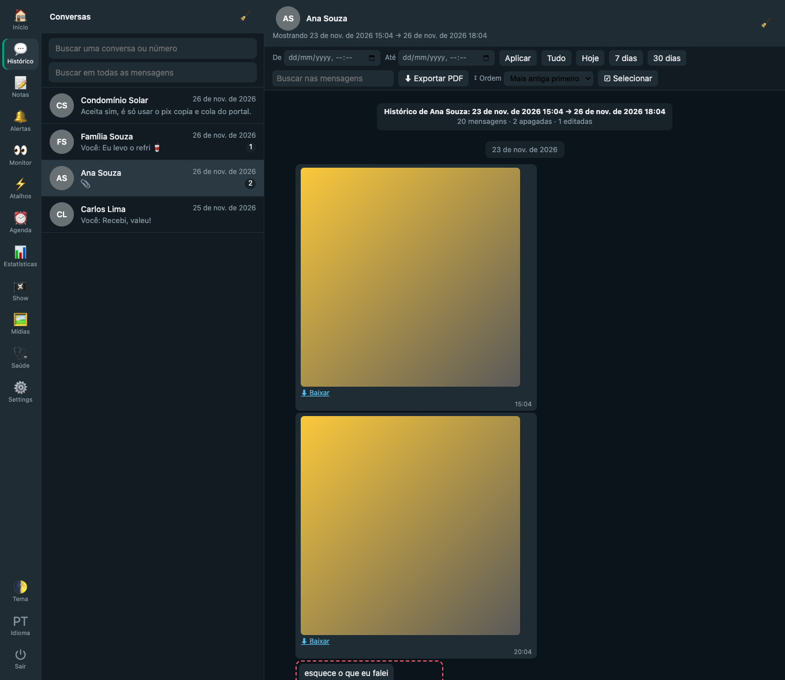

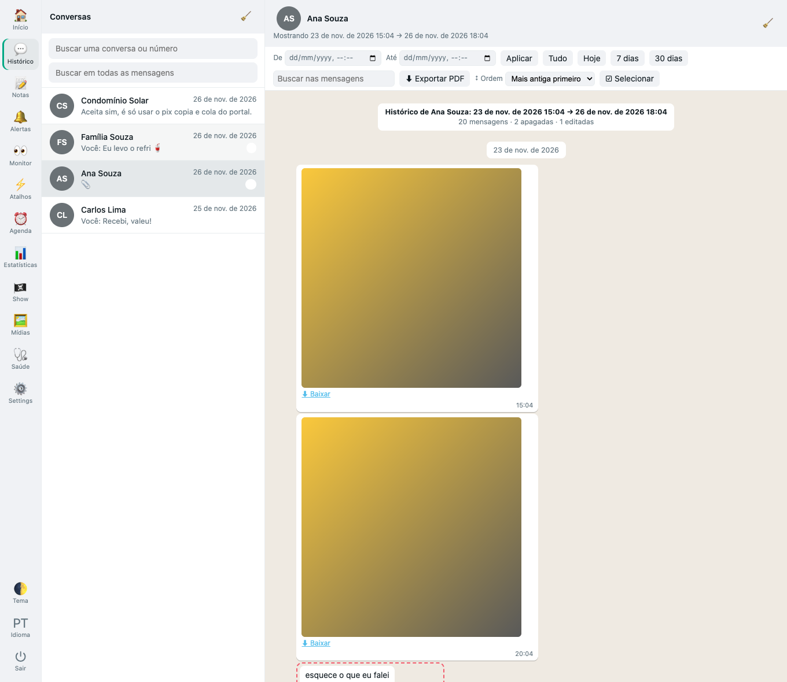

Ao abrir uma conversa, um aviso começa o histórico: `Histórico de Fulano: <primeira mensagem> → <última mensagem>`,
com quantas mensagens, apagadas e editadas há.

A seção **Histórico de reações**, abaixo da mensagem original, mostra quem trocou ou removeu
a reação, os emojis e o horário. Com a atualização automática ligada, as reações das mensagens
visíveis também são atualizadas enquanto você lê mensagens antigas.

### Lendo o histórico

- **Ordem** (a lista da barra de ferramentas): *mais recente primeiro* (o padrão: a mais recente no alto, as mais antigas
  conforme você rola), *mais recente embaixo*, como o WhatsApp (as mais antigas carregam quando você rola para cima), ou
  *mais antiga primeiro*, do começo ao fim.
- **Período**: escolha `De` e `Até` (data e hora) e clique em *Aplicar*, ou use *Hoje*, *7 dias*, *30 dias* e *Tudo*. O
  aviso e o contador embaixo do nome mostram o período que está sendo lido.
- **Buscar nas mensagens**: digite um texto e aperte Enter (ele busca no texto e nas transcrições).
- **Carregar mais**: nas ordens *mais recente primeiro* e *mais antiga primeiro* o fim da página tem um botão *Carregar
  mais*, além da rolagem.

### Selecionar, exportar e limpar

- **Exportar PDF**: o botão da barra de ferramentas faz um PDF da conversa no período da tela (até 5000 mensagens):
  quem disse o quê e quando, as apagadas e as editadas marcadas, com o texto antes e depois de cada edição.
- **Selecionar mensagens**: *Selecionar* deixa você clicar nas mensagens que quer (elas ganham uma marca ●) e *Exportar
  selecionadas* faz um PDF só com elas.
- **Limpar o histórico de uma conversa**: o 🧹 no cabeçalho da conversa apaga as mensagens dela (e a mídia) do cache,
  **menos** as apagadas, as editadas (com o texto de antes) e as que têm reações. A janela diz quantas saem e quantas
  ficam, e pede que você digite o nome da conversa; nada é apagado antes disso.


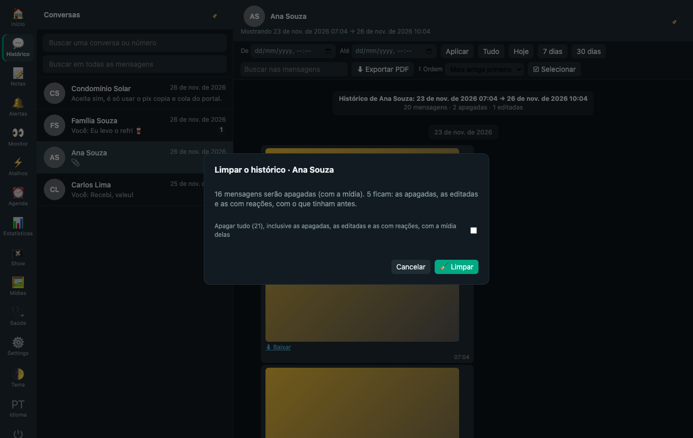

### Avisos do WhatsApp

Quando alguém troca de aparelho, o WhatsApp mostra um aviso no chat. O histórico o exibe como uma linha centralizada
(`🔒 o código de segurança de Maria mudou`, com o nome quando o bot sabe quem é; senão `de um participante`), e os
outros avisos do sistema (um evento de grupo, uma chamada) como `ℹ️ ...`. Eles nunca fazem uma conversa aparecer na
lista (um contato só com um código de segurança que mudou não é listado), nunca sobem uma conversa e nunca entram nos
totais. Com `zapbot.web.warnChangedPhone off` as linhas de código de segurança também ficam escondidas dentro das
conversas.

### No celular

A mesma página cabe numa tela estreita: a barra da esquerda vira uma barra embaixo, a lista de conversas e a conversa
se revezam (o botão *Voltar* volta para a lista) e a barra de ferramentas quebra em linhas.

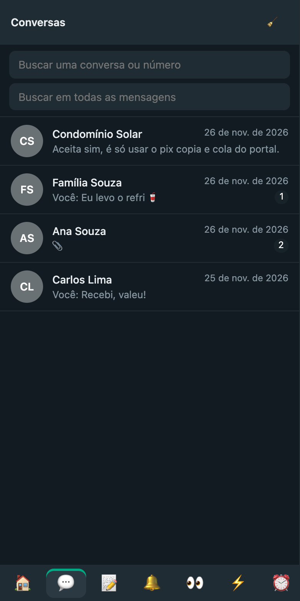


Só aparece o que o bot tem no banco: o texto das mensagens comuns fica por `cache.messageRetentionHours` (68 h por
padrão; até 90 dias), e as apagadas, editadas e com reação pela retenção própria de cada uma
([`/cache`](commands/cache.md), [`/show`](commands/show.md)). Para guardar mais histórico, aumente esses settings.

## Notas

Todo o conteúdo do [`/notes`](commands/notes.md). A lista de **tags** da esquerda tem a descrição e quantas notas cada
uma tem (`Todas as notas` e `(sem tag)` também) e uma caixa para buscar o texto das notas. Um clique numa tag mostra as
notas dela como cartões: a data, o alerta, o texto (a primeira linha é o título, os links são clicáveis) e as
**imagens** (clique para abrir em tamanho grande), com um link **Baixar** para a imagem ou o arquivo. **⬇ PDF** exporta
a tag (ou todas) no mesmo PDF do `/notes -pdf`, com as imagens.

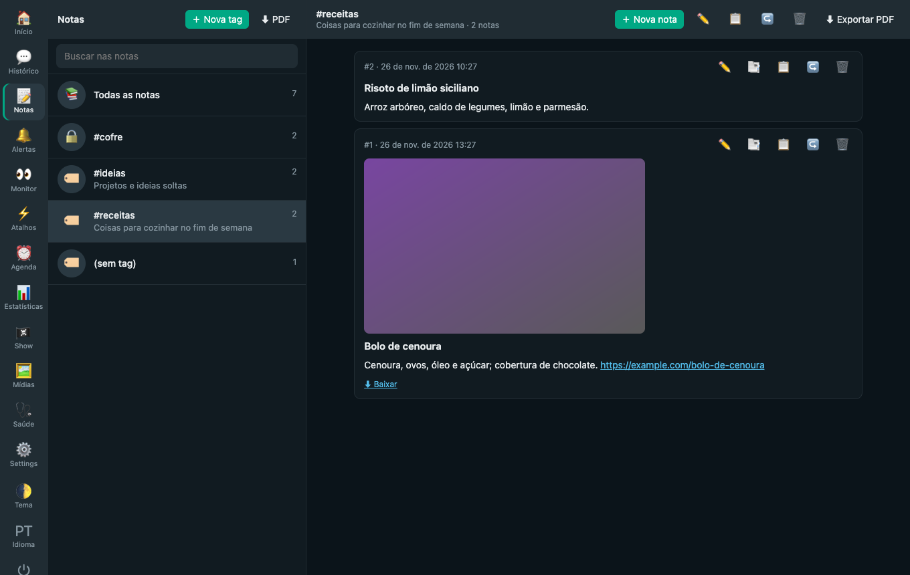

### Novas tags e notas

- **＋ Nova tag** pede um nome e uma descrição, como o `/notes -desc #tag <texto>`, e cria uma tag que aparece na lista
  mesmo sem notas. Dentro de uma tag, ✏️ muda a descrição (vazia remove) ou o nome (as notas vão junto). O **🗑️**
  remove: uma tag vazia some na hora (pergunta antes); uma com notas pede para você **digitar o nome dela** para
  confirmar, do mesmo jeito que o 🧹 do histórico, e aí apaga todas as notas, a mídia delas, a descrição da tag e o
  cadeado, se ela era protegida — o mesmo que o `/notes -rm #tag -yes` no WhatsApp, e um pouco mais (esse comando
  deixa a descrição e o cadeado para trás; aqui não).
- **＋ Nova nota** adiciona uma nota na tag, com um alerta numa data e hora se você quiser. Em cada cartão, ✏️ edita o
  texto, a tag e o alerta, e 🗑️ apaga a nota (e o arquivo dela).

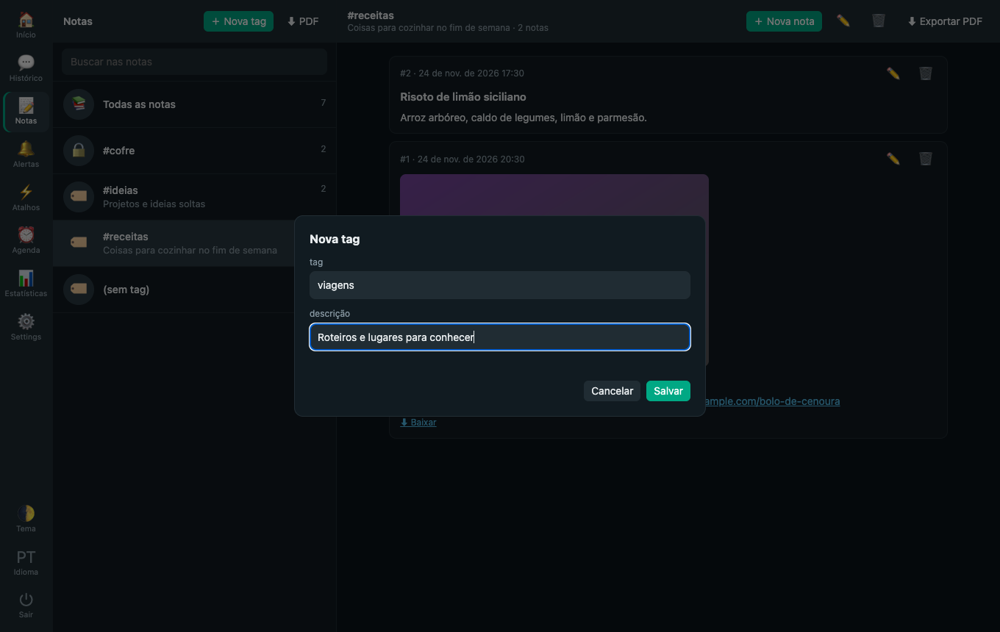


### Tags protegidas

Uma tag protegida pelo [`/notes -lock`](commands/notes.md#tags-protegidas--lock) vem **travada** 🔒: sem texto e sem
arquivo, só o cadeado. Digite a senha da tag para ler. A chave fica só na memória, ligada a **aquele login**, e trava de
novo depois de `notes.lockMinutes` sem uso (ou com *Travar agora*, ou ao sair). É um destravar só da página: ele não abre
a tag no chat, e vice-versa. O texto e as imagens são decifrados na memória (nada decifrado é escrito no cache), 5
senhas erradas bloqueiam a tag por 15 minutos e o PDF de uma tag travada fica de fora até você destravar. Uma tag
protegida não pode ser renomeada aqui (o `/notes -move` no WhatsApp faz isso).

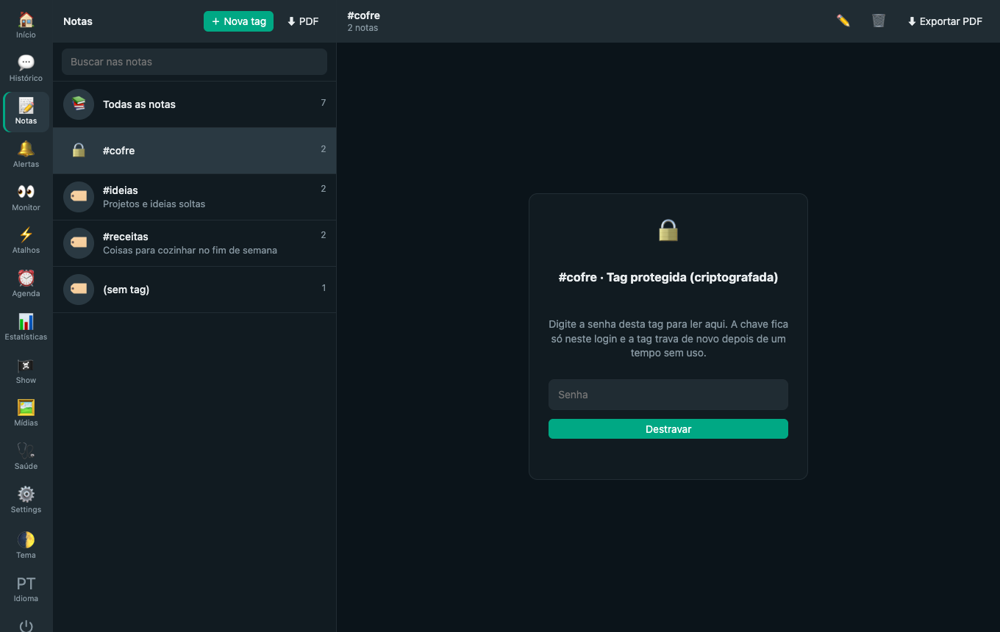

## Alertas

Três tabelas: os alertas de preço, as regras do `/watch` e os contatos monitorados. Cada uma tem **＋ Adicionar** e, em
cada linha, ✏️ editar e 🗑️ apagar.


### Alertas de preço

Os alertas do [`/stocks`](commands/stocks.md) e do [`/crypto`](commands/crypto.md): símbolo, regra (`BTC > 90000`), para
quem avisa e a mensagem. Um preço mantém os centavos (`6.20`). Adicionar ou editar passa pelo mesmo código do comando,
então as checagens são as mesmas: um símbolo que não existe, o preço que não dá para ler e a regra "já atendida" são
recusados com o mesmo texto. Uma edição mantém a data em que o alerta foi criado.


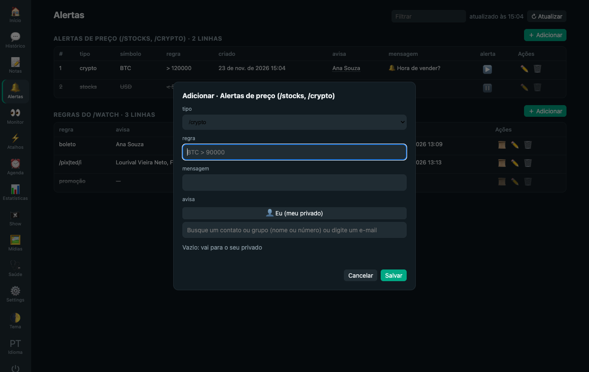

### Regras do /watch

As regras do [`/watch`](commands/watch.md) (um texto, ou `/regex/flags`; uma regex inválida ou arriscada é recusada), para
quem cada uma avisa, quantas ocorrências já teve e a data da última. O botão **📜** abre o **histórico da regra**: cada
mensagem que casou, com quando, a conversa, quem disse e o texto.

Um clique na conversa ou no texto de uma ocorrência **abre aquela conversa no Histórico, na mensagem**: ela ganha um
**contorno laranja**, a parte que casou fica **destacada**, e uma linha `🔎 /watch: <regra>` diz qual foi a regra (mais
de uma, se várias casaram). Essas marcas aparecem sempre que você lê aquela conversa, não só quando chega por aqui.


### Contatos monitorados

Os contatos do [`/monitor`](commands/monitor.md) com a situação, a última vez em que foram vistos, a última checagem e o
erro, se houver. **＋ Adicionar** escolhe um contato da sua agenda (o limite é o setting `monitor.max`) e ✏️ edita o nome
e o alerta. O botão **📜** abre o que o monitor leu do contato: cada "visto por último", com a hora em que foi lido, e um
🗑️ para remover uma leitura.

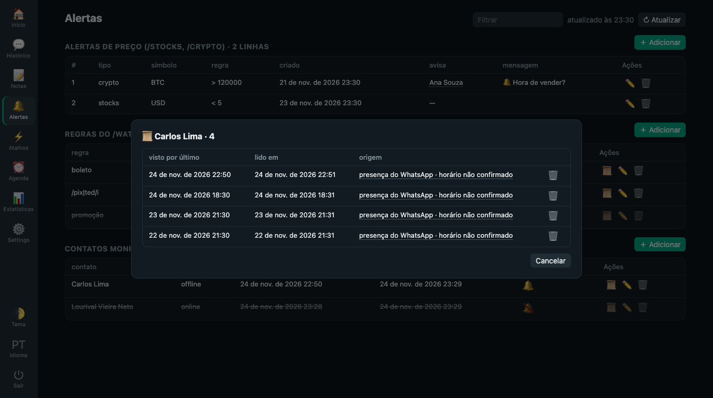

### A coluna alerta e quem é avisado

Tudo que pode ser ligado e desligado tem a **mesma célula, na coluna `alerta`**, e **um clique nela alterna**:

- na tabela do `/watch`, 🔔 é o **aviso da regra** ligado e 🔕 desligado. Desligado, as ocorrências continuam sendo
  guardadas (e o histórico da regra continua crescendo), mas ninguém é avisado;
- na tabela do `/monitor`, 🔔 é o alerta do contato (você é avisado quando ele ficar online) e 🔕 desligado;
- na agenda, ▶️ é uma mensagem ativa e ⏸️ uma pausada.

Desligado ou pausado, **a linha inteira fica mais opaca, com o texto riscado** (ela continua funcionando; nada fica
escondido, só mais apagado), então uma olhada na tabela já mostra quais regras, contatos e mensagens não estão fazendo
nada no momento. O próprio botão de sino/play, e os botões 🗑️/✏️/📜 da linha, ficam como são.

Os alertas de preço e as regras do `/watch` têm um **seletor de contatos** no campo *avisa*. Digite parte de um nome (ou
um número) e aparecem os contatos e grupos da sua agenda que combinam; clique para adicionar (pode ser mais de um), ou
digite um e-mail. **👤 Eu** adiciona a sua própria conta. Vazio quer dizer o seu privado. O mesmo seletor escolhe o
contato do `/monitor`.

## Atalhos

A lista do [`/alias`](commands/alias.md): o atalho, o comando, a descrição e as flags (🔇 silencioso e 🔒 só você).
Adicionar e editar usam as mesmas checagens do `/alias`: um nome que é comando é recusado e, se uma edição for
recusada, o atalho antigo fica.


## Agenda

O que o [`/cron`](commands/cron.md) tem agendado: o tipo (mensagem ou lembrete), quando, a repetição, a conversa, o texto
e o estado ▶️ / ⏸️. No formulário (novo ou existente) a **conversa** se escolhe com o seletor de contatos: uma conversa,
várias (a primeira é a conversa e todas recebem) ou nenhuma (o seu próprio chat). E-mails não são aceitos aqui: uma
mensagem agendada vai para o WhatsApp.

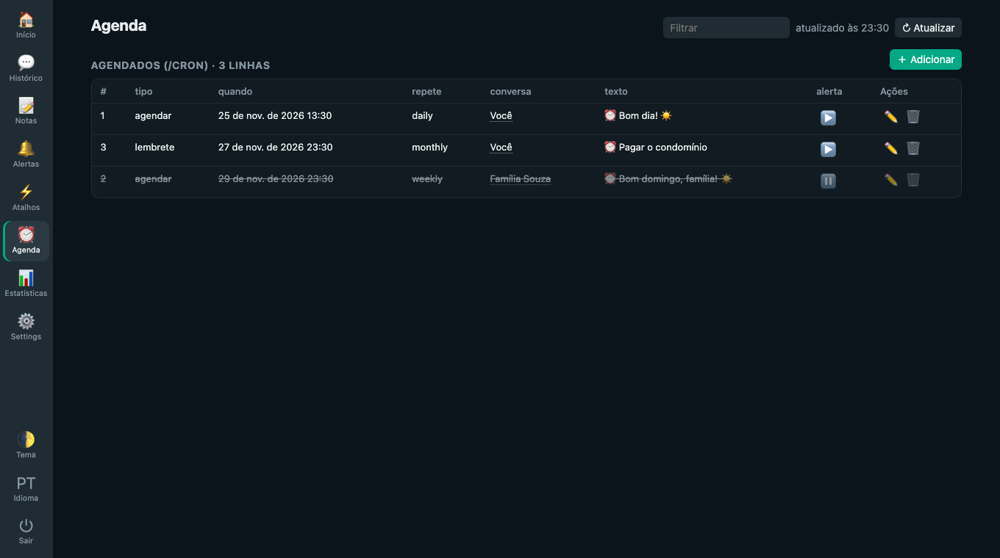


## Estatísticas

Gráficos dos contadores do [`/stats`](commands/stats.md) para 7, 30, 90 ou 365 dias. Cartões com mensagens, mídia,
apagadas, edições, dias com conversa, a média por dia, o dia mais movimentado e a hora de pico, cada um com a **variação
em relação ao período anterior** (▲ / ▼); mensagens por dia (texto e mídia empilhados); apagadas e editadas por dia
(linhas); a divisão entre texto e mídia (rosca); mensagens por hora; um **mapa de calor dia da semana x hora** de quando
as conversas esquentam; e o ranking das conversas (clique para abrir uma) e das pessoas. Passe o mouse numa barra ou
célula para ver o número.

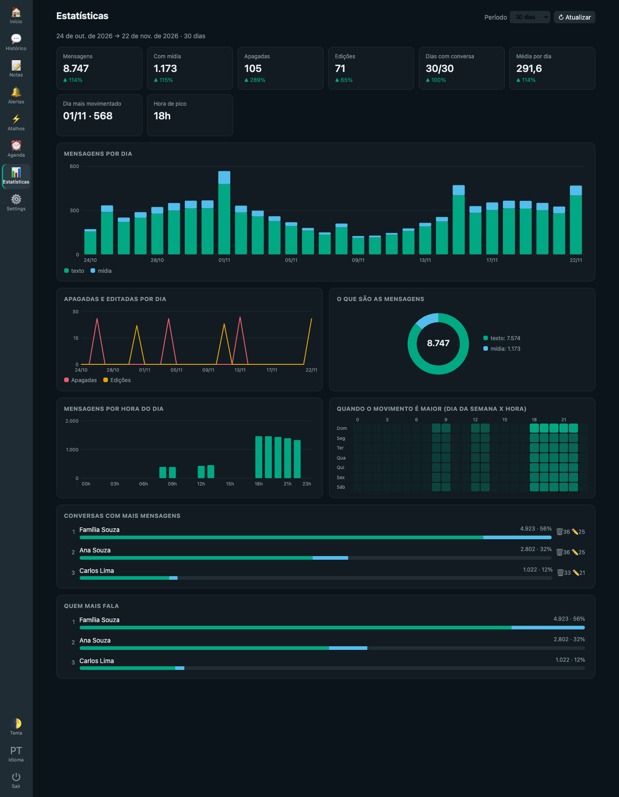

## Settings

No topo, um **painel só da interface web** (os settings `zapbot.web.*`), para você ajustá-la sem procurar numa lista
longa. Abaixo, a tabela com **todos os outros settings**.

### O painel da web

Quatro cartões: **Acesso** (`enabled`, `host`, `port`, `url`, `trustProxy`), **Login e sessão** (`login`, `password`,
`totp`, `sessionHours`, `sessionTimeout`), **Tela** (`pageSize`, `refreshSeconds`) e **Avisos** (`warnAccess`, `warnChangedPhone`). Ao lado
do título, o endereço para abrir a interface.

- um **interruptor** para os settings liga/desliga e uma caixa para números e texto: ela salva quando você sai da
  caixa, com um `✔ salvo` (ou o erro das mesmas checagens do `/set`);
- ↺ volta ao padrão de um setting que foi mudado;
- ⟳ marca o que só vale quando o bot reinicia (`enabled`, `host`, `port`);
- 🔒 marca o que só o `/set` no WhatsApp muda: o login, a senha (mostrada como `••••••••`) e o segredo do TOTP;
- 🔧 marca um setting que uma variável do `config/.env` decide (`ZAPBOT_WEB_ENABLED`, `ZAPBOT_WEB_HOST`,
  `ZAPBOT_WEB_PORT`): ele mostra a variável e o valor dela, só para leitura, porque a variável vence o setting.

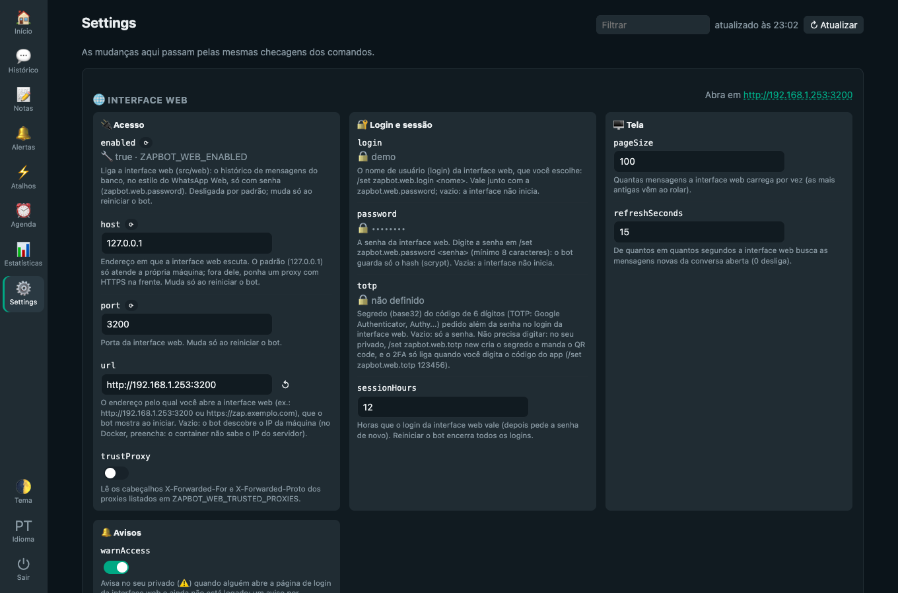

### Os outros settings

Todo outro setting com o valor, o padrão e o que faz. ✏️ edita (a mesma validação do `/set`: um valor errado é recusado
com o mesmo texto) e ↺ volta ao padrão. Os secretos (chaves, senhas, hashes) aparecem escondidos, e o `bot.login` não
muda aqui.

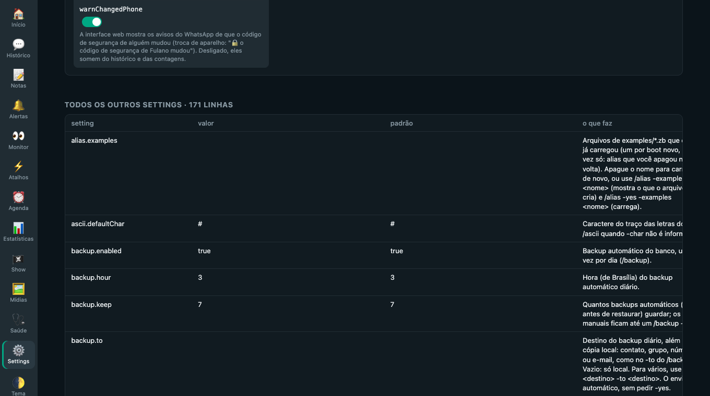

## Botões e ícones

| Ícone | Onde | O que faz |
|---|---|---|
| ＋ | o título de uma lista | Adiciona uma linha (abre um formulário) |
| ✏️ | cada linha | Edita, com as mesmas checagens do comando |
| 🗑️ | cada linha | Apaga (pergunta antes); nos Settings, ↺ volta ao padrão |
| 📜 | linhas do `/watch` e do `/monitor` | Abre o histórico da regra ou do contato |
| 🔔 / 🔕 | a coluna `alerta` | Ligado / desligado; um clique alterna |
| ▶️ / ⏸️ | a agenda | Ativo / pausado; um clique alterna |
| 🧹 | o cabeçalho de uma conversa | Limpa o histórico, mantendo as mensagens apagadas, editadas e com reação |
| 👤 | o seletor de contatos | Um contato ou um grupo; *Eu* é a sua própria conta |
| 🔒 | tags e settings | Tag protegida; setting que só o `/set` muda |
| 🔧 | o painel da web | Um setting que uma variável de ambiente decide |
| ⟳ | o painel da web | Só vale quando o bot reinicia |

## Segurança

- **Só com a senha**: toda requisição, menos a página e o login, precisa da sessão. A sessão é um token aleatório num
  cookie `HttpOnly` + `SameSite=Strict`, guardado na memória, e dura `zapbot.web.sessionHours`.
- **5 senhas erradas bloqueiam o endereço por 15 minutos**, e toda falha e todo login ficam no log com o nome de login
  que foi tentado (nunca a senha).
- **Você é avisado no WhatsApp**: uma senha errada (do login ou de uma tag protegida) manda `⚠️ ZapBot-Web: senha errada
  vinda de <endereço> (tentativa 2 de 5)` para o chat com você mesmo, e o bloqueio manda `🚫 ZapBot-Web: ... está
  bloqueado por 15 minutos`. Uma rajada do mesmo endereço em 15 segundos vira um aviso só. A senha digitada nunca vai
  no aviso.
- **Abrir a página também avisa**: quando alguém que não está logado abre o endereço da interface, você recebe
  `⚠️ ZapBot-Web: alguém abriu a página de login a partir de <endereço>` com os primeiros 100 caracteres do nome do
  navegador. Os limites contra enxurrada: **um aviso por endereço a cada 10 minutos** (as outras visitas são contadas e
  ditas no próximo) e **no máximo 5 avisos em 10 minutos** de qualquer endereço (o resto só é contado). Só a página
  conta, não os arquivos nem a API, e um navegador já logado não avisa. Desligue com `zapbot.web.warnAccess off`.
- **As mudanças são só as que você vê**: a página muda atalhos, alertas, regras do `/watch`, contatos monitorados, a
  agenda, notas e settings, sempre pelo mesmo código dos comandos, e **nunca** o login, a senha e o segredo do TOTP
  (só o `/set` no WhatsApp). Ela não manda mensagens para outras pessoas. Toda mudança fica no log, sem os valores. Os
  POSTs só aceitam JSON.
- **Página isolada**: sem script inline (CSP estrita), `nosniff`, sem enquadramento, e a mídia é servida com uma CSP
  `sandbox`: um HTML guardado nunca roda, ele baixa. A mídia só vem da pasta do cache (um caminho fora dela nunca é
  servido).
- **Segundo fator (opcional)**: com o `zapbot.web.totp` preenchido, o login pede também o código de 6 dígitos de um app
  autenticador. O `/set zapbot.web.totp new` cria o segredo e mostra o QR code no seu privado, e o 2FA só liga quando você digita o código do app (veja
  [Login em duas etapas (2FA)](#login-em-duas-etapas-2fa)). Um código errado conta como senha errada.
- **Atrás de um proxy**, ligue `zapbot.web.trustProxy` e configure `ZAPBOT_WEB_TRUSTED_PROXIES`
  com os IPs dos proxies que se conectam diretamente ao ZapBot, separados por vírgula. No Docker,
  use os endereços vistos de dentro do contêiner. Configure o proxy para substituir
  `X-Forwarded-For` ou acrescentar o IP do cliente ao final, e para sobrescrever
  `X-Forwarded-Proto`. O ZapBot usa o último endereço para contar as tentativas de login e
  adiciona `Secure` ao cookie quando o proxy informa `https`.
- **Notas protegidas** abrem na página só com a senha da tag, na memória, e o que é decifrado nunca é escrito no cache.
  **O que o bot envia nos chats com uma nota decifrada nunca é guardado** no banco (o `notes.lockPrivateOnly` diz onde
  as notas abrem no WhatsApp).

## Referência dos settings

| Setting | Padrão | O que faz |
|---|---|---|
| `zapbot.web.enabled` | `off` | Liga a interface (vale depois de reiniciar) |
| `zapbot.web.login` | *(vazio)* | O nome de login que você escolhe (3 a 40 caracteres). Vazio: ela não sobe |
| `zapbot.web.password` | *(vazio)* | A senha; o bot guarda o hash dela. Vazia: ela não sobe |
| `zapbot.web.host` | `127.0.0.1` | Endereço em que ela escuta |
| `zapbot.web.port` | `3200` | Porta |
| `zapbot.web.url` | *(vazio)* | O endereço pelo qual você a abre, mostrado na mensagem de inicialização |
| `zapbot.web.sessionHours` | `12` | Quanto tempo um login dura |
| `zapbot.web.pageSize` | `100` | Mensagens carregadas por vez |
| `zapbot.web.refreshSeconds` | `15` | De quanto em quanto tempo busca mensagens novas (`0`: nunca) |
| `zapbot.web.sessionTimeout` | `30` | Minutos de inatividade antes de sair (`0` desliga) |
| `zapbot.web.totp` | *(vazio)* | Segredo em base32 do código de 6 dígitos pedido além da senha |
| `zapbot.web.trustProxy` | `off` | Lê cabeçalhos dos proxies listados em `ZAPBOT_WEB_TRUSTED_PROXIES` |
| `zapbot.web.warnAccess` | `on` | Avisa (⚠️) quando alguém abre a página de login sem estar logado (limites acima) |
| `zapbot.web.warnChangedPhone` | `on` | Mostra, dentro das conversas, os avisos de que o código de segurança de alguém mudou |

## Docker e variáveis de ambiente

No Docker a imagem já expõe a porta `3200` e escuta em todas as interfaces dentro do container
(`ZAPBOT_WEB_HOST=0.0.0.0`); o `docker/docker-compose.yml` a publica só no `127.0.0.1` do **host**
(`127.0.0.1:3200:3200`). Para alcançá-la de outra máquina, use um túnel SSH (`ssh -L 3200:127.0.0.1:3200 host`), um
proxy reverso com HTTPS na frente ou, sabendo do risco, `ZAPBOT_WEB_BIND=0.0.0.0` no `docker/.env` (que não vai para o
git). Sem isso, `http://<ip-do-servidor>:3200` não responde: a porta está só no `127.0.0.1` do próprio servidor.

| Variável | Onde | O que faz |
|---|---|---|
| `ZAPBOT_WEB_ENABLED` | `config/.env` | `true` / `false`: liga ou desliga a interface, por cima do `zapbot.web.enabled` |
| `ZAPBOT_WEB_URL` | `config/.env` ou `docker/.env` | O endereço mostrado na mensagem de inicialização (o setting `zapbot.web.url` vence) |
| `ZAPBOT_WEB_HOST` | `config/.env` | O endereço em que escuta, por cima do `zapbot.web.host` (a imagem define `0.0.0.0`) |
| `ZAPBOT_WEB_PORT` | `docker/.env` | A porta, por cima do `zapbot.web.port`; no Compose a porta publicada acompanha |
| `ZAPBOT_WEB_BIND` | `docker/.env` | Só no Compose: onde o host publica a porta (`127.0.0.1` por padrão) |

Depois de mudar uma delas, rode o deploy de novo: as variáveis são lidas quando o bot inicia.

## Dúvidas e problemas

| O problema | O que conferir |
|---|---|
| A página não abre | O `zapbot.web.enabled`, o login e a senha precisam estar definidos (`/set`) e o bot reiniciado. O log diz o que falta |
| Abre no servidor, mas não de outra máquina | Por padrão ela só escuta em `127.0.0.1`; veja o Docker acima (`ZAPBOT_WEB_BIND`, um túnel ou um proxy) |
| `ZAPBOT_WEB_ENABLED=true` não fez nada | A variável precisa chegar ao container (o compose lê o `config/.env`) e o bot precisa ser reimplantado; a página de Settings mostra 🔧 quando ela está sendo usada |
| *Bloqueado por 15 minutos* | 5 senhas erradas daquele endereço. Espere, ou reinicie o bot (os bloqueios ficam na memória) |
| O histórico de uma conversa é curto | Só aparece o que está no banco; veja os settings de retenção no [`/cache`](commands/cache.md) |
| Um contato não aparece na lista de conversas | Conversas só com avisos do WhatsApp (um código de segurança que mudou) não são listadas |
| Os números do Início são menores que os avisos que eu vejo | Os contadores contam mensagens de verdade; os avisos do sistema não contam |
| O seletor não acha o contato | Ele busca na agenda e nos grupos do WhatsApp conectado; digite pelo menos 2 letras ou um número completo |
